# 00 - Início de toda aula (atualizando credenciais)

> **Toda aula, 19h. Diego Tavares, AI SRE sênior da Quantum Commerce, passa na sua mesa.**
> > *— "Semana passada alguém do time perdeu meia hora debugando um `terraform plan` da base do Assistente de Rastreio e Políticas que falhava com `ExpiredToken`. O código estava certo; a sessão do Learner Lab, que dura 4 horas, é que tinha vencido. E outra pessoa procurava a demo do dia num fork parado havia uma semana. Então, antes de encostar em qualquer coisa: sincroniza o repositório e recoloca as credenciais."*

**Helena Marques** transformou isso em regra do time: ninguém começa a sessão sem o ritual em dia.

Toda aula começa com o mesmo ritual: trazer o material mais recente da disciplina para o seu Codespaces e recolocar credenciais válidas da AWS. Pule a Parte 1 se já sincronizou hoje; pule a Parte 2 só se a sessão do Academy ainda está verde e você renovou as credenciais nas últimas 4 horas.

Os comandos abaixo são executados em dois lugares: o **navegador** (GitHub e AWS Academy) e o **terminal do GitHub Codespaces**.

> [!WARNING]
> **Pré-requisitos obrigatórios antes de começar:**
>
> - [ ] Você já concluiu o [setup inicial do ambiente](README.md) (fork ou clone, Codespaces, conta AWS Academy e bucket base criados)
> - [ ] Tem acesso à sua conta do AWS Academy Learner Lab
> - [ ] O Codespaces da disciplina existe na sua conta
>
> **O que você vai fazer:** sincronizar o repositório (fork ou clone direto), atualizar o Codespaces e recolocar credenciais válidas da AWS.
>
> **Tempo estimado:** **5–10 min**.

## Principais pontos de aprendizagem

- sincronizar o seu fork com o repositório oficial da disciplina (ou atualizar o clone direto)
- atualizar o repositório local dentro do Codespaces sem perder o seu trabalho
- reiniciar a sessão do AWS Academy e recopiar as credenciais temporárias
- validar que o ambiente está pronto para os comandos da AWS

## O que você terá ao final

Um Codespaces com o material mais recente e credenciais AWS válidas, pronto para a aula do dia. **É o "destravar antes de começar" que o Diego cobra.**

> [!TIP]
> Sempre que encontrar um bloco com o título **💡 Clique para entender**, abra esse trecho para o contexto do passo.

## Mapa do lab

| Parte | O que você faz | Passos | Tempo |
|-------|----------------|--------|-------|
| [Parte 1](#parte-1---sincronizar-o-fork-e-o-repositório-local) | Sincronizar o fork (ou o clone) e o repositório local | [1](#passo-1) · [2](#passo-2) · [3](#passo-3) · [4](#passo-4) · [5](#passo-5) | ~3 min |
| [Parte 2](#parte-2---atualizar-as-credenciais-da-aws) | Atualizar as credenciais da AWS | [6](#passo-6) · [7](#passo-7) · [8](#passo-8) · [9](#passo-9) · [10](#passo-10) · [11](#passo-11) · [12](#passo-12) · [13](#passo-13) · [14](#passo-14) | ~5 min |

> [!TIP]
> Se travou em algum passo, clique no número do passo na coluna **Passos** acima.

---

## Parte 1 - Sincronizar o fork e o repositório local

### Resultado esperado desta parte

Ao final desta etapa, o seu repositório no Codespaces estará atualizado com o material mais recente do repositório oficial, [`vamperst/FIAP-AI-Devops-CICD`](https://github.com/vamperst/FIAP-AI-Devops-CICD), sem descartar nada que você tenha feito.

> [!NOTE]
> Os prints desta página mostram nomes de repositório de outras turmas e disciplinas (`FIAP-Platform-Engineering`, `FIAP-Autoglass-Serverless`). No seu ambiente o nome é `FIAP-AI-Devops-CICD`; o resto da tela é igual.

Antes do primeiro passo, identifique o seu caso:

| Como você obteve o repositório | O que fazer |
|---|---|
| **Caminho A:** clonou direto de `vamperst/FIAP-AI-Devops-CICD` | Pule para o passo [4](#passo-4) e use o **5.1** (só `git pull`). |
| **Caminho B:** fez fork para a sua conta (padrão do setup) | Faça os passos [1](#passo-1) a [3](#passo-3) (Sync fork na interface do GitHub) e depois o **5.1**. Prefere a linha de comando? Pule para o passo [4](#passo-4) e use o **5.2**. |

Na dúvida, o passo [4](#passo-4) mostra como confirmar pelo terminal.

---

<a id="passo-1"></a>

**1. Abra o seu fork no GitHub (Caminho B)**

Acesse, na sua conta do GitHub, o repositório que você forkou da disciplina **FIAP-AI-Devops-CICD**.

---

<a id="passo-2"></a>

**2. Clique em `Sync fork` e depois em `Update branch`**

O botão `Sync fork` fica no meio da tela. Se houver algo para sincronizar, clique em `Update branch`.

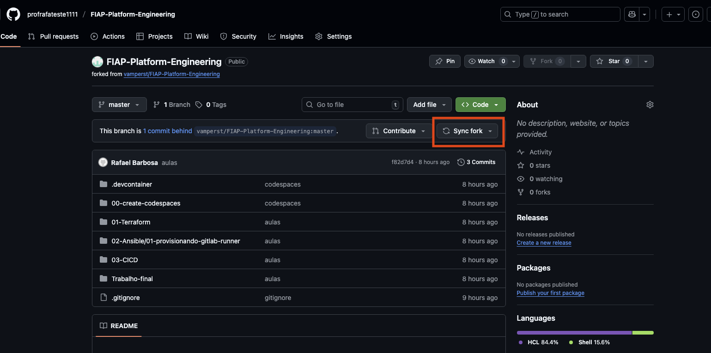

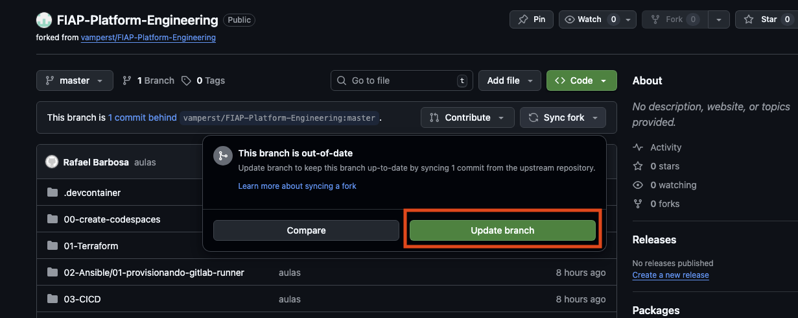

> [!CAUTION]
> Se o GitHub oferecer **`Discard N commits`** em vez de `Update branch`, **não clique**: esse botão apaga os commits que você fez no seu fork. Isso acontece quando o seu fork tem commits próprios que conflitam com o oficial. Nesse caso, siga direto para o passo [4](#passo-4) e use o **5.2**, que faz o merge no Codespaces preservando o seu trabalho.

<details>
<summary><b>💡 Clique para entender: o que é sincronizar o fork</b></summary>
<blockquote>

O seu fork é uma fotografia do repositório oficial no momento em que você o criou. Conforme o professor publica correções e novas demos, o oficial (chamado de `upstream`) avança e o seu fork fica para trás.

`Sync fork` puxa essas atualizações do `upstream` para o seu fork, sem você precisar refazer nada. É o equivalente, na interface do GitHub, a um `git fetch upstream` + `git merge`, que é exatamente o que o passo **5.2** faz pela linha de comando.

</blockquote>
</details>

---

<a id="passo-3"></a>

**3. Confirme que o fork está em dia**

Se não houver nada para sincronizar, a mensagem será `This branch is not behind the upstream`. Nesse caso, não é preciso fazer nada nesta tela.

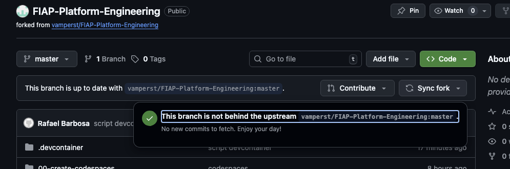

---

<a id="passo-4"></a>

**4. Abra o Codespaces da disciplina**

Acesse [github.com/codespaces](https://github.com/codespaces) e clique no nome do Codespace que você criou para as aulas (derivado do repositório **FIAP-AI-Devops-CICD**).

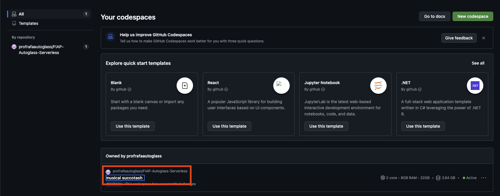

Para confirmar qual é o seu caminho, rode no terminal do Codespaces:

```bash
cd /workspaces/FIAP-AI-Devops-CICD && git remote -v
```

> Saída esperada (o `origin` diz o seu caminho; pode aparecer no formato `git@github.com:...` em vez de `https://`, o que não muda nada):
>
> ```text
> origin  https://github.com/vamperst/FIAP-AI-Devops-CICD (fetch)    <- Caminho A (clone direto)
> origin  https://github.com/<SEU-USUARIO>/FIAP-AI-Devops-CICD (fetch)  <- Caminho B (fork)
> ```

---

<a id="passo-5"></a>

**5. Atualize o repositório local no Codespaces**

**5.1. Caminho A, ou Caminho B depois do `Sync fork`: traga as alterações com `git pull`**

```bash
cd /workspaces/FIAP-AI-Devops-CICD && git pull --no-rebase --no-edit origin master
```

> Saída esperada: `Already up to date.` (nada novo) ou `Fast-forward`/`Merge made by` seguido da lista de arquivos; as duas estão certas.

O `--no-rebase` é necessário porque o Git recente exige escolher merge ou rebase quando os históricos divergem; escolhemos merge, que não reescreve os seus commits. O `--no-edit` evita que o editor abra pedindo mensagem de merge.

**5.2. Caminho B pela linha de comando (alternativa aos passos 1 a 3): sincronize com o `upstream` oficial**

```bash
cd /workspaces/FIAP-AI-Devops-CICD
git remote add upstream https://github.com/vamperst/FIAP-AI-Devops-CICD.git 2>/dev/null \
  || git remote set-url upstream https://github.com/vamperst/FIAP-AI-Devops-CICD.git
git fetch upstream
git merge --no-edit upstream/master
git push origin master
```

> Saída esperada: `Already up to date.` (nada novo) ou `Fast-forward`/`Merge made by` seguido da lista de arquivos; as duas estão certas.

O bloco pode ser repetido em toda aula: na primeira vez ele cria o remote `upstream`; nas seguintes, só garante que ele aponta para o repositório oficial. O `git push` final leva a atualização para o seu fork no GitHub.

<details>
<summary><b>⚠ Se der erro: <code>CONFLICT</code> ou <code>Your local changes would be overwritten by merge</code> no pull/merge</b></summary>
<blockquote>

Identifique a mensagem que apareceu e siga **só** o caso correspondente. Nos dois casos nada foi perdido: não descarte nada.

**Caso 1: apareceu `CONFLICT` ou `Automatic merge failed`**

O merge começou e parou no meio. Desfaça só o merge (os seus commits continuam intactos) e confira o estado:

```bash
cd /workspaces/FIAP-AI-Devops-CICD && git merge --abort
git status
```

**Nunca** rode `git add -A` nem `git commit` com arquivo em conflito: isso grava os marcadores `<<<<<<<` no projeto (e, no 5.2, o `push` os levaria para o seu fork).

Se o `git merge --abort` responder `There is no merge to abort` e o `git status` mostrar `both modified`, o conflito veio do `git stash pop` (Opção 2): não rode a Opção 1; siga o parágrafo do stash no Caso 2. Se o `git status` mostrar arquivos alterados (`modified`), siga o **Caso 2**. Se o `git status` estiver limpo e o pull continuar dando `CONFLICT`, o conflito é entre os seus commits e os do professor. Rode o pull de novo (no 5.2, o `git merge --no-edit upstream/master`), abra cada arquivo listado como `both modified`, escolha a versão certa, apague as linhas `<<<<<<<`, `=======` e `>>>>>>>`, depois `git add <arquivo>` e `git commit --no-edit` (no 5.2, termine com `git push origin master`). Na dúvida, rode `git merge --abort` e peça ajuda no canal da disciplina.

**Caso 2: apareceu `Your local changes ... would be overwritten`**

O Git parou **antes** de começar o merge para proteger arquivos que você alterou no Codespaces e que a atualização também altera. As Opções 1 e 2 abaixo valem **só para este caso**: guarde o seu trabalho primeiro e só então atualize.

**Veja o que está alterado:**

```bash
cd /workspaces/FIAP-AI-Devops-CICD && git status
```

**Opção 1: commitar o seu trabalho antes de atualizar** (recomendado se a alteração é sua e você quer mantê-la no histórico):

```bash
cd /workspaces/FIAP-AI-Devops-CICD && git add -A && git commit -m "meu trabalho antes de sincronizar" && git pull --no-rebase --no-edit origin master
```

**Opção 2: guardar temporariamente com `stash` e reaplicar depois** (use só se o `git status` mostrou arquivos alterados):

```bash
cd /workspaces/FIAP-AI-Devops-CICD && git stash push -m "trabalho local antes de sincronizar"
```

Confira a saída antes de seguir. Se apareceu `No local changes to save`, não havia nada para guardar: rode só o `git pull --no-rebase --no-edit origin master` e **não** rode o `git stash pop`, que aplicaria um stash antigo sem relação com hoje. Se apareceu `Saved working directory`, continue:

```bash
cd /workspaces/FIAP-AI-Devops-CICD && git pull --no-rebase --no-edit origin master && git stash pop
```

O `stash` tira as suas alterações do caminho, o `pull` atualiza e o `stash pop` devolve o seu trabalho por cima. Se o `stash pop` acusar conflito, o stash **não é apagado**. Abra cada arquivo listado como `both modified`, escolha a versão certa e apague as linhas `<<<<<<<`, `=======` e `>>>>>>>`. Depois rode `git add <arquivo>` e **não** commite. O stash continua guardado (`git stash list`) como backup até você conferir que está tudo certo.

Nos comandos acima, troque `git pull --no-rebase --no-edit origin master` por `git merge --no-edit upstream/master` se você está no **5.2**, e termine com `git push origin master` para o seu fork ficar atualizado.

</blockquote>
</details>

### Checkpoint

Se você chegou até aqui, então:

- o `Sync fork` foi feito, ou o merge do `upstream` pelo **5.2**, ou você está no clone direto (Caminho A)
- o `git pull` (ou o `git merge upstream/master`) trouxe o material mais recente para o Codespaces
- `git status` não mostra merge pendente

---

## Parte 2 - Atualizar as credenciais da AWS

### Resultado esperado desta parte

Ao final desta etapa, o Codespaces terá credenciais AWS válidas e o comando `aws s3 ls` funcionará.

---

<a id="passo-6"></a>

**6. Abra o arquivo de credenciais da AWS**

Ainda no terminal do Codespaces:

```bash
code ~/.aws/credentials
```

---

<a id="passo-7"></a>

**7. Entre no AWS Academy Learner Lab**

Acesse o [AWS Academy](https://www.awsacademy.com/vforcesite/LMS_Login) e clique em `AWS Academy Learner Lab` para entrar no laboratório que o professor informou.

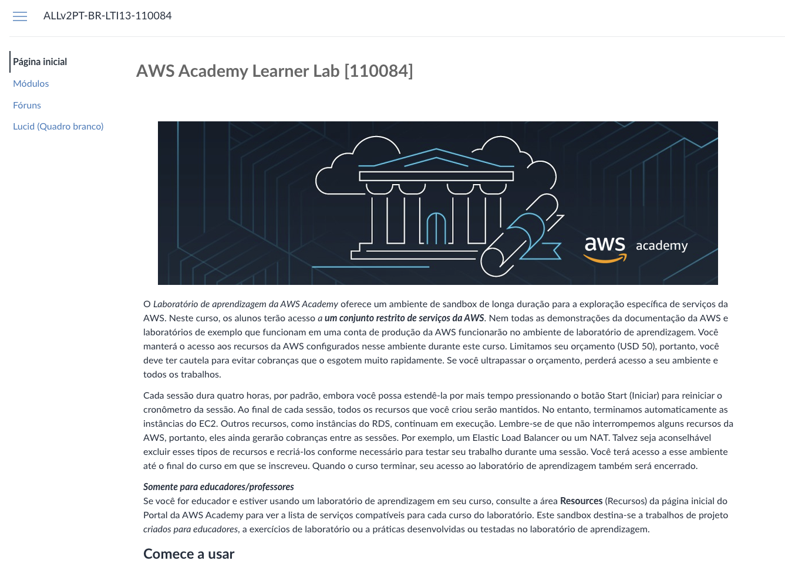

---

<a id="passo-8"></a>

**8. Abra `Módulos`**

Na lateral esquerda, clique em `AWS Academy Learner Lab` e depois em `Módulos`.

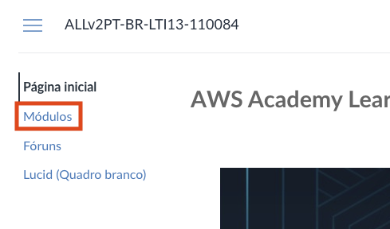

---

<a id="passo-9"></a>

**9. Abra o laboratório de aprendizagem**

Clique em `Iniciar os laboratórios de aprendizagem da AWS Academy`.

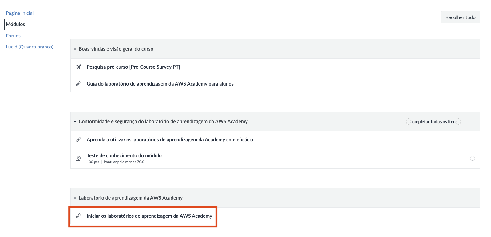

---

<a id="passo-10"></a>

**10. Inicie a sessão com `Start Lab`**

Clique em `Start Lab` e aguarde até a bolinha ao lado de `AWS` (canto superior esquerdo) ficar **verde**. Em seguida, clique em `AWS` para abrir o console em outra aba.

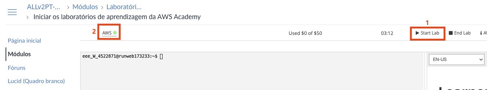

---

<a id="passo-11"></a>

**11. Abra `AWS Details`**

Ainda na aba do AWS Academy, clique em `AWS Details` no canto superior direito.

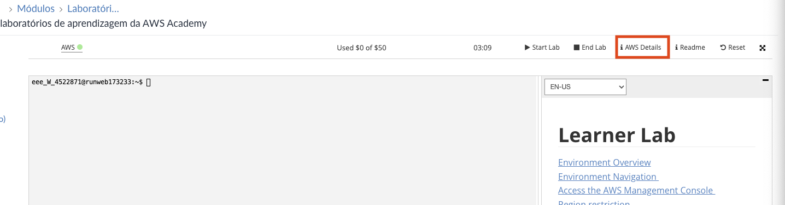

---

<a id="passo-12"></a>

**12. Mostre as credenciais da CLI**

Em `AWS CLI`, clique em `Show` para ver as credenciais de acesso.

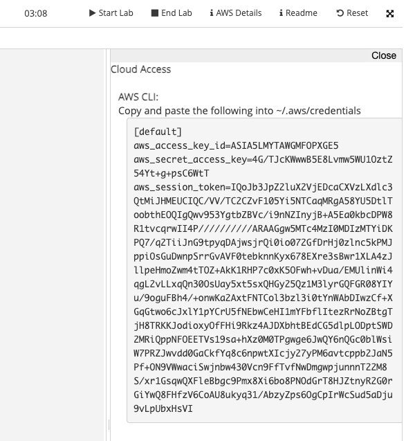

---

<a id="passo-13"></a>

**13. Substitua as credenciais antigas e salve**

No arquivo aberto no passo [6](#passo-6), selecione todo o conteúdo antigo (`Ctrl+A`) e apague. Só então cole as credenciais novas (`Ctrl+V`). O arquivo deve ter **um único** bloco `[default]`, com `aws_access_key_id`, `aws_secret_access_key` e `aws_session_token`. Salve com `Ctrl+S`.

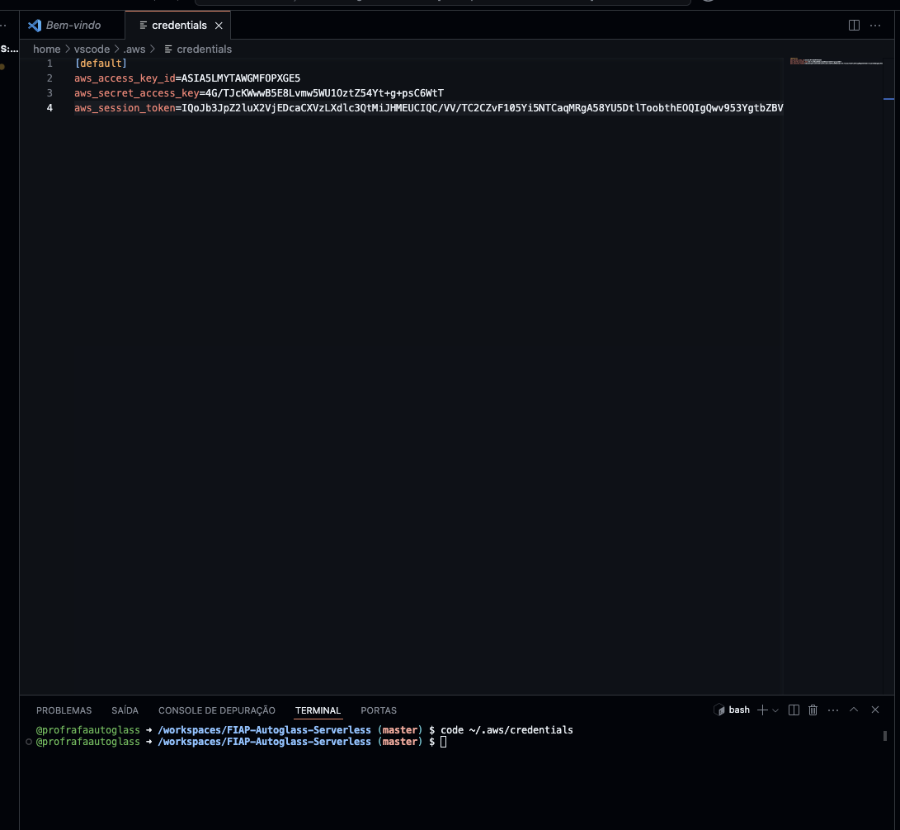

<details>
<summary><b>💡 Clique para entender: por que as credenciais mudam toda aula</b></summary>
<blockquote>

O AWS Academy Learner Lab usa credenciais **temporárias**: além do `aws_access_key_id` e do `aws_secret_access_key`, há um `aws_session_token` que expira em até 4 horas. Por isso não dá para "configurar uma vez e esquecer": a cada nova sessão (e a cada nova aula) o token muda e você precisa recopiá-lo.

Foi exatamente isso que travou o `terraform plan` do Assistente de Rastreio e Políticas que o Diego citou: código correto, sessão vencida. É o oposto de uma credencial fixa de IAM e é proposital, porque reduz o risco de uma chave vazada continuar válida por muito tempo.

</blockquote>
</details>

---

<a id="passo-14"></a>

**14. Valide o acesso à AWS**

No terminal do Codespaces:

```bash
aws s3 ls
```

Se tudo estiver correto, você verá a lista de buckets do S3 da sua conta, incluindo o `base-config-<SEU RM>` criado no setup.

<details>
<summary><b>⚠ Se der erro: <code>ExpiredToken</code>, <code>Unable to locate credentials</code> ou <code>Unable to parse config file</code></b></summary>
<blockquote>

- `ExpiredToken` / `The security token included in the request is invalid`: a sessão do AWS Academy expirou ou você copiou credenciais antigas. Refaça os passos [10](#passo-10) a [13](#passo-13) com a sessão ativa (bolinha verde).
- `Unable to locate credentials`: o arquivo `~/.aws/credentials` não foi salvo. Refaça os passos [6](#passo-6) e [13](#passo-13), confirmando o `Ctrl+S`.
- `Unable to parse config file`: o arquivo ficou com dois blocos `[default]` (credencial nova colada sem apagar a antiga). Rode `code ~/.aws/credentials`, apague tudo, cole só a credencial nova e salve.

Para confirmar quem você é na AWS, rode também `aws sts get-caller-identity`; ele deve retornar seu `Account` e `Arn`.

</blockquote>
</details>

### Checkpoint

Se você chegou até aqui, então:

- a sessão do AWS Academy está ativa (bolinha verde)
- `aws s3 ls` lista seus buckets (credenciais válidas no Codespaces)

---

## Conclusão

Ritual concluído: repositório sincronizado com o oficial, Codespaces atualizado sem perder trabalho local e credenciais AWS válidas. O ambiente está pronto para a aula de AI-Devops-CICD.

**Mensagem para o Diego:** repositório em dia, token novo, nenhum `ExpiredToken` à vista. Pode começar a aula.

---

## Próximo passo

Com o ambiente pronto, abra o laboratório da aula de hoje a partir do **[README raiz do repositório](../README.md)** e siga a ordem das pastas numeradas (`01-Terraform`, `02-Ansible`, `03-CICD`).

---

<details>
<summary><b>💡 Glossário rápido: termos que aparecem neste lab</b></summary>
<blockquote>

| Termo | O que é |
|-------|---------|
| **Fork** | Cópia do repositório na sua conta GitHub. |
| **Clone direto** | Cópia local feita direto do repositório oficial, sem fork na sua conta. |
| **`upstream`** | O repositório oficial da disciplina (`vamperst/FIAP-AI-Devops-CICD`), do qual o seu fork (Caminho B) foi criado. |
| **Sync fork** | Ação do GitHub que traz as atualizações do `upstream` para o seu fork. |
| **`git pull`** | Comando que traz as atualizações do repositório remoto para o seu Codespaces local. |
| **`git stash`** | Guarda temporariamente alterações locais para que você possa atualizar e depois reaplicá-las (`git stash pop`). |
| **`git merge --abort`** | Cancela um merge em andamento e volta ao estado anterior, sem perder commits. |
| **`aws_session_token`** | Token temporário das credenciais do AWS Academy; expira em até 4 horas. |
| **`aws sts get-caller-identity`** | Comando que confirma qual identidade AWS está autenticada no momento. |

</blockquote>
</details>

<details>
<summary><b>💡 Como pedir ajuda se travou</b></summary>
<blockquote>

Antes de pedir ajuda, colete:

1. **Em que passo você está** (ex.: "passo 14, rodando `aws s3 ls`")
2. **Mensagem de erro literal** (copia-cola do terminal, não screenshot)
3. **Saída de** `aws sts get-caller-identity` (erro de credencial) ou de `git status` (erro de sincronização)
4. **O que você já tentou**

Canais (em ordem de prioridade):

- **Issues do repositório:** [github.com/vamperst/FIAP-AI-Devops-CICD/issues](https://github.com/vamperst/FIAP-AI-Devops-CICD/issues)
- **E-mail do professor:** [Rafael@rfbarbosa.com](mailto:Rafael@rfbarbosa.com)
- **Antes de tudo:** confirme que a sessão do AWS Academy está ativa (bolinha verde); quase todo erro de credencial é sessão expirada.

</blockquote>
</details>
