# 00 - Setup e configuração do ambiente

> **Segunda-feira, 8h. Seu primeiro dia na Quantum Commerce.**
> Você acaba de ser contratado(a) como AI DevOps Engineer da **Quantum Commerce**, uma plataforma de e-commerce de moda e eletrônicos. O Comitê de Tecnologia aprovou três iniciativas de IA: o **Personal Stylist Virtual**, o **Assistente de Rastreio e Políticas** (pedidos, entregas, trocas e devoluções) e a **Categorização Automatizada do Catálogo**. Os protótipos existem; o que falta é uma forma confiável de levá-los para produção. **Helena Marques**, Head de Engenharia de IA e Entrega Contínua, te recebe com a missão do dia:
>
> > *— "Bem-vindo(a). Nos próximos meses você vai me ajudar a tirar essas iniciativas do protótipo. Hoje a infraestrutura é criada na mão, cada pessoa tem um ambiente diferente e o deploy só acontece quando uma pessoa específica está disponível. Antes de construir qualquer aplicação, quero o time inteiro no mesmo ambiente de desenvolvimento e com acesso controlado à AWS. Esse é o seu dia zero."*
>
> Logo depois, **Diego Tavares**, AI SRE sênior, puxa uma cadeira e conta por que isso não é burocracia:
>
> > *— "No mês passado, o protótipo do Assistente de Rastreio informava o prazo de troca certo no notebook de quem o escreveu e errado na máquina de outra pessoa do time. Era uma versão diferente de biblioteca, uma variável de ambiente que só existia num computador e uma chave de acesso pessoal, de longa duração, que alguém revogou no meio de um deploy feito à mão. Levamos dois dias para descobrir. Em IA isso é pior, porque a resposta errada não derruba nada: ela só sai errada. Por isso aqui todo mundo trabalha num ambiente que nasce de código, com credenciais próprias, temporárias e renovadas no começo de cada sessão."*
>
> Antes de escrever uma linha de Terraform, você precisa de um lugar para escrevê-la. Hoje montamos esse lugar.

> ***"Antes de colocar inteligência artificial em produção, precisamos garantir que todos conseguem construir e operar a mesma base de engenharia."***
> <br>Helena Marques, Head de Engenharia de IA e Entrega Contínua

Os comandos deste laboratório são executados em **dois lugares**: o **console da AWS** (no navegador, para criar a conta e o bucket) e o **terminal do GitHub Codespaces** (o ambiente cloud onde você vai rodar tudo no resto do curso).

> [!WARNING]
> **Pré-requisitos obrigatórios antes de começar:**
>
> - [ ] Uma conta no [GitHub](https://github.com) (gratuita)
> - [ ] Acesso ao email institucional da FIAP no formato `rm<SEU RM>@fiap.com.br`
> - [ ] Navegador atualizado (Chrome, Edge ou Firefox)
>
> **O que você vai fazer:** preparar todo o ambiente de trabalho do curso — fork do repositório, Codespaces, conta AWS Academy, bucket base no S3, credenciais e chave SSH.
>
> **Tempo estimado:** **40–60 min** (a criação do Codespaces pode levar até 15 min sozinha; o resto é leitura, cliques no console e cópia de credenciais).

Neste laboratório montamos a fundação que você vai reutilizar em **todas** as aulas. Ele é dividido em duas ferramentas que se complementam: a **conta AWS** (via AWS Academy, onde a infraestrutura da Quantum Commerce vai morar) e o **GitHub Codespaces** (a IDE cloud onde você escreve e executa os comandos). Ao final, seu ambiente estará pronto e idêntico ao de todos os colegas.

## Principais pontos de aprendizagem

- fazer o fork do repositório da disciplina e criar um Codespace a partir dele
- acessar a conta AWS provisionada pelo AWS Academy Learner Lab
- criar o bucket base no S3 que receberá os arquivos de configuração do curso
- copiar as credenciais do AWS Academy para o Codespaces e validá-las
- configurar a chave SSH usada para conectar nos servidores EC2

## O que você terá ao final

Um ambiente de trabalho cloud padronizado, com AWS CLI, Terraform e Ansible já instalados, credenciais válidas e chave SSH configurada. **É o "dia zero" que Helena pediu** — a partir daqui, todo o time da Quantum Commerce (você incluído) trabalha no mesmo ambiente.

> [!TIP]
> Sempre que encontrar um bloco com o título **💡 Clique para entender**, abra esse trecho. Ele traz explicação detalhada do passo, contexto prático da aula e links oficiais para aprofundamento.

## Mapa do lab

| Parte | O que você faz | Passos | Tempo |
|-------|----------------|--------|-------|
| [Parte 1](#parte-1---fork-e-criação-do-codespaces) | Fork do repositório e criação do Codespaces | [1](#passo-1) · [2](#passo-2) · [3](#passo-3) · [4](#passo-4) · [5](#passo-5) · [6](#passo-6) | ~20 min |
| [Parte 2](#parte-2---acesso-à-conta-aws-academy) | Acesso à conta AWS Academy | [7](#passo-7) · [8](#passo-8) · [9](#passo-9) · [10](#passo-10) · [11](#passo-11) · [12](#passo-12) · [13](#passo-13) | ~10 min |
| [Parte 3](#parte-3---criação-do-bucket-base-no-s3) | Criação do bucket base no S3 | [14](#passo-14) · [15](#passo-15) · [16](#passo-16) | ~5 min |
| [Parte 4](#parte-4---credenciais-e-chave-ssh-no-codespaces) | Credenciais e chave SSH no Codespaces | [17](#passo-17) · [18](#passo-18) · [19](#passo-19) · [20](#passo-20) · [21](#passo-21) · [22](#passo-22) · [23](#passo-23) · [24](#passo-24) | ~15 min |

> [!TIP]
> Se travou em algum passo, você pode pular direto: clique no número do passo na coluna **Passos** acima.

<details>
<summary><b>💡 O que é GitHub Codespaces e por que usamos no curso</b></summary>
<blockquote>

GitHub Codespaces é uma máquina de desenvolvimento que roda na nuvem e abre direto no navegador (ou no VS Code). Em vez de cada aluno instalar Terraform, Ansible, AWS CLI, Python e Node — cada um numa versão diferente, num sistema operacional diferente — todo mundo recebe **o mesmo container já configurado**.

Por que isso importa na disciplina AI-Devops-CICD:

- elimina o clássico "na minha máquina funciona" — o ambiente é idêntico para todos (o problema que Diego contou no primeiro dia)
- o `.devcontainer/` do repositório descreve o ambiente como código (mesma filosofia de IaC que vamos estudar com Terraform)
- você pode abrir o ambiente de qualquer computador, sem perder configuração

Na história do curso, o Codespaces é a "estação de trabalho padronizada" que Helena exige antes de deixar qualquer engenheiro tocar na infraestrutura da Quantum Commerce.

Documentação oficial:
- [GitHub Codespaces](https://docs.github.com/pt/codespaces/overview)
- [Dev Containers](https://containers.dev/)

</blockquote>
</details>

## Contexto

A Quantum Commerce já tem protótipos das três iniciativas de IA, mas a infraestrutura que os sustenta foi toda criada manualmente, no console da AWS, por pessoas diferentes em momentos diferentes. Ninguém consegue reproduzir um ambiente do zero com confiança, e cada deploy depende de alguém específico estar disponível. Antes de atacar esse problema (o que faremos a partir do Mês 1, com Terraform), precisamos de uma base comum: um ambiente de desenvolvimento idêntico para todo o time e acesso controlado à conta AWS. É exatamente isso que este lab entrega.

---

## Parte 1 - Fork e criação do Codespaces

### Resultado esperado desta parte

Ao final desta etapa, você terá um fork do repositório na sua conta GitHub e um Codespace em criação (ou já criado) a partir dele.

> [!NOTE]
> Os prints mostram IDs de turma ilustrativos e, em alguns casos, o nome antigo do repositório (`FIAP-Platform-Engineering`). No seu ambiente o nome é `FIAP-AI-Devops-CICD`; o resto da tela é igual. O **ID do laboratório (Learner Lab) correto será informado pelo professor**, específico para cada turma — use sempre o que o professor passar, não o que está nas imagens.

---

<a id="passo-1"></a>

**1.** Vamos usar sua conta do GitHub para acessar o Codespaces. Caso não tenha uma conta, crie uma em [github.com](https://github.com). Em seguida, acesse o repositório da disciplina: [FIAP-AI-Devops-CICD](https://github.com/vamperst/FIAP-AI-Devops-CICD).

---

<a id="passo-2"></a>

**2.** No canto superior da tela haverá o botão `Fork`, para copiar o repositório para a sua conta do GitHub. Clique nele.

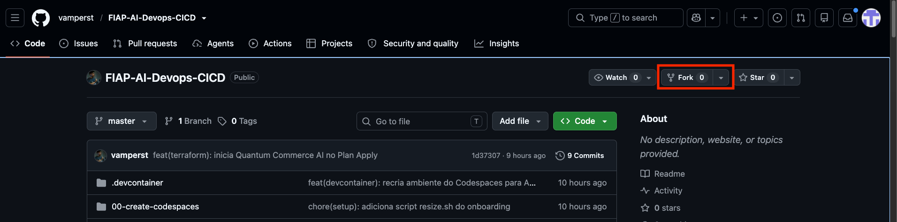

---

<a id="passo-3"></a>

**3.** Você será redirecionado para a tela de fork. Deixe a opção `Copy the master branch only` **desmarcada** para copiar todas as branches do repositório (no print ela aparece marcada; desmarque antes de seguir). Clique em `Create Fork`.

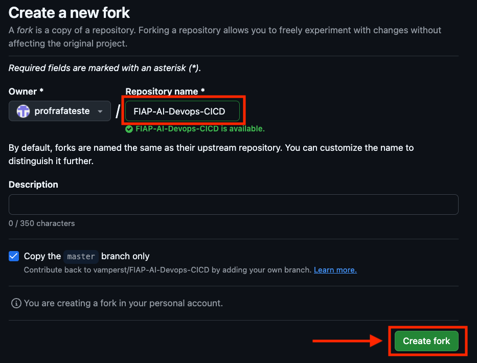

<details>
<summary><b>💡 Clique para entender: por que copiar todas as branches</b></summary>
<blockquote>

Hoje todo o material do curso está na branch `master`. Desmarcar `Copy the master branch only` faz o fork copiar todas as branches que existirem no repositório no momento do fork; se só existir a `master`, o resultado é o mesmo.

É apenas uma precaução, sem efeito colateral — se alguma branch extra existir quando você fizer o fork, ela já vem junto e você não precisa refazer o fork para acessá-la.

Documentação oficial:
- [Sobre forks no GitHub](https://docs.github.com/pt/pull-requests/collaborating-with-pull-requests/working-with-forks/about-forks)

</blockquote>
</details>

---

<a id="passo-4"></a>

**4.** Agora vamos criar o Codespaces. Acesse [github.com/codespaces](https://github.com/codespaces) e clique em `Get Started for free` (ou diretamente em `New codespace`, se já tiver usado o serviço antes).

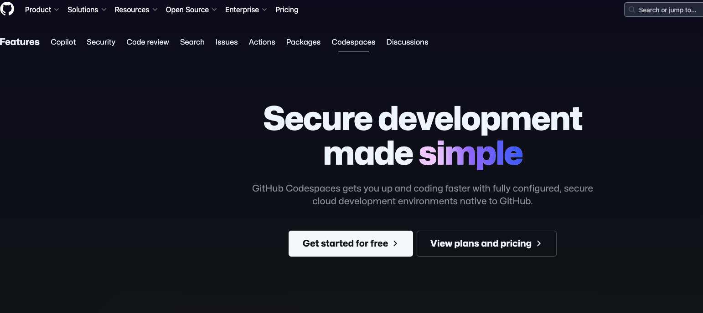

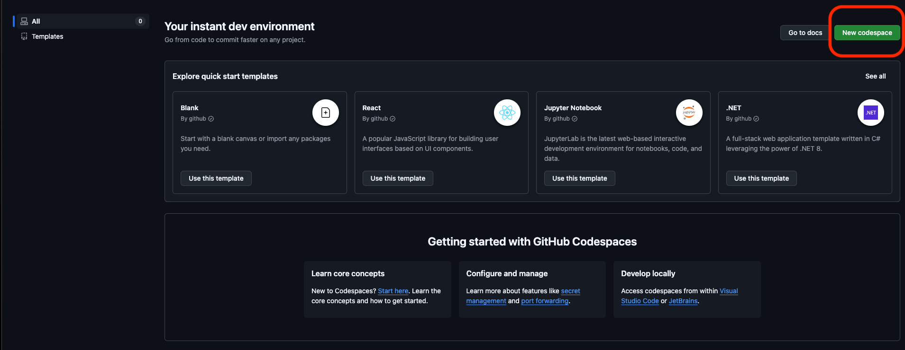

---

<a id="passo-5"></a>

**5.** Configure as opções da tela exatamente assim e clique em `Create Codespace`:

- **Repository:** `<SEU-USUARIO>/FIAP-AI-Devops-CICD` (o seu fork)
- **Branch:** `master`
- **Dev container configuration:** `FIAP Lab`
- **Region:** `US East`
- **Machine type:** `2-core`

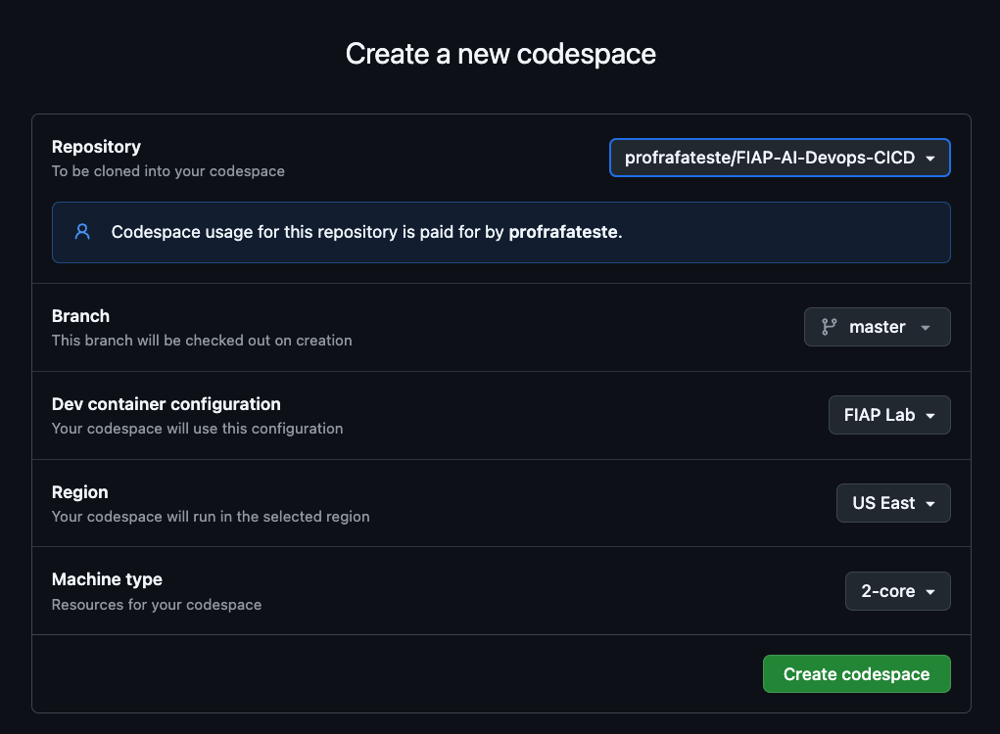

<details>
<summary><b>💡 Clique para entender: a configuração FIAP Lab</b></summary>
<blockquote>

A opção `FIAP Lab` aponta para o arquivo `.devcontainer/devcontainer.json` do repositório. Esse arquivo descreve, como código, tudo o que o seu ambiente precisa ter: AWS CLI, Terraform, Ansible (via Python), Node, Docker-in-Docker e as extensões do VS Code.

É a primeira vez no curso em que você vê o princípio de **infraestrutura como código** aplicado: em vez de instalar ferramentas na mão, declaramos o que o ambiente precisa e o GitHub constrói tudo igual para todos. Guarde essa ideia — é exatamente o que faremos com a infraestrutura da Quantum Commerce usando Terraform.

A região `US East` e a máquina `2-core` são escolhidas para alinhar com os recursos da AWS Academy (que ficam em `us-east-1`) e para não consumir créditos do Codespaces à toa.

Documentação oficial:
- [Configurando um dev container](https://docs.github.com/pt/codespaces/setting-up-your-project-for-codespaces/adding-a-dev-container-configuration)

</blockquote>
</details>

---

<a id="passo-6"></a>

**6.** Após iniciar a criação, você será redirecionado para o ambiente. No canto inferior esquerdo, clique em `Building codespace` para acompanhar os logs de criação. Essa criação pode levar **até 15 minutos**, pois o ambiente já vem com tudo instalado. Quando terminar, você verá o repositório clonado e pronto. **Deixe essa aba aberta** enquanto executa os próximos passos.

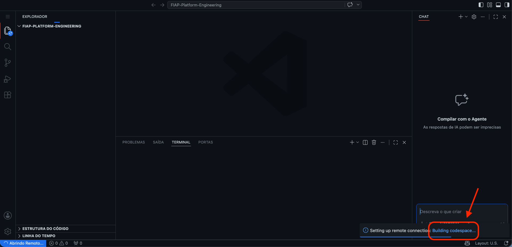

### Checkpoint

Se você chegou até aqui, então:

- o repositório está forkado na sua conta GitHub (com todas as branches)
- um Codespace está sendo criado (ou já foi criado) a partir do seu fork
- a aba do Codespaces está aberta

---

## Parte 2 - Acesso à conta AWS Academy

### Resultado esperado desta parte

Ao final desta etapa, você terá uma sessão ativa do AWS Academy Learner Lab e o console da AWS aberto em uma aba do navegador.

---

<a id="passo-7"></a>

**7.** Caso ainda **não** tenha conta no AWS Academy:

- **7.1.** Entre no seu email da FIAP pelo endereço [webmail.fiap.com.br](http://webmail.fiap.com.br/). Seu email tem o formato `rm` + número do seu RM + `@fiap.com.br` (ex.: RM `12345` → `rm12345@fiap.com.br`). A senha é a mesma dos portais.
- **7.2.** Procure na caixa de entrada o email de convite do Academy e siga as instruções.
- **7.3.** Ao entrar na plataforma, aparecerá uma turma que começa com `AWS Academy Learner Lab`. Clique em `Enroll` para aceitar e acessar.

---

<a id="passo-8"></a>

> Use o ID de Learner Lab que o professor passar, não o que aparece nos prints.

**8.** Para entrar em uma conta do Academy que já existe, acesse [awsacademy.com/vforcesite/LMS_Login](https://www.awsacademy.com/vforcesite/LMS_Login). Depois, no menu lateral esquerdo, clique em `Cursos` e selecione o curso da disciplina atual.

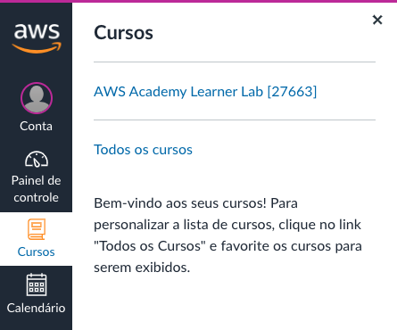

---

<a id="passo-9"></a>

**9.** Dentro do curso, clique em `Módulos` na lateral esquerda.

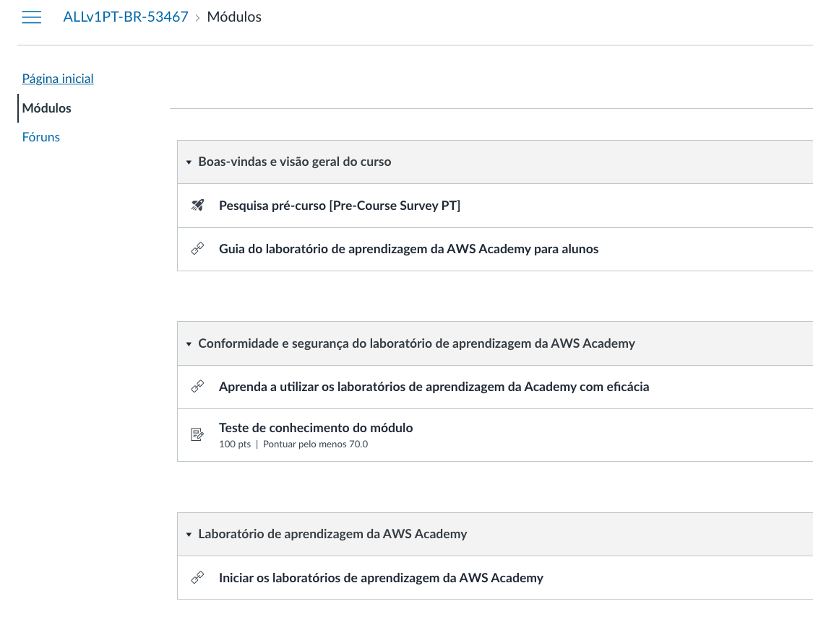

---

<a id="passo-10"></a>

**10.** Clique em `Iniciar os laboratórios de aprendizagem da AWS Academy`.

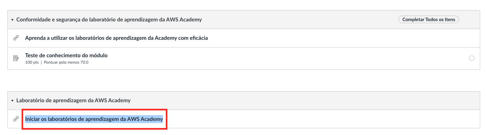

---

<a id="passo-11"></a>

**11.** Se for seu primeiro acesso, aparecerão dois contratos de termos e condições para aceitar. Role até o final de cada um para conseguir aceitar. Se você já fez isso antes, pule para o passo [12](#passo-12).

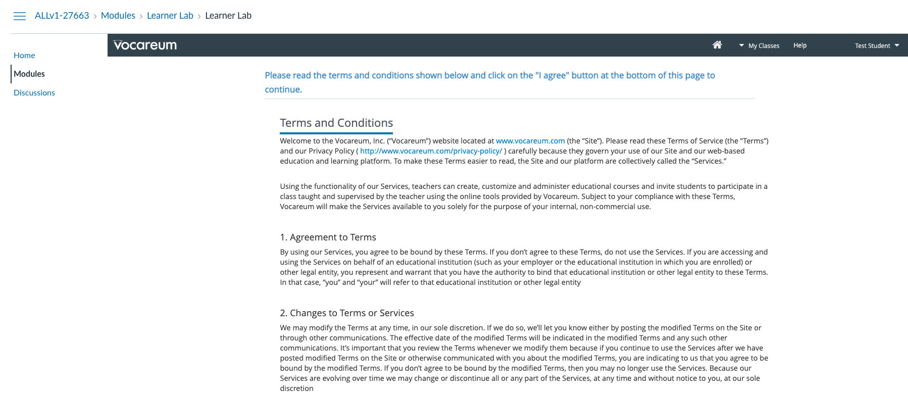

---

<a id="passo-12"></a>

**12.** Clique em `Start Lab` para iniciar uma sessão. Cada sessão dura **4 horas**; depois disso você precisa iniciar uma nova, mas os dados gravados na conta AWS ficam salvos até o final do curso. O processo de iniciar pode levar alguns minutos.

O topo do painel mostra quanto do crédito do Learner Lab você já usou (no print, `Used $0 of $100`; o limite varia por turma). Se o crédito acabar, você perde o acesso ao laboratório e aos recursos criados, por isso, ao fim de cada lab, destrua os recursos criados seguindo o passo de limpeza indicado nele.

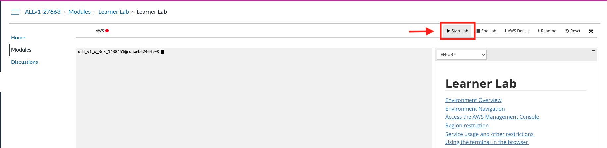

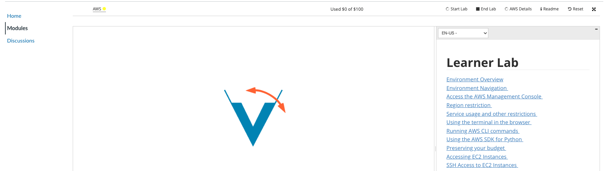

---

<a id="passo-13"></a>

**13.** Quando tudo estiver pronto, a bolinha ao lado da palavra `AWS` (canto superior esquerdo) ficará **verde**. Clique em `AWS` para abrir o console da conta em outra aba do navegador.

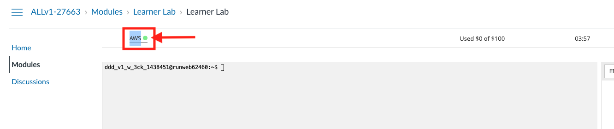

### Checkpoint

Se você chegou até aqui, então:

- você tem uma sessão ativa do AWS Academy Learner Lab (bolinha verde)
- o console da AWS está aberto em uma aba do navegador

---

## Parte 3 - Criação do bucket base no S3

### Resultado esperado desta parte

Ao final desta etapa, existirá um bucket S3 chamado `base-config-<SEU RM>` que receberá os arquivos de configuração ao longo do curso.

---

<a id="passo-14"></a>

**14.** Vamos criar o bucket S3 que recebe os arquivos de configuração do curso. Na aba do console AWS, abra o [serviço S3](https://us-east-1.console.aws.amazon.com/s3/home?region=us-east-1#).

---

<a id="passo-15"></a>

**15.** Clique em `Criar bucket`.

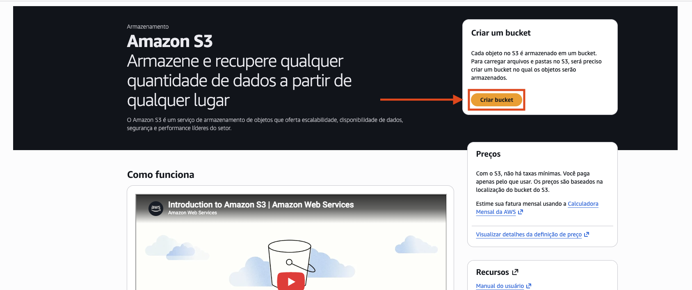

---

<a id="passo-16"></a>

**16.** Dê ao bucket o nome `base-config-<SEU RM>` (substitua `<SEU RM>` pelo seu RM, sem espaços — ex.: `base-config-12345`) e clique em `Criar`.

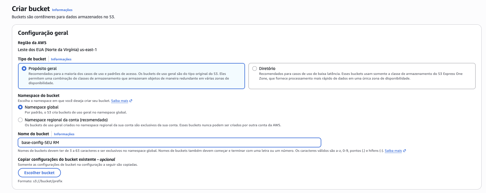

<details>
<summary><b>💡 Clique para entender: por que um bucket "base de configuração"</b></summary>
<blockquote>

Nomes de bucket no S3 são **globais e únicos** em toda a AWS, por isso usamos o seu RM como sufixo — assim o nome não colide com o de outro aluno. O bucket não pode conter espaços nem letras maiúsculas no nome.

Esse bucket vai guardar artefatos de configuração que reaparecem ao longo do curso. Mais adiante, no módulo de Terraform, ele também servirá como **backend remoto do state** — o lugar onde o Terraform guarda o "mapa" da infraestrutura que ele gerencia, permitindo que um time inteiro colabore sem corromper esse mapa.

Documentação oficial:
- [Regras de nomenclatura de buckets S3](https://docs.aws.amazon.com/AmazonS3/latest/userguide/bucketnamingrules.html)

</blockquote>
</details>

<details>
<summary><b>⚠ Se der erro: <code>Bucket name already exists</code></b></summary>
<blockquote>

O nome do bucket precisa ser único globalmente. Se você já tinha um bucket com esse nome de uma sessão anterior, ele continua existindo (os dados na conta persistem). Nesse caso, não precisa recriar — apenas confirme que ele aparece na lista.

Se o erro persistir com um RM que não é o seu, escolha um sufixo mais específico, como `base-config-<SEU RM>-quantum`. Anote o nome escolhido e use-o sempre que os próximos labs pedirem `base-config-<SEU RM>`.

</blockquote>
</details>

### Checkpoint

Se você chegou até aqui, então:

- o bucket `base-config-<SEU RM>` aparece na lista de buckets do S3

---

## Parte 4 - Credenciais e chave SSH no Codespaces

### Resultado esperado desta parte

Ao final desta etapa, o Codespaces conseguirá se autenticar na sua conta AWS (`aws s3 ls` funciona) e a chave SSH estará pronta para conectar nas instâncias EC2.

---

<a id="passo-17"></a>

**17.** Volte para a aba do Codespaces criado na Parte 1. Verifique se o terminal está aberto — se não estiver, abra pelo menu `Terminal` → `New Terminal`.

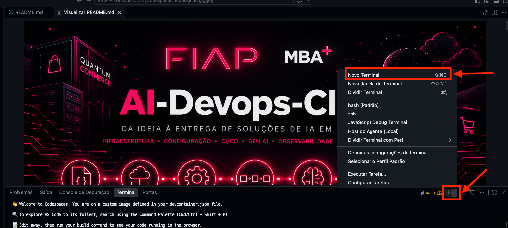

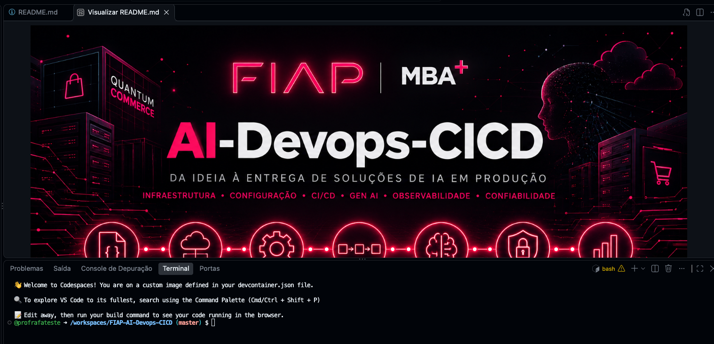

---

<a id="passo-18"></a>

**18.** Abra o arquivo de credenciais da AWS para edição. No terminal do Codespaces, execute:

```bash
code ~/.aws/credentials
```

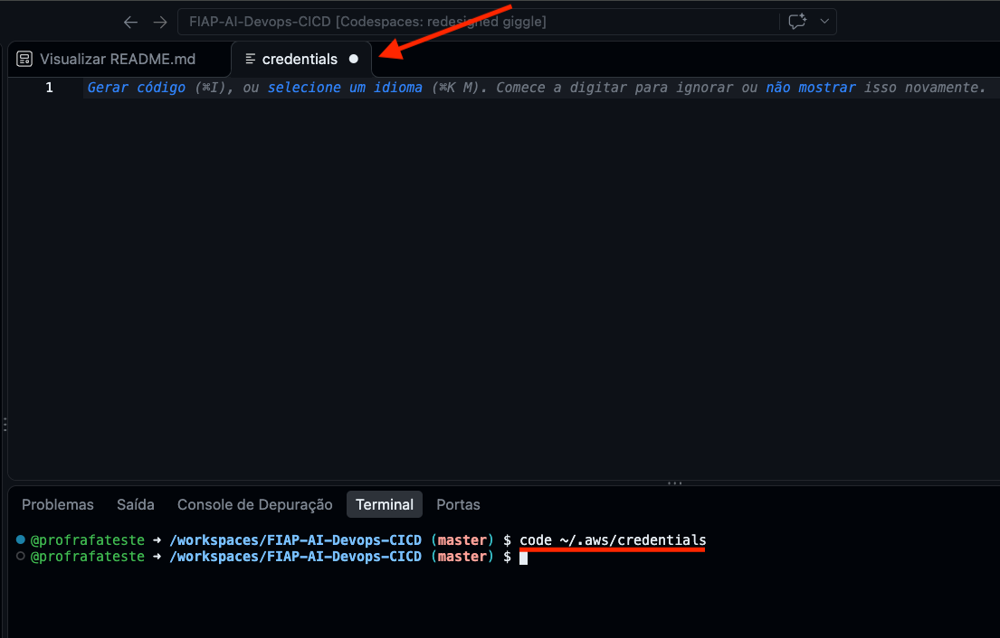

Por enquanto o arquivo estará vazio — é o que vamos preencher.

---

<a id="passo-19"></a>

**19.** Na aba do AWS Academy (onde você acessou a conta AWS), clique em `AWS Details` no canto superior direito e depois em `Show` no campo de **AWS CLI**.

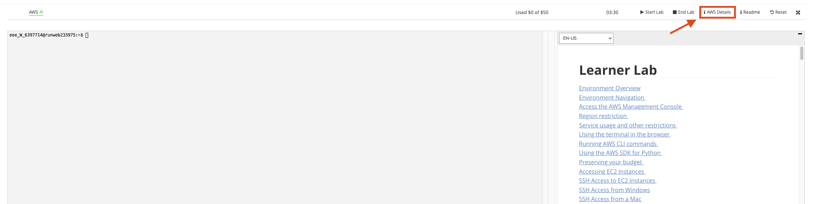

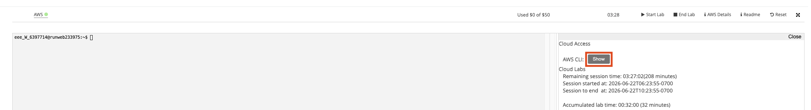

---

<a id="passo-20"></a>

**20.** Copie todo o conteúdo das credenciais exibidas (`Ctrl+C`).

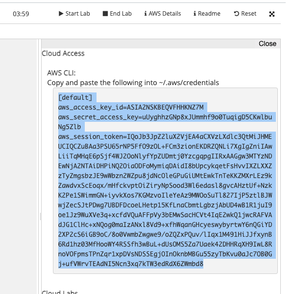

---

<a id="passo-21"></a>

**21.** Volte ao Codespaces, no arquivo `~/.aws/credentials` aberto no passo [18](#passo-18). Se ele não estiver vazio, apague todo o conteúdo (`Ctrl+A` e Delete). Cole as credenciais e salve com `Ctrl+S`. O arquivo deve ter um único bloco `[default]`.

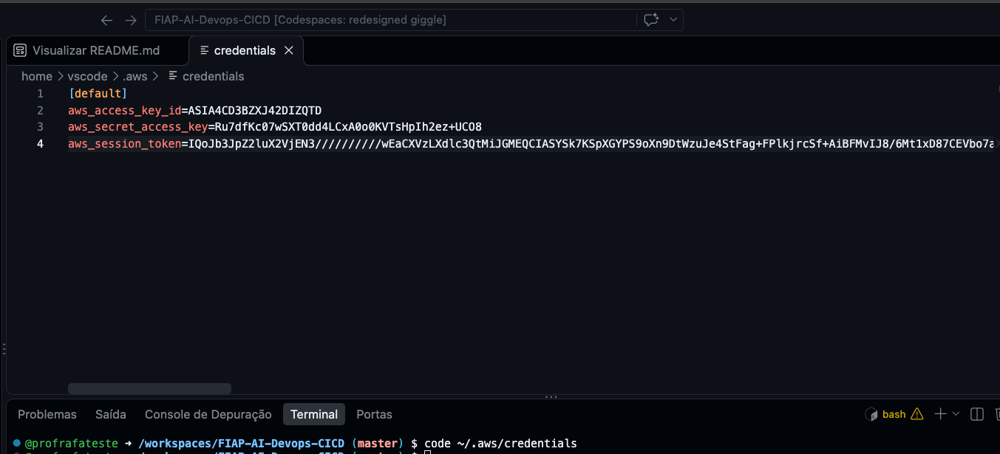

---

<a id="passo-22"></a>

**22.** Teste as credenciais. No terminal do Codespaces, execute:

```bash
aws s3 ls
```

Se tudo estiver correto, você verá na lista o bucket `base-config-<SEU RM>` que criou no passo [16](#passo-16).

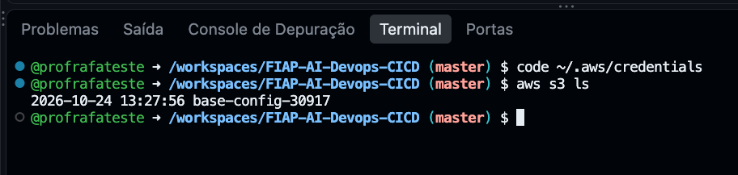

<details>
<summary><b>⚠ Se der erro: <code>Unable to locate credentials</code> ou <code>ExpiredToken</code></b></summary>
<blockquote>

- `Unable to locate credentials`: o arquivo `~/.aws/credentials` está vazio ou foi salvo em outro lugar. Refaça os passos [18](#passo-18) a [21](#passo-21), confirmando que salvou com `Ctrl+S`.
- `ExpiredToken` / `The security token included in the request is invalid`: as credenciais do AWS Academy expiram a cada 4 horas. Volte ao AWS Academy, garanta que a sessão está ativa (bolinha verde) e recopie as credenciais.

Esse é o passo que você vai repetir no **início de toda aula** — está descrito em detalhe em [Inicio-de-aula.md](Inicio-de-aula.md).

</blockquote>
</details>

---

<a id="passo-23"></a>

**23.** Agora vamos configurar a chave SSH usada para conectar nas instâncias EC2 ao longo do curso. No terminal do Codespaces, execute:

```bash
mkdir -p /home/vscode/.ssh/
code ~/.ssh/vockey.pem
```

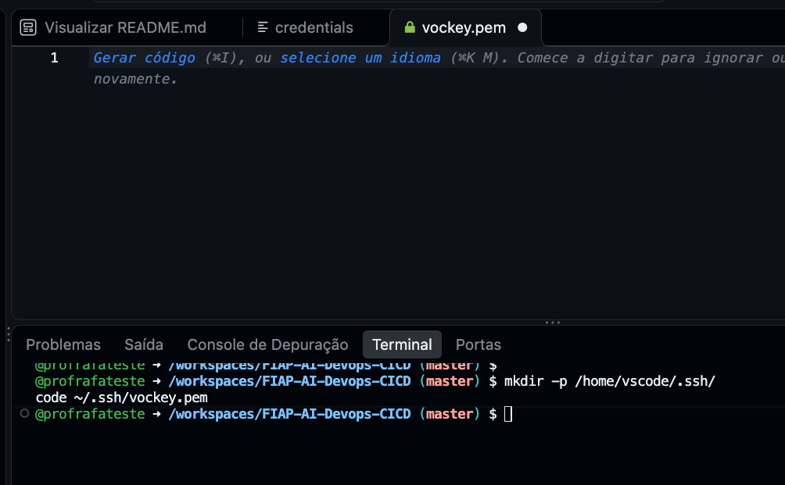

De volta à aba do AWS Academy, clique em `AWS Details`, expanda `SSH Key` clicando em `Show` e copie o conteúdo da chave privada. Cole no arquivo `~/.ssh/vockey.pem` aberto e salve com `Ctrl+S`.

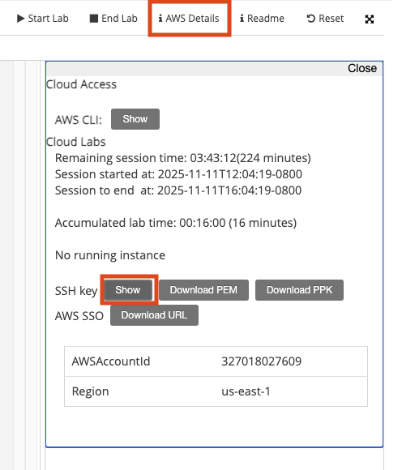

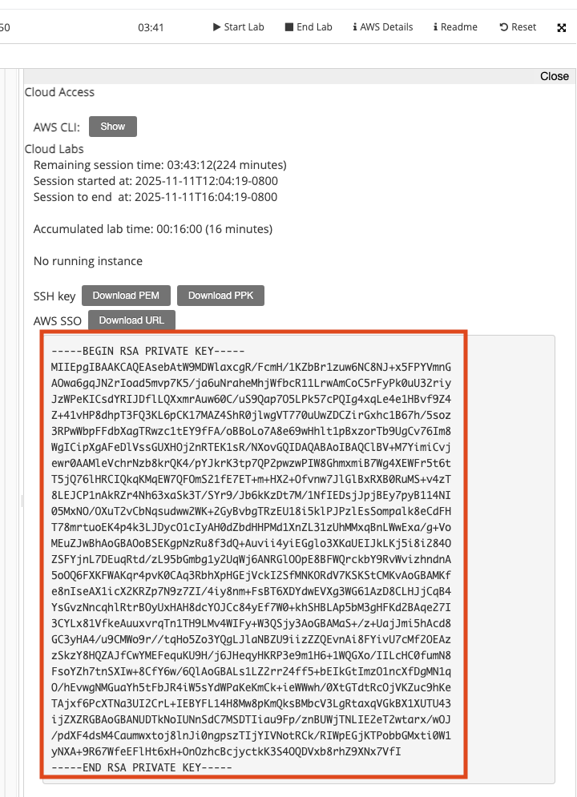

---

<a id="passo-24"></a>

**24.** Ajuste as permissões da chave SSH para que o SSH aceite usá-la:

```bash
chmod 400 ~/.ssh/vockey.pem
```
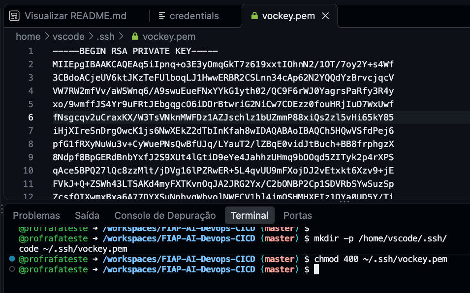
<details>
<summary><b>💡 Clique para entender: por que <code>chmod 400</code> na chave</b></summary>
<blockquote>

O cliente SSH se recusa a usar uma chave privada se ela estiver acessível por outros usuários do sistema — é uma proteção contra vazamento de credenciais. `chmod 400` define a permissão como "somente leitura, somente para o dono", que é o que o SSH exige.

Se você pular este passo, ao tentar conectar em uma EC2 mais adiante verá o erro `Permissions 0644 for 'vockey.pem' are too open`.

</blockquote>
</details>

### Checkpoint

Se você chegou até aqui, então:

- `aws s3 ls` lista o bucket `base-config-<SEU RM>` (credenciais válidas)
- o arquivo `~/.ssh/vockey.pem` existe e tem permissão `400`. Confira no terminal do Codespaces:

```bash
ls -l ~/.ssh/vockey.pem
```

> Saída esperada (tamanho e data variam; o que importa é a linha começar por `-r--------`):
>
> ```text
> -r-------- 1 vscode vscode 1675 Oct 23 10:00 /home/vscode/.ssh/vockey.pem
> ```

---

## Conclusão

Se você chegou até aqui, então já:

- fez o fork do repositório e criou o Codespaces a partir dele
- acessou a conta AWS via AWS Academy Learner Lab
- criou o bucket base `base-config-<SEU RM>` no S3
- configurou e validou as credenciais AWS no Codespaces
- configurou a chave SSH com as permissões corretas

**Mensagem para Helena:** o "dia zero" está fechado. Todo o time da Quantum Commerce agora trabalha no mesmo ambiente cloud, com acesso controlado à conta AWS. A partir daqui, podemos começar a transformar a infraestrutura "criada na mão" em infraestrutura como código, o primeiro passo para levar o Assistente de Rastreio e Políticas do protótipo para produção.

> [!WARNING]
> Copiar as credenciais para o Codespaces é necessário sempre que você abrir o ambiente. Como a sessão do AWS Academy dura 4 horas, **no início de cada aula** você vai repetir esse ritual — ele está descrito passo a passo em [Inicio-de-aula.md](Inicio-de-aula.md).

> [!CAUTION]
> **SEMPRE DESLIGUE** o ambiente ao final de cada aula para não gerar custos extras nem esgotar suas horas gratuitas no Codespaces. Acesse [github.com/codespaces](https://github.com/codespaces), clique nos três pontinhos ao lado do ambiente e selecione `Stop Codespace`.

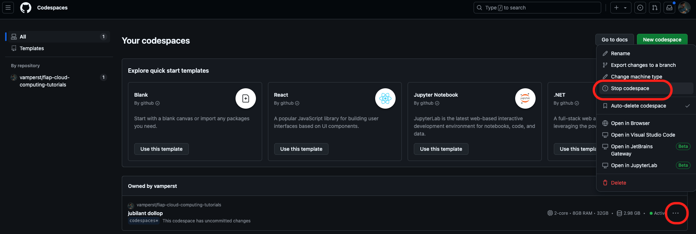

---

## Próximo passo

No início de toda aula, abra: **[Início de aula — atualizando credenciais](Inicio-de-aula.md)**.

Lá você revê, em poucos minutos, o ritual de sincronizar o fork e recolocar as credenciais válidas no Codespaces — o que destrava qualquer comando da AWS no resto do curso. Em seguida, partimos para o **Mês 1**, onde Helena pede que a infraestrutura da Quantum Commerce vire código versionado com Terraform, começando pela base que vai sustentar o Assistente de Rastreio e Políticas.

---

<details>
<summary><b>💡 Glossário rápido — termos que aparecem neste lab</b></summary>
<blockquote>

| Termo | O que é |
|-------|---------|
| **Fork** | Cópia de um repositório para a sua própria conta GitHub, onde você pode trabalhar sem afetar o original. |
| **GitHub Codespaces** | Ambiente de desenvolvimento que roda na nuvem e abre no navegador/VS Code, já com as ferramentas instaladas. |
| **Dev container** | Definição do ambiente como código (`.devcontainer/devcontainer.json`); garante que todos tenham o mesmo setup. |
| **AWS Academy Learner Lab** | Conta AWS temporária e com crédito limitado fornecida pela AWS Academy para uso educacional. As sessões duram 4 horas. |
| **Bucket S3** | "Pasta" de armazenamento de objetos na AWS. Nomes são globais e únicos em toda a AWS. |
| **Credenciais AWS CLI** | Chaves (`aws_access_key_id`, `aws_secret_access_key`, `aws_session_token`) que autenticam seus comandos na conta AWS. |
| **Chave SSH (`vockey.pem`)** | Chave privada usada para conectar com segurança em instâncias EC2 da sua conta. |
| **`chmod 400`** | Permissão de arquivo "somente leitura para o dono"; exigida pelo SSH para usar uma chave privada. |

</blockquote>
</details>

<details>
<summary><b>💡 Como pedir ajuda se travou</b></summary>
<blockquote>

Antes de abrir issue ou perguntar, colete estas 4 informações — elas reduzem o tempo de resposta em 10×:

1. **Em que passo você está** (ex.: "passo 22, rodando `aws s3 ls`")
2. **Mensagem de erro literal** (copia-cola completo do terminal, não screenshot — texto é pesquisável)
3. **Saída de** `aws sts get-caller-identity` no terminal do Codespaces (mostra se as credenciais estão válidas)
4. **O que você já tentou**

Canais (em ordem de prioridade):

- **Issues do repositório:** [github.com/vamperst/FIAP-AI-Devops-CICD/issues](https://github.com/vamperst/FIAP-AI-Devops-CICD/issues)
- **E-mail do professor:** [Rafael@rfbarbosa.com](mailto:Rafael@rfbarbosa.com)
- **Antes de tudo:** confira se a sessão do AWS Academy está ativa (bolinha verde) — a maioria dos erros de credencial é por sessão expirada.

</blockquote>
</details>
