# 01.1 - Plan e Apply: o primeiro recurso da Quantum Commerce em código

> **Segunda-feira, 10h. Aula 2 na Quantum Commerce: o primeiro ambiente do AI Customer Assistant.**
> O Comitê de Tecnologia aprovou os projetos de IA, e o "dia zero" do lab 00 deixou todo o time no mesmo Codespaces. Mas a empresa ainda depende de ambientes criados à mão: já existe a ideia do Assistente de Rastreio e Políticas, e ainda não existe uma forma confiável de criar a infraestrutura em que a equipe vai trabalhar. **Helena Marques**, Head de Engenharia de IA e Entrega Contínua, define a missão:
>
> > *— "Não quero que você treine um modelo hoje. Quero algo mais fundamental: prove que conseguimos criar um ambiente, enxergar a mudança antes de executá-la, publicar uma primeira página e destruir tudo de forma reproduzível. Amanhã outra equipe deve conseguir repetir o processo."*
>
> **Diego Tavares**, AI SRE sênior, puxa uma cadeira: *— "Começamos com uma única EC2. Primeiro entendemos `init`, `plan`, `apply` e `destroy`. Depois a máquina ganha um servidor web e mostra a primeira interface do Customer Assistant. O modelo de IA, a API de pedidos e o RAG vêm nas próximas aulas."*

Os comandos `bash` deste lab rodam **no terminal do Codespaces**. As verificações visuais são feitas **no console da AWS** (painel EC2).

Nunca usou Terraform, um terminal ou Git? Tudo bem: cada passo diz o que fazer, onde rodar, o que deve aparecer e o que fazer se aparecer outra coisa. Copie o bloco cinza inteiro (ícone de copiar no canto do bloco), cole no terminal do Codespaces e aperte Enter. Se aparecer uma mensagem começando com `Error:`, pare no passo em que está e abra o bloco **⚠ Se der erro** logo abaixo dele.

> [!WARNING]
> **Pré-requisitos obrigatórios antes de começar:**
>
> - [ ] Credenciais AWS do Academy atualizadas no Codespaces — ver [Preparando Credenciais](../../../00-create-codespaces/Inicio-de-aula.md)
> - [ ] Terraform instalado (`terraform -version` deve responder 1.x)
> - [ ] AWS CLI e `jq` disponíveis (o devcontainer já entrega; a Parte 2 valida isso de novo no passo 9)
> - [ ] Você consegue abrir o [painel EC2](https://us-east-1.console.aws.amazon.com/ec2/home?region=us-east-1#Instances:)
>
> **Valide rapidamente:**
>
> ```bash
> aws sts get-caller-identity && terraform -version
> ```
>
> **O que você vai fazer:** provisionar uma EC2 simples, destruí-la, e depois subir uma EC2 com Nginx servindo a página inicial do assistente, acessível pelo navegador. **Tempo estimado: ~30 min** (execução pura ~10 min + tempo para ler, copiar comandos e observar o console da AWS).

Neste laboratório vamos percorrer juntos o ciclo de vida básico do Terraform. Primeiro com o exemplo mais simples possível (uma EC2 sem nada), para focar nos comandos. Depois com um exemplo um pouco mais rico (uma EC2 que se autoconfigura como servidor web), para ver o Terraform conversando com a máquina recém-criada.

## Principais pontos de aprendizagem

- entender o que cada comando do ciclo faz: `init`, `plan`, `apply`, `destroy`
- ler um plano do Terraform e prever o que será criado
- usar um `data source` para descobrir a AMI mais recente dinamicamente
- provisionar a máquina recém-criada **via AWS Systems Manager (SSM)** — sem chave SSH e sem porta 22 aberta
- publicar a primeira página do assistente na EC2 e provar, pelo hostname, qual máquina respondeu

## O que você terá ao final

Uma EC2 rodando Nginx com a página inicial do **Quantum Commerce AI Customer Assistant**, criada e destruída inteiramente por código: **a prova de conceito que Helena pediu** de que a infraestrutura da Quantum Commerce pode nascer de um arquivo de texto.

> [!TIP]
> Sempre que encontrar um bloco **💡 Clique para entender**, abra-o. Ele aprofunda o comando sem atrapalhar quem só quer seguir o passo a passo.

## Mapa do lab

| Parte | O que você faz | Passos | Tempo |
|-------|----------------|--------|-------|
| [Parte 1](#parte-1---o-ciclo-básico-com-uma-ec2) | O ciclo básico com uma EC2 | [1](#passo-1) · [2](#passo-2) · [3](#passo-3) · [4](#passo-4) · [5](#passo-5) · [6](#passo-6) · [7](#passo-7) · [8](#passo-8) | ~12 min |
| [Parte 2](#parte-2---uma-ec2-que-vira-servidor-web) | Uma EC2 que vira servidor web (provisionada via SSM) | [9](#passo-9) · [10](#passo-10) · [11](#passo-11) · [12](#passo-12) · [13](#passo-13) · [14](#passo-14) · [15](#passo-15) · [16](#passo-16) · [17](#passo-17) · [18](#passo-18) · [19](#passo-19) | ~18 min |
| [Parte 3](#parte-3---lendo-o-plano-o-que-vai-mudar) | Lendo o plano: o que vai mudar | [20](#passo-20) · [21](#passo-21) · [22](#passo-22) · [23](#passo-23) | ~12 min |
| [Parte 4](#parte-4---drift-quando-alguém-mexe-no-console) | Drift: quando alguém mexe no console | [24](#passo-24) · [25](#passo-25) · [26](#passo-26) · [27](#passo-27) | ~12 min |
| [Parte 5](#parte-5---o-que-o-terraform-sabe-o-estado) | O que o Terraform sabe: o estado | [28](#passo-28) · [29](#passo-29) · [30](#passo-30) · [31](#passo-31) | ~10 min |

> [!TIP]
> Se travou em algum passo, clique no número dele na coluna **Passos**.

## Contexto

A Quantum Commerce tem dezenas de recursos AWS criados na mão para sustentar os protótipos de IA. O problema não é que estejam errados — é que ninguém consegue **reproduzir** o ambiente. Terraform resolve isso descrevendo a infraestrutura como código declarativo: você diz **o que** quer, e a ferramenta calcula **como** chegar lá. O ciclo `init → plan → apply → destroy` é o coração dessa abordagem, e é o que dominaremos aqui.

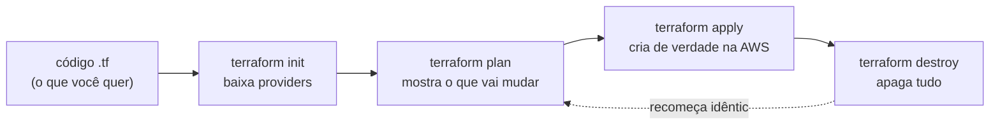

---

## Parte 1 - O ciclo básico com uma EC2

### Resultado esperado desta parte

Você terá criado e destruído uma instância EC2 inteiramente via Terraform, entendendo cada comando do ciclo.

---

<a id="passo-1"></a>

**1.** No terminal do Codespaces, entre na pasta do exemplo mais simples:

```bash
cd /workspaces/FIAP-AI-Devops-CICD/01-Terraform/demos/01-Plan-Apply/EC2
```

---

<a id="passo-2"></a>

**2.** Inicialize o diretório de trabalho:

```bash
terraform init
```

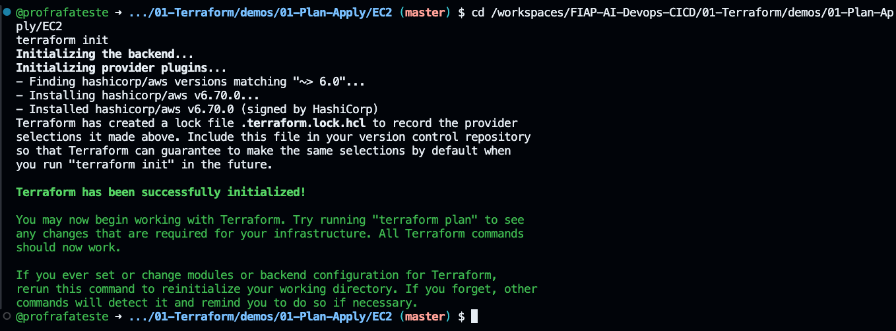

> Saída esperada (a linha que importa; o resto da saída varia):
>
> ```text
> Terraform has been successfully initialized!
> ```

<details>
<summary><b>💡 Clique para entender: terraform init</b></summary>
<blockquote>

`terraform init` é o primeiro comando ao iniciar um projeto. Ele prepara o diretório de trabalho:

- **baixa os plugins de provedores** declarados no código (aqui, o `hashicorp/aws ~> 6.0` do `versions.tf`) para a pasta `.terraform/`
- **configura o backend de estado** (local por padrão; nas demos 04 e 05 será remoto no S3)
- **baixa módulos** referenciados, se houver

Se os plugins já estiverem instalados, ele não baixa de novo (a menos que você passe `-upgrade`). Sem rodar `init`, qualquer `plan` ou `apply` falha.

Documentação oficial: [terraform init](https://developer.hashicorp.com/terraform/cli/commands/init)

</blockquote>
</details>

---

<a id="passo-3"></a>

**3.** Gere o plano de execução para conferir o que será criado **antes** de criar:

```bash
cd /workspaces/FIAP-AI-Devops-CICD/01-Terraform/demos/01-Plan-Apply/EC2
terraform plan
```

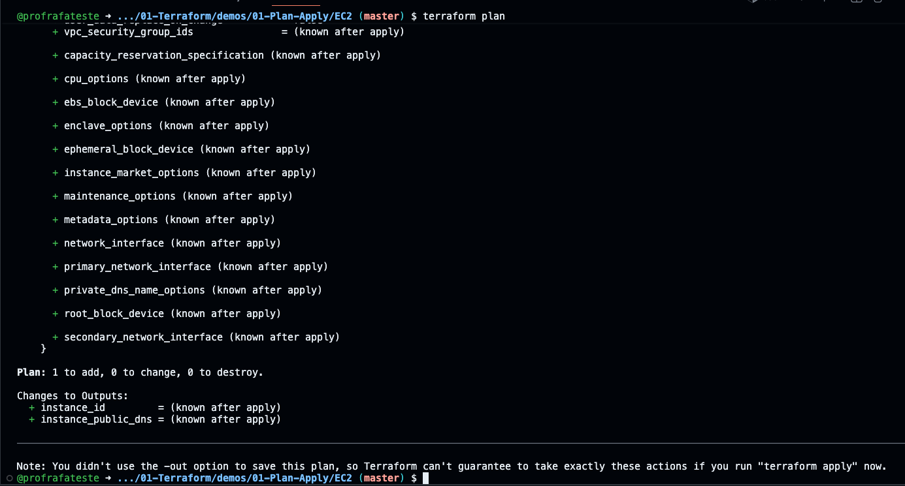

> Saída esperada (a linha que importa; o resto da saída varia):
>
> ```text
> Plan: 1 to add, 0 to change, 0 to destroy.
> ```

<details>
<summary><b>💡 Clique para entender: terraform plan</b></summary>
<blockquote>

`terraform plan` compara o estado atual (o que existe) com o que o código descreve, e mostra as ações necessárias **sem executar nada**. Símbolos do plano:

- `+` recurso que será **criado**
- `~` recurso que será **modificado** in-place
- `-` recurso que será **destruído**

É a sua rede de segurança: você revisa as mudanças antes de aplicá-las. Em time, o `plan` costuma ir num pull request para revisão. Aqui você deve ver `+ aws_instance.example` (1 a adicionar).

Documentação oficial: [terraform plan](https://developer.hashicorp.com/terraform/cli/commands/plan)

</blockquote>
</details>

---

<a id="passo-4"></a>

**4.** Aplique o plano para criar o recurso de verdade na AWS:

```bash
cd /workspaces/FIAP-AI-Devops-CICD/01-Terraform/demos/01-Plan-Apply/EC2
terraform apply -auto-approve
```

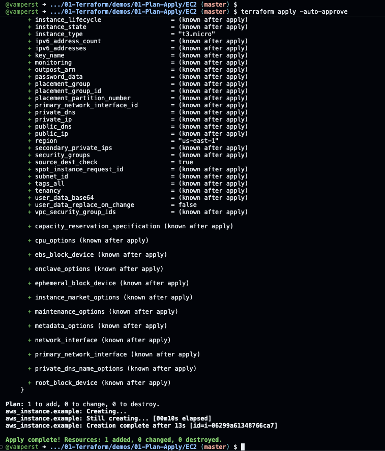

> Saída esperada (a linha que importa; o resto da saída varia):
>
> ```text
> Apply complete! Resources: 1 added, 0 changed, 0 destroyed.
> ```

> [!NOTE]
> A flag `-auto-approve` pula o "type 'yes' to confirm". Usamos em todos os labs para focar no conteúdo. **Em produção, nunca** — lá você revisa o plano e aprova manualmente.

<details>
<summary><b>💡 Clique para entender: o código desta pasta (EC2)</b></summary>
<blockquote>

Três arquivos compõem este exemplo:

**`versions.tf`** — fixa as versões mínimas, garantindo reprodutibilidade:

```hcl
terraform {
  required_version = ">= 1.10"
  required_providers {
    aws = {
      source  = "hashicorp/aws"
      version = "~> 6.0"
    }
  }
}
```

**`provider.tf`** — diz ao Terraform em qual região operar e aplica tags de governança a tudo via `default_tags`:

```hcl
provider "aws" {
  region = var.aws_region

  # default_tags marca TODOS os recursos deste provider de uma vez,
  # sem repetir "tags = {...}" em cada bloco.
  default_tags {
    tags = {
      Project   = "quantum-commerce"
      ManagedBy = "terraform"
      Lab       = "01-terraform"
    }
  }
}
```

**`vars.tf`** — a região e, em vez de uma AMI fixa, um `data source` que descobre a Amazon Linux 2023 mais recente na conta:

```hcl
variable "aws_region" {
  default = "us-east-1"
}

data "aws_ami" "amazon_linux" {
  most_recent = true
  owners      = ["amazon"]
  filter {
    name   = "name"
    values = ["al2023-ami-2023.*-x86_64"]
  }
  filter {
    name   = "virtualization-type"
    values = ["hvm"]
  }
}
```

**`instance.tf`** — a instância em si, usando o ID descoberto pelo data source:

```hcl
resource "aws_instance" "example" {
  ami           = data.aws_ami.amazon_linux.id
  instance_type = "t3.micro"
}
```

Por que data source de AMI em vez de um ID fixo? AMIs antigas são despublicadas e o lab quebra com o tempo. O data source sempre pega a imagem válida mais recente — robusto e didático.

Documentação oficial: [aws_ami data source](https://registry.terraform.io/providers/hashicorp/aws/latest/docs/data-sources/ami) · [aws_instance](https://registry.terraform.io/providers/hashicorp/aws/latest/docs/resources/instance)

</blockquote>
</details>

---

<a id="passo-5"></a>

**5.** Abra o [painel EC2](https://us-east-1.console.aws.amazon.com/ec2/home?region=us-east-1#Instances:instanceState=running) e confirme que a instância foi criada (sem nome, pois não definimos a tag `Name`).

> O link só abre direto se o console da AWS já estiver aberto pelo botão **AWS** do Learner Lab ([lab 00, passo 13](../../../00-create-codespaces/README.md#passo-13)). Se aparecer uma tela de login da AWS, volte ao Learner Lab, confira que a bolinha está verde e clique em **AWS**.

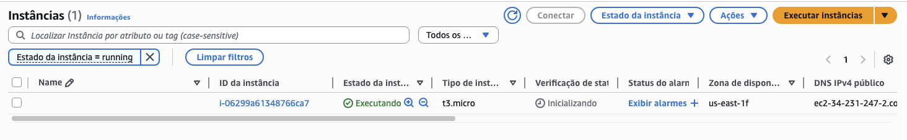

<details>
<summary><b>💡 Clique para entender: como dar nome a um recurso na AWS</b></summary>
<blockquote>

A AWS exibe no console o valor da tag `Name`. Para nomear a instância, adicione um bloco `tags`:

```hcl
resource "aws_instance" "example" {
  ami           = data.aws_ami.amazon_linux.id
  instance_type = "t3.micro"

  tags = {
    Name = "quantum-ai-web-01"
  }
}
```

Tags servem também para organização e billing (`env = "prod"`, `team = "plataforma"`). Veremos isso nas próximas demos.

</blockquote>
</details>

---

<a id="passo-6"></a>

**6.** Destrua o recurso:

```bash
cd /workspaces/FIAP-AI-Devops-CICD/01-Terraform/demos/01-Plan-Apply/EC2
terraform destroy -auto-approve
```

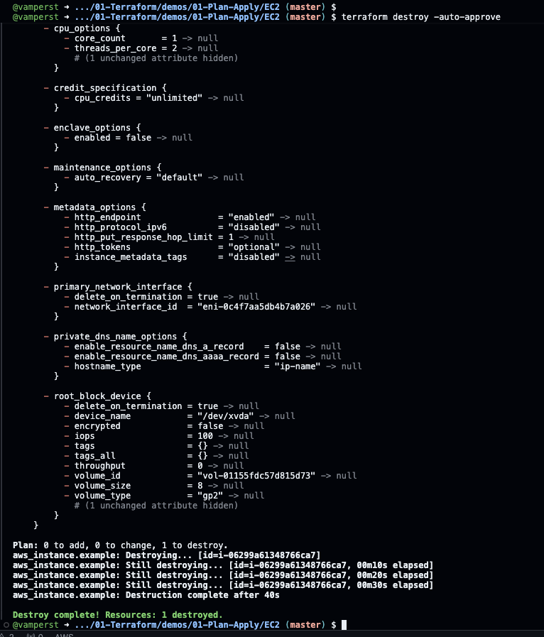

> Saída esperada (a linha que importa; o resto da saída varia):
>
> ```text
> Destroy complete! Resources: 1 destroyed.
> ```

---

<a id="passo-7"></a>

**7.** Confirme no [painel EC2](https://us-east-1.console.aws.amazon.com/ec2/home?region=us-east-1#Instances:) que a instância não está mais lá (estado `Terminated`).

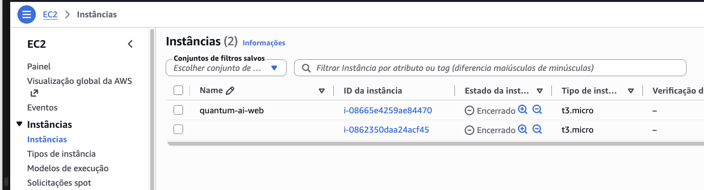

---

<a id="passo-8"></a>

**8.** Volte uma pasta para preparar a Parte 2:

```bash
cd /workspaces/FIAP-AI-Devops-CICD/01-Terraform/demos/01-Plan-Apply
```

### Checkpoint

Se chegou até aqui, você:

- inicializou um projeto Terraform (`init`)
- previu mudanças (`plan`) e as aplicou (`apply`)
- viu o recurso no console e o destruiu (`destroy`)

---

## Parte 2 - Uma EC2 que vira servidor web

### Resultado esperado desta parte

Uma EC2 que, ao nascer, se configura sozinha como servidor Nginx e publica a página inicial do **Quantum Commerce AI Customer Assistant** — **provisionada via AWS Systems Manager (SSM), sem chave SSH e sem porta 22 aberta** — acessível pelo DNS público no navegador.

Por que uma página e não a tela padrão do Nginx? Ela é o **primeiro artefato visível do Assistente de Rastreio e Políticas**: a prova, para Helena e Diego, de que a infraestrutura nasce de código e serve conteúdo de verdade. A página mostra o status **EC2 / Nginx online — página servida pela instância** e o **hostname da instância** que respondeu.

| Implantado nesta parte | Ainda não existe (próximas aulas) |
|---|---|
| 1 EC2 `t3.micro` com Nginx | modelo de IA ou qualquer inferência |
| uma página estática (HTML + CSS) | API de pedidos |
| o hostname da instância gravado na página | RAG sobre as políticas de troca e devolução |

**Onde está a página e como ela chega à EC2.** O HTML fica no repositório em `EC2-ssh/site/index.html`. Para pré-visualizar antes do `apply`, clique com o botão direito no arquivo no explorador do Codespaces, escolha **Download** e abra o arquivo baixado no navegador do seu computador: o título e o status dizem que é uma pré-visualização local, sem EC2. É de propósito: só a página servida pela instância diz "online". No `apply`, o `terraform_data.provisiona` converte o arquivo para **base64** (texto só com letras, números, `+`, `/` e `=`), envia esse texto como primeira linha do comando SSM, e o `script.sh` decodifica de volta para `/usr/share/nginx/html/index.html` dentro da EC2. Sem SSH, sem S3, sem copiar arquivo à mão.

> [!NOTE]
> A pasta se chama `EC2-ssh` por motivo histórico: na versão antiga deste lab, o provisionamento era feito por SSH. Hoje ela usa **AWS Systems Manager (SSM)**; o nome foi mantido para não quebrar links e comandos.

---

<a id="passo-9"></a>

**9.** Confira as ferramentas do provisionamento. O provisionamento via SSM usa a **AWS CLI** e o **`jq`** na sua própria máquina (o Codespaces) para enviar o script à instância. O devcontainer já instala os dois; este passo só confirma. No terminal do Codespaces, rode:

```bash
aws --version && jq --version
```

> Saída esperada (os números de versão variam):
>
> ```text
> aws-cli/2.x.x Python/3.x.x Linux/...
> jq-1.x
> ```

Se apareceu `command not found`, abra o bloco abaixo antes de seguir. O `script.sh` que será enviado começa com `set -euo pipefail`, então qualquer falha de comando no servidor propaga o erro de volta e **aborta o `apply`** (mesma garantia de um provisioner SSH).

<details>
<summary><b>⚠ Se der erro: <code>aws: command not found</code> ou <code>jq: command not found</code> no passo 9</b></summary>
<blockquote>

O devcontainer já instala as duas ferramentas; use estes comandos **só se a verificação acima falhar** (por exemplo, se você abriu o lab fora do Codespaces do curso). Rode no terminal do Codespaces:

```bash
# jq e unzip (Ubuntu) — unzip e necessario para o instalador da AWS CLI
sudo apt-get update -y && sudo apt-get install -y jq unzip

# AWS CLI v2 (Ubuntu/x86_64) — instalador oficial da AWS
command -v aws >/dev/null || {
  curl -s "https://awscli.amazonaws.com/awscli-exe-linux-x86_64.zip" -o /tmp/awscliv2.zip
  unzip -q /tmp/awscliv2.zip -d /tmp
  sudo /tmp/aws/install --update
}

aws --version && jq --version
```

As duas últimas linhas devem imprimir as versões. Depois disso, siga para o passo 10.

</blockquote>
</details>

---

<a id="passo-10"></a>

**10.** Entre na pasta do exemplo provisionado via SSM:

```bash
cd /workspaces/FIAP-AI-Devops-CICD/01-Terraform/demos/01-Plan-Apply/EC2-ssh
```

Esta pasta cria a EC2 com o instance profile `LabInstanceProfile` (que já carrega a permissão SSM no Learner Lab) e provisiona o Nginx via SSM — sem chave privada, sem porta 22.

---

<a id="passo-11"></a>

**11.** Inicialize:

```bash
cd /workspaces/FIAP-AI-Devops-CICD/01-Terraform/demos/01-Plan-Apply/EC2-ssh
terraform init
```

> Saída esperada (a linha que importa; o resto da saída varia):
>
> ```text
> Terraform has been successfully initialized!
> ```

---

<a id="passo-12"></a>

**12.** Gere o plano:

```bash
cd /workspaces/FIAP-AI-Devops-CICD/01-Terraform/demos/01-Plan-Apply/EC2-ssh
terraform plan
```

> Saída esperada (são 2 recursos: a EC2 e o `terraform_data.provisiona`):
>
> ```text
> Plan: 2 to add, 0 to change, 0 to destroy.
> ```

<details>
<summary><b>💡 Clique para entender: o código desta pasta (provisionamento via SSM)</b></summary>
<blockquote>

A diferença para a Parte 1 é que aqui a instância **se autoconfigura** após nascer. Na versão antiga isso era feito com um `provisioner "remote-exec"` por SSH (que exigia a chave `vockey.pem` e a porta 22 aberta). Agora usamos **AWS Systems Manager (SSM)** — sem chave, sem porta 22.

**`instance.tf`** — a EC2 já **não tem** `key_name`, `connection` nem `provisioner` de SSH. Ela só carrega o instance profile que habilita o SSM, e um recurso `terraform_data` separado faz o provisionamento:

```hcl
resource "aws_instance" "example" {
  ami                  = data.aws_ami.amazon_linux.id
  instance_type        = "t3.micro"
  iam_instance_profile = "LabInstanceProfile"

  tags = {
    Name = "quantum-ai-web"
  }
}

resource "terraform_data" "provisiona" {
  triggers_replace = {
    instance_id = aws_instance.example.id
    script_hash = filesha256("${path.module}/script.sh")
    site_hash   = filesha256("${path.module}/site/index.html")
  }

  provisioner "local-exec" {
    interpreter = ["bash", "-c"]
    command     = <<-EOT
      # 1. espera a instancia ficar Online no SSM
      # 2. envia SITE_B64 (a pagina em base64) + o script.sh via 'aws ssm send-command'
      # 3. 'aws ssm wait' ate a execucao terminar
      # 4. imprime o log do provisionamento
      # 5. se o Status != Success, faz 'exit 1' e ABORTA o apply
    EOT
  }
}
```

Como funciona, em 4 ideias:

- **`LabInstanceProfile`** é o perfil de instância do Learner Lab que já traz a permissão `AmazonSSMManagedInstanceCore` na `LabRole`. É ele que permite o SSM Agent (pré-instalado na Amazon Linux 2023) registrar a máquina no Systems Manager.
- O `terraform_data.provisiona` roda um `local-exec` **na sua máquina** (o Codespaces): com a AWS CLI ele faz `aws ssm send-command` mandando as linhas do `script.sh` para a instância, espera com `aws ssm wait command-executed`, imprime o `StandardOutputContent` (o **log aparece no próprio `apply`** — auditável) e, se o `Status` não for `Success`, faz `exit 1` — o que **aborta o `apply`**. É a mesma garantia "falhou o script, falhou o apply" do antigo provisioner SSH.
- O `jq` monta a lista de comandos: o parâmetro `commands` do documento `AWS-RunShellScript` é um **array de linhas**, e `jq -R . | jq -s '{commands: .}'` converte cada linha numa entrada do array, já dentro do JSON `{"commands": [...]}` que vai em `--parameters`. A primeira entrada é `SITE_B64=<a página em base64>`; as demais são as linhas do `script.sh`. O JSON completo (e não a forma abreviada `commands=...` da AWS CLI) é o que permite linhas terminando em `\`, como as do `sed` no `script.sh`.
- **Sem chave, sem porta 22:** o SSM Agent fala de **dentro para fora** com o serviço (saída HTTPS), então não precisamos abrir nenhuma porta de entrada nem distribuir chave privada.

**`script.sh`** instala o Nginx, publica a página e valida o resultado. Ele começa com `set -euo pipefail` (para que qualquer erro pare o script e seja capturado pelo SSM como falha) e usa `dnf`, já que migramos para Amazon Linux 2023 (o antigo `amazon-linux-extras` não existe mais). As linhas principais, sem os comentários:

```bash
set -euo pipefail
sudo dnf install -y -q nginx
PAGINA=/usr/share/nginx/html/index.html
echo "$SITE_B64" | base64 -d | sudo tee "$PAGINA" > /dev/null
HOST=$(uname -n)
sudo env LC_ALL=C sed -i \
  -e 's|<!--QC:TITLE-->.*<!--/QC:TITLE-->|A primeira infraestrutura do assistente está online.|' \
  -e 's|<!--QC:STATUS-->.*<!--/QC:STATUS-->|<span class="on">EC2 / Nginx online — página servida pela instância</span>|' \
  -e "s|<!--QC:HOST-->.*<!--/QC:HOST-->|<code>${HOST}</code>|" \
  "$PAGINA"
sudo nginx -t
sudo systemctl enable nginx
sudo systemctl restart nginx
RESPOSTA=$(curl -fsS http://localhost/)
```

O que cada decisão resolve:

- **`/usr/share/nginx/html/index.html`** é o docroot do Nginx no Amazon Linux 2023: sobrescrever esse arquivo troca a página padrão pela do assistente, sem mexer na configuração do Nginx.
- **Base64** porque o comando SSM é uma lista de linhas de shell. Um HTML com acentos, aspas, `$`, `<` e `>` dentro de uma linha de shell poderia ser interpretado pelo próprio shell; em base64 esses caracteres não existem, e o `base64 -d` devolve o arquivo idêntico.
- **Marcadores:** o HTML traz três marcadores, cada um numa linha: `<!--QC:TITLE-->`, `<!--QC:STATUS-->` e `<!--QC:HOST-->`. Aberto direto no seu navegador, ele avisa que é uma pré-visualização local, sem EC2. Na instância, o `sed` troca cada marcador pelo título "A primeira infraestrutura do assistente está online.", pelo status e pelo hostname; o resto do HTML chega intocado. `env LC_ALL=C` faz o `sed` tratar acentos e o travessão como bytes.
- **`nginx -t`** valida a configuração antes do restart, e o **`curl`** final confere se a resposta contém `Quantum Commerce`. Se não contiver, o script sai com erro, o SSM marca `Failed` e o `apply` aborta.
- **`site_hash` no `triggers_replace`:** edite o HTML e rode `terraform plan`; o plano mostra `terraform_data.provisiona` para recriar (só ele, a EC2 fica). É assim que uma mudança na página é republicada.

**`outputs.tf`** expõe o DNS público no final do `apply`, para você colar no navegador:

```hcl
output "ec2_dns" {
  value = aws_instance.example.public_dns
}
```

Documentação: [aws ssm send-command](https://docs.aws.amazon.com/cli/latest/reference/ssm/send-command.html) · [terraform_data](https://developer.hashicorp.com/terraform/language/resources/terraform-data)

</blockquote>
</details>

---

<a id="passo-13"></a>

**13.** Antes do `apply`, precisamos liberar o tráfego para conseguir abrir a página no navegador. A EC2 deste lab não declara rede nem Security Group, então a AWS a coloca na **VPC default**, com o **Security Group `default`** dessa VPC. É nas **regras de entrada** desse grupo que vamos mexer.

---

<a id="passo-14"></a>

**14.** No terminal do Codespaces, copie o bloco inteiro abaixo, cole e tecle Enter. Ele encontra a VPC default e o Security Group `default` dela, **apaga todas as regras de entrada** que existirem e adiciona uma única regra: **todo o tráfego, de qualquer origem (`0.0.0.0/0`)**. As regras de saída não são alteradas.

```bash
VPC=$(aws ec2 describe-vpcs --region us-east-1 --filters Name=is-default,Values=true --query 'Vpcs[0].VpcId' --output text)
SG=$(aws ec2 describe-security-groups --region us-east-1 --filters Name=vpc-id,Values=$VPC Name=group-name,Values=default --query 'SecurityGroups[0].GroupId' --output text)
echo "VPC default: $VPC | Security Group default: $SG"
for REGRA in $(aws ec2 describe-security-group-rules --region us-east-1 --filters Name=group-id,Values=$SG --query 'SecurityGroupRules[?IsEgress==`false`].SecurityGroupRuleId' --output text); do aws ec2 revoke-security-group-ingress --region us-east-1 --group-id $SG --security-group-rule-ids $REGRA > /dev/null; done
aws ec2 authorize-security-group-ingress --region us-east-1 --group-id $SG --protocol -1 --cidr 0.0.0.0/0 > /dev/null
aws ec2 describe-security-group-rules --region us-east-1 --filters Name=group-id,Values=$SG --query 'SecurityGroupRules[?IsEgress==`false`].[IpProtocol,CidrIpv4]' --output table
```

> Saída esperada (os IDs variam). A tabela do final serve de conferência: **uma única linha**, protocolo `-1` (todo o tráfego) e origem `0.0.0.0/0`:
>
> ```text
> VPC default: vpc-0123456789abcdef0 | Security Group default: sg-0123456789abcdef0
> ----------------------------
> |DescribeSecurityGroupRules|
> +-------+------------------+
> |  -1   |  0.0.0.0/0       |
> +-------+------------------+
> ```

Você pode executar o bloco quantas vezes quiser. Como ele sempre apaga o que existe antes de criar a regra, o resultado é o mesmo e não aparece erro de regra duplicada.

<details>
<summary><b>💡 Clique para entender cada linha</b></summary>
<blockquote>

| Linha | O que faz |
|---|---|
| `VPC=$(...)` | Pergunta à AWS qual é a VPC marcada como default (`is-default=true`) e guarda o ID na variável `VPC`. |
| `SG=$(...)` | Procura, **dentro dessa VPC**, o Security Group chamado `default` e guarda o ID em `SG`. Filtrar pela VPC evita pegar o `default` de outra rede. |
| `echo` | Mostra os dois IDs, para você conferir que algo foi encontrado. |
| `for REGRA in ...` | Lista os IDs de todas as regras de **entrada** (`IsEgress==false`) do grupo e apaga uma a uma com `revoke-security-group-ingress`. Se não houver nenhuma, o laço não faz nada. |
| `authorize-security-group-ingress` | Cria a regra nova: `--protocol -1` significa todos os protocolos e portas, e `--cidr 0.0.0.0/0` significa qualquer endereço da internet. |
| `describe-security-group-rules ... --output table` | Lê de novo as regras de entrada e imprime a tabela de conferência. |

O `> /dev/null` só esconde o JSON que a AWS devolve a cada alteração, para a saída ficar curta. Se houver erro, ele aparece mesmo assim, porque os erros saem por outro canal.

</blockquote>
</details>

<details>
<summary><b>⚠ Se der erro no passo 14</b></summary>
<blockquote>

- `Unable to locate credentials` ou `ExpiredToken`: as credenciais do Learner Lab não estão no Codespaces ou expiraram. Refaça o [Início de aula](../../../00-create-codespaces/Inicio-de-aula.md) e rode o bloco de novo.
- A linha `echo` mostra `None` no lugar dos IDs: a conta não tem VPC default. No Learner Lab ela existe; avise o professor.
- `UnauthorizedOperation`: a sessão do Learner Lab não está ativa (a bolinha não está verde). Inicie o lab, atualize as credenciais e rode o bloco de novo.

</blockquote>
</details>

---

<a id="passo-15"></a>

**15.** Confira o resultado também no console. Abra o [painel EC2 da AWS](https://us-east-1.console.aws.amazon.com/ec2/home?region=us-east-1#Home:), clique em **Security Groups** no menu lateral, selecione o grupo com `default` na coluna Nome e abra a aba **Regras de entrada**.

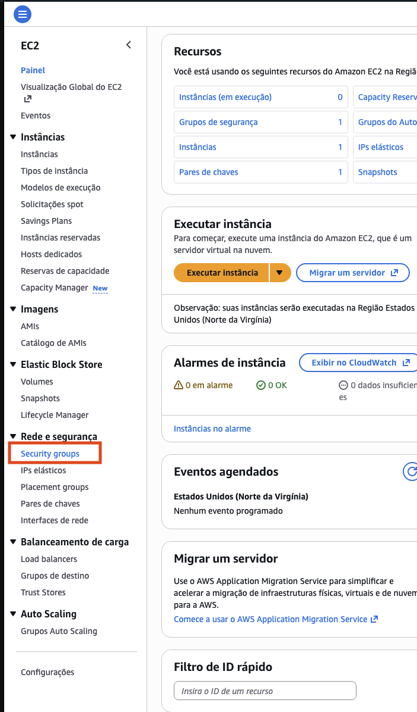

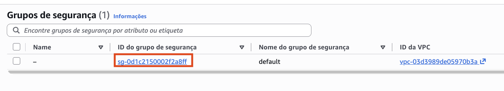

---

<a id="passo-16"></a>

**16.** A aba **Regras de entrada** deve mostrar uma única regra: **Todo o tráfego**, com origem `0.0.0.0/0`, a mesma da tabela do passo 14. Não é preciso editar nada no console.

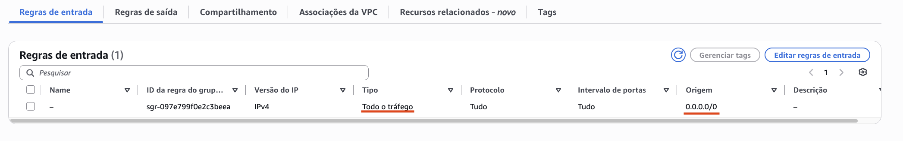

> [!WARNING]
> **Todo o tráfego aberto para qualquer origem é uma exceção efêmera de laboratório, não um padrão de produção.** Ela é aceitável aqui porque a conta do Learner Lab é temporária, a página é pública e estática e não há nenhum dado sensível na máquina. O tráfego da página é HTTP, sem criptografia; este lab não configura HTTPS. O provisionamento não depende dessa regra: ele é feito via SSM (que sai de dentro da máquina), não por SSH. Em produção, o Security Group seria descrito em código, liberando só as portas necessárias e com origem restrita, como faremos na demo Count. O passo [31](#passo-31), no fim do lab, desfaz essa regra.

Por que apagar as regras que já existiam? A regra padrão do Security Group `default` libera **todo o tráfego vindo de outros recursos do mesmo grupo**. Apagar tudo antes de criar a regra nova deixa o grupo com uma única regra que você entende, e o resultado é sempre o mesmo, não importa o que havia antes. O risco: se outros recursos da sua conta usam o grupo `default` para conversar entre si, eles perdem essa comunicação até o passo [31](#passo-31), que restaura a regra padrão.

---

<a id="passo-17"></a>

**17.** De volta ao Codespaces, provisione a máquina. Acompanhe o output: o Terraform cria a EC2, espera ela ficar `Online` no SSM e então **mostra o log do `script.sh`** (a instalação do Nginx) dentro do próprio `apply`:

```bash
cd /workspaces/FIAP-AI-Devops-CICD/01-Terraform/demos/01-Plan-Apply/EC2-ssh
terraform apply -auto-approve
```

> [!TIP]
> Procure no output o bloco `----- log do provisionamento -----`. É o `StandardOutputContent` que o SSM devolveu — o mesmo que você veria logando na máquina, mas agora auditável direto no `apply`.

> Saída esperada (trecho final de uma execução real; tempo, `id`, hostname e DNS variam):
>
> ```text
> terraform_data.provisiona (local-exec): ----- log do provisionamento -----
> terraform_data.provisiona (local-exec): == provisionando servidor web da Quantum Commerce ==
> terraform_data.provisiona (local-exec): Installed:
> terraform_data.provisiona (local-exec):   nginx-1:1.30.5-1.amzn2023.0.1.x86_64
> terraform_data.provisiona (local-exec):   (... outros pacotes ...)
> terraform_data.provisiona (local-exec): nginx: active
> terraform_data.provisiona (local-exec): pagina: <title>Quantum Commerce · AI Customer Assistant</title>
> terraform_data.provisiona (local-exec): host: ip-172-31-21-57.ec2.internal
> terraform_data.provisiona (local-exec): == provisionamento concluido ==
> terraform_data.provisiona (local-exec): ----------------------------------
> terraform_data.provisiona (local-exec): Status=Success ResponseCode=0
> terraform_data.provisiona: Creation complete after 1m0s [id=...]
>
> Apply complete! Resources: 2 added, 0 changed, 0 destroyed.
>
> Outputs:
>
> ec2_dns = "ec2-XX-XX-XX-XX.compute-1.amazonaws.com"
> ```

Antes desse trecho aparece uma linha `Executing: [...]` muito longa, com o script inteiro: é normal e não precisa ser lida. A lista `Installed:` vem do `dnf` e mostra os pacotes instalados; os nomes e as versões podem mudar de uma execução para outra. No teste real, o `apply` levou cerca de 1 min 20 s: uns 15 s para criar a EC2 e cerca de 60 s para o SSM instalar o Nginx e publicar a página.

São **2 recursos**: a EC2 (`aws_instance.example`) e o provisionamento (`terraform_data.provisiona`). Se em vez disso aparecer `ERRO:`, `Status=InProgress` ou `Status=Failed`, abra o bloco **⚠ o `apply` falha no provisionamento via SSM** no passo 18.


<!-- NOVA-IMAGEM: images/apply-ssm-log-ec2-dns.png | capturar: terminal do Codespaces na pasta EC2-ssh, fim do 'terraform apply -auto-approve' do passo 17, mostrando o bloco 'log do provisionamento' com 'nginx: active', 'pagina: <title>...', 'host: ip-...', a linha 'Status=Success ResponseCode=0', 'Apply complete! Resources: 2 added' e o output 'ec2_dns' (substitui o antigo apply-3.png, que mostrava remote-exec por SSH) | depois de salvar o arquivo, descomente a linha abaixo -->
<!--  -->

---

<a id="passo-18"></a>

**18.** Quando o `apply` terminar, copie o valor de `ec2_dns` do final do output (sem as aspas) e cole na barra de endereço do navegador começando com `http://` (por exemplo, `http://ec2-xx-xx-xx-xx.compute-1.amazonaws.com`). Você verá a página inicial do **Quantum Commerce AI Customer Assistant**, com o status **EC2 / Nginx online — página servida pela instância** e, mais abaixo, a linha **Servido por:** com o hostname da instância (no formato `ip-172-31-...`).

<!-- TROCAR-IMAGEM: images/qc-ai-assistant.png | motivo: gerada a partir da pré-visualização local com as trocas aplicadas, não capturada da EC2 | capturar: navegador em http://<ec2_dns>/ logo após o passo 17, janela 1440x900, rolando até aparecer o rodapé "Servido por: ip-..." -->
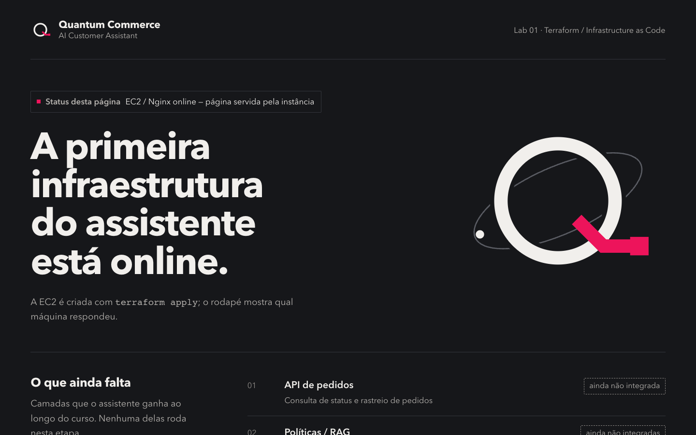

A sua tela deve ficar assim: o status no topo diz "página servida pela instância" e o título diz que a infraestrutura está online.

Para validar pelo terminal do Codespaces, sem depender do navegador:

```bash
cd /workspaces/FIAP-AI-Devops-CICD/01-Terraform/demos/01-Plan-Apply/EC2-ssh
curl -s -i "http://$(terraform output -raw ec2_dns)/" | grep -E "HTTP/|<title>|Servido por"
```

> Saída esperada (o hostname varia por instância; o que importa é o `200 OK`, o título e a linha `Servido por`):
>
> ```text
> HTTP/1.1 200 OK
> <title>Quantum Commerce · AI Customer Assistant</title>
>     <p class="host">Servido por: <code>ip-172-31-xx-xx.ec2.internal</code></p>
> ```

O hostname é a prova de que a página veio da EC2 que o Terraform acabou de criar: se você destruir e recriar, ele muda, e o conteúdo continua idêntico. Se em vez do hostname aparecer `pré-visualização local`, a página não passou pelo `script.sh`: veja o bloco **⚠ aparece a página padrão do Nginx** abaixo.

<details>
<summary><b>⚠ Se der erro: a página do navegador não carrega</b></summary>
<blockquote>

Causa mais comum: o Security Group ainda não está liberando o tráfego. Rode de novo o bloco do passo [14](#passo-14) e confira a tabela no final. Se o `apply` terminou com `Status=Success` no log do provisionamento, o Nginx já está instalado — o problema é só a regra de entrada. Valide também que a instância está `running` no painel e que o DNS colado é exatamente o do output (`http://<dns>`).

Um **timeout** (o navegador fica carregando, o `curl` não responde) quase sempre é isso: a regra de entrada não existe ou foi criada em outro Security Group. Outra causa comum é o navegador forçar `https://`: digite `http://` explicitamente, porque o Nginx deste lab só escuta na porta 80.

</blockquote>
</details>

<details>
<summary><b>⚠ Se der erro: aparece a página padrão do Nginx (<code>Welcome to nginx!</code>) ou um 403/404</b></summary>
<blockquote>

- **Página padrão do Nginx:** a EC2 e o Nginx subiram, mas a página do assistente não foi gravada. Procure no log do `apply` a linha `pagina: <title>Quantum Commerce · AI Customer Assistant</title>`. Se ela não aparece, seu fork está com uma versão antiga do lab: atualize o fork (ritual do [Início de aula](../../../00-create-codespaces/Inicio-de-aula.md)) e rode `terraform apply -auto-approve`. Como os hashes do `script.sh` e do `site/index.html` são gatilhos do `terraform_data.provisiona`, o Terraform reenvia a página sem recriar a EC2. Se o log está correto e o navegador ainda mostra a página antiga, é cache: recarregue com `Ctrl+Shift+R`.
- **403 Forbidden ou 404 Not Found:** o Nginx respondeu, mas não achou um `index.html` legível no docroot (`/usr/share/nginx/html`). Rodar `terraform apply` de novo não adianta: o código não mudou, então ele responde `No changes`. Force o reenvio só do provisionamento, sem recriar a EC2, com o comando abaixo, e confira no log as linhas `nginx: active` e `pagina: ...`.

```bash
cd /workspaces/FIAP-AI-Devops-CICD/01-Terraform/demos/01-Plan-Apply/EC2-ssh
terraform apply -replace=terraform_data.provisiona -auto-approve
```

</blockquote>
</details>

<details>
<summary><b>⚠ Se der erro: o <code>apply</code> falha no provisionamento via SSM</b></summary>
<blockquote>

O `terraform_data.provisiona` imprime mensagens próprias quando o SSM falha. Procure no output qual delas apareceu:

| Mensagem no `apply` | O que significa | O que fazer |
|---|---|---|
| `ERRO: a instancia nao ficou online no SSM a tempo.` | O SSM Agent da EC2 não se registrou em ~5 minutos. | No [painel EC2](https://us-east-1.console.aws.amazon.com/ec2/home?region=us-east-1#Instances:), confira se a instância está `running` e se, na aba **Segurança**, a função do IAM é `LabInstanceProfile`. Depois rode `terraform apply -auto-approve` de novo. |
| `Status=InProgress` | O script ainda rodava quando a espera do `aws ssm wait` terminou. | Rode `terraform apply -auto-approve` de novo. |
| `Status=Failed` | O `script.sh` falhou dentro da EC2. | Leia as linhas logo abaixo da mensagem `ERRO: o provisionamento via SSM falhou`: é o `StandardErrorContent`, com o comando que falhou. Corrija a causa e rode `terraform apply -auto-approve` de novo. |

Por que rodar o `apply` de novo funciona aqui: quando o provisionamento falha, o Terraform marca o `terraform_data.provisiona` como *tainted* (danificado), e o próximo `apply` o recria e reenvia o script, sem recriar a EC2.

</blockquote>
</details>

<details>
<summary><b>⚠ Se der erro: <code>aws: command not found</code> ou <code>jq: command not found</code> durante o apply</b></summary>
<blockquote>

O provisionamento via SSM roda na sua máquina (Codespaces) e precisa da AWS CLI e do `jq`. Volte ao passo 9 e rode os comandos de validação/instalação; depois rode `terraform apply -auto-approve` de novo.

</blockquote>
</details>

---

<a id="passo-19"></a>

**19.** Destrua os recursos e confirme no [painel EC2](https://us-east-1.console.aws.amazon.com/ec2/home?region=us-east-1#Instances:) que nada mais está rodando:

```bash
cd /workspaces/FIAP-AI-Devops-CICD/01-Terraform/demos/01-Plan-Apply/EC2-ssh
terraform destroy -auto-approve
```

> Saída esperada (a linha que importa; o resto da saída varia):
>
> ```text
> Destroy complete! Resources: 2 destroyed.
> ```


### Checkpoint

Se chegou até aqui, você:

- criou uma EC2 que se autoconfigura como servidor web, provisionada **via SSM** (sem chave SSH, sem porta 22)
- viu o **log do provisionamento dentro do próprio `apply`**
- acessou a página do **Quantum Commerce AI Customer Assistant** pelo DNS público, confirmou o hostname da instância e destruiu tudo

---

## Parte 3 - Lendo o plano: o que vai mudar

> Diego volta à sua mesa: *— "Antes de mexer em qualquer coisa da Quantum Commerce, você precisa **ler o plano**. Tem mudança que o Terraform faz no lugar, e tem mudança que **destrói e recria** o recurso. Confundir as duas, em produção, derruba serviço."*

### Resultado esperado desta parte

Você vai aprender a distinguir os três símbolos do `plan` (`+` criar, `~` alterar no lugar, `-/+` destruir e recriar) usando a EC2 simples da pasta `EC2`.

---

<a id="passo-20"></a>

**20.** Volte para a pasta da EC2 simples (sem provisionamento) e suba uma instância:

```bash
cd /workspaces/FIAP-AI-Devops-CICD/01-Terraform/demos/01-Plan-Apply/EC2
terraform apply -auto-approve
```

> Saída esperada (a linha que importa; o resto da saída varia):
>
> ```text
> Apply complete! Resources: 1 added, 0 changed, 0 destroyed.
> ```

---

<a id="passo-21"></a>

**21.** Agora **adicione uma tag** sem mudar mais nada, em quatro sub-passos.

**21.1.** Abra o arquivo `instance.tf` no editor (o terminal continua na pasta `EC2` do passo 20):

```bash
code /workspaces/FIAP-AI-Devops-CICD/01-Terraform/demos/01-Plan-Apply/EC2/instance.tf
```

**21.2.** Apague **todo** o conteúdo do arquivo, cole exatamente o texto abaixo no lugar (a única diferença é o novo bloco `tags`) e salve (**File → Save**, ou `Ctrl+S` / `Cmd+S`):

```hcl
resource "aws_instance" "example" {
  ami           = data.aws_ami.amazon_linux.id
  instance_type = "t3.micro"

  tags = {
    Name = "quantum-ai-poc"
  }
}
```

**21.3.** Rode o `plan` e **leia a saída**:

```bash
cd /workspaces/FIAP-AI-Devops-CICD/01-Terraform/demos/01-Plan-Apply/EC2
terraform plan
```

O Terraform mostra `~ update in-place` — uma tag é um atributo mutável, então ele **altera a máquina existente**, sem recriar.

<!-- TROCAR-IMAGEM: images/plan-2.png | motivo: mostra a tag Name da narrativa anterior, e não quantum-ai-poc | capturar: terminal do Codespaces na pasta EC2, saída do 'terraform plan' do passo 21.3, mostrando '~ update in-place', '+ "Name" = "quantum-ai-poc"' em tags e tags_all e 'Plan: 0 to add, 1 to change, 0 to destroy.' -->
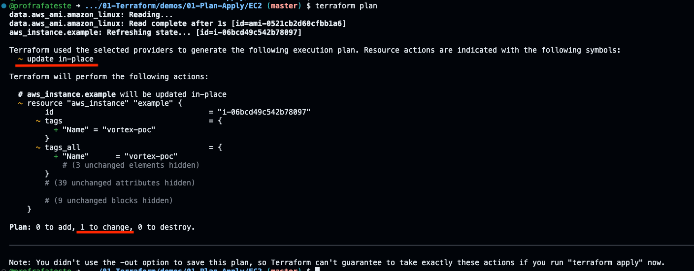

<!-- REMOVER-APOS-TROCA: images/plan-2.png -->
O print é da versão anterior e mostra `vortex-poc`; no seu terminal aparece `quantum-ai-poc`. O que importa é o `~ update in-place` e o `1 to change`.

<details>
<summary><b>💡 Clique para entender: os símbolos do plano</b></summary>
<blockquote>

O `plan` antecede toda mudança e usa símbolos para dizer **o que** vai acontecer:

- `+` — recurso será **criado**
- `-` — recurso será **destruído**
- `~` — recurso será **alterado no lugar** (in-place), sem perder identidade/IP
- `-/+` — recurso será **destruído e recriado** (replace). O `plan` mostra o motivo com `# forces replacement` ao lado do atributo culpado

Ler esse diff é a habilidade mais importante do dia a dia: é a diferença entre uma mudança segura e uma que derruba produção. Por isso a regra de ouro é **sempre rodar `plan` antes de `apply`** e ler cada linha.

Documentação oficial: [Terraform plan](https://developer.hashicorp.com/terraform/cli/commands/plan)

</blockquote>
</details>

**21.4.** Aplique a tag (é uma alteração in-place, rápida):

```bash
cd /workspaces/FIAP-AI-Devops-CICD/01-Terraform/demos/01-Plan-Apply/EC2
terraform apply -auto-approve
```

> Saída esperada (a linha que importa; o resto da saída varia):
>
> ```text
> Apply complete! Resources: 0 added, 1 changed, 0 destroyed.
> ```

---

<a id="passo-22"></a>

**22.** Agora provoque o outro tipo de mudança: **fixar a Availability Zone** da máquina.

**22.1.** Abra novamente o arquivo `instance.tf` no editor:

```bash
code /workspaces/FIAP-AI-Devops-CICD/01-Terraform/demos/01-Plan-Apply/EC2/instance.tf
```

**22.2.** Apague **todo** o conteúdo do arquivo e cole exatamente o texto abaixo no lugar (é o arquivo inteiro — a única diferença em relação ao passo 21 é a nova linha `availability_zone`):

```hcl
resource "aws_instance" "example" {
  ami               = data.aws_ami.amazon_linux.id
  instance_type     = "t3.micro"
  availability_zone = "us-east-1b"

  tags = {
    Name = "quantum-ai-poc"
  }
}
```

**22.3.** Salve o arquivo (no editor do Codespaces: menu **File → Save**, ou `Ctrl+S` / `Cmd+S` no Mac).

**22.4.** Rode o `plan`:

```bash
cd /workspaces/FIAP-AI-Devops-CICD/01-Terraform/demos/01-Plan-Apply/EC2
terraform plan
```

Desta vez aparece `# forces replacement` na linha do `availability_zone`, e o resumo vira `Plan: 1 to add, 0 to change, 1 to destroy` — ou seja, **destruir e recriar**. Uma instância não pode "mudar de zona" no lugar: a AWS precisa criar outra na zona nova e apagar a antiga.

> [!IMPORTANT]
> É exatamente aqui que mora o risco: um replace (`1 to destroy`) numa máquina de produção significa **downtime**. O `plan` te avisa **antes**. Em demos seguintes (e na vida real) usamos recursos como `create_before_destroy` para suavizar isso.

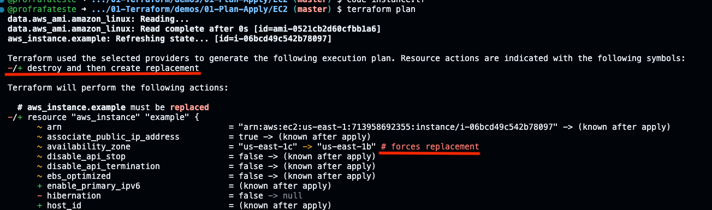

<details>
<summary><b>💡 Clique para entender: por que a zona força replace e o tipo não</b></summary>
<blockquote>

Cada atributo de um recurso é marcado pelo provider como *updatable in-place* ou *force-new*. A **Availability Zone** é uma propriedade de posicionamento físico decidida na criação — mudá-la exige uma máquina nova, então é *force-new*. Já o `instance_type`, em instâncias modernas (família Nitro, como as `t3`), a AWS consegue alterar com um stop/start, então o provider o trata como *update in-place*. Não dá para adivinhar de cabeça: o `plan` é a fonte da verdade sobre o que é replace e o que é in-place — por isso a regra é sempre lê-lo.

</blockquote>
</details>

---

<a id="passo-23"></a>

**23.** **Não** aplique a recriação. Vamos desfazer a mudança, confirmar que o plano volta ao normal e só então destruir — em etapas separadas, para você ler a saída de cada uma com calma.

**23.1.** Abra novamente o arquivo `instance.tf` no editor:

```bash
code /workspaces/FIAP-AI-Devops-CICD/01-Terraform/demos/01-Plan-Apply/EC2/instance.tf
```

**23.2.** Apague **todo** o conteúdo do arquivo e cole exatamente o texto abaixo no lugar (é o arquivo inteiro — voltamos ao estado do passo 21, **sem** a linha `availability_zone`):

```hcl
resource "aws_instance" "example" {
  ami           = data.aws_ami.amazon_linux.id
  instance_type = "t3.micro"

  tags = {
    Name = "quantum-ai-poc"
  }
}
```

**23.3.** Salve o arquivo (**File → Save**, ou `Ctrl+S` / `Cmd+S`).

**23.4.** Rode **somente** o `plan` e **leia a saída com atenção**:

```bash
cd /workspaces/FIAP-AI-Devops-CICD/01-Terraform/demos/01-Plan-Apply/EC2
terraform plan
```

> [!IMPORTANT]
> O resultado esperado é a mensagem **`No changes. Your infrastructure matches the configuration.`** Esse é o objetivo deste passo: como você desfez a alteração, o código voltou a bater com o que existe na AWS, então **não há nada a fazer**. Confirme que viu essa mensagem antes de continuar — é a prova de que reverter funcionou. (Se aparecer algo a alterar/destruir, seu `instance.tf` ainda está diferente do bloco acima; revise o passo 23.2.)

**23.5.** Agora sim, destrua a instância:

```bash
cd /workspaces/FIAP-AI-Devops-CICD/01-Terraform/demos/01-Plan-Apply/EC2
terraform destroy -auto-approve
```

> Saída esperada (a linha que importa; o resto da saída varia):
>
> ```text
> Destroy complete! Resources: 1 destroyed.
> ```

### Checkpoint

Se chegou até aqui, você:

- viu o símbolo `~` (alteração in-place) ao adicionar uma tag
- viu o símbolo `-/+` (replace com downtime) ao fixar a Availability Zone
- viu o `plan` voltar a **`No changes`** depois de desfazer a alteração
- entendeu por que ler o `plan` antes do `apply` é inegociável

---

## Parte 4 - Drift: quando alguém mexe no console

> **A dor da Quantum Commerce em pessoa.** Helena aparece: *— "Semana passada alguém entrou no console e mudou uma configuração na mão. Ninguém anotou. Quando fomos rodar o código, deu ruim. Como o Terraform lida com isso?"*
>
> Diego: *— "Isso tem nome: **drift**. É a infra real divergindo do que está no código. Deixa eu te mostrar o Terraform detectando e corrigindo."*

### Resultado esperado desta parte

Você vai criar uma EC2 por código, **alterá-la pelo console/CLI da AWS** (simulando o "alguém mexeu na mão") e ver o Terraform **detectar o drift** no `plan` e **reconciliar** no `apply`.

---

<a id="passo-24"></a>

**24.** Suba a EC2 simples de novo e guarde o ID dela numa variável de shell. A pasta `EC2` tem um `outputs.tf` que expõe o `instance_id`, então usamos `terraform output -raw` (saída limpa, sem formatação):

```bash
cd /workspaces/FIAP-AI-Devops-CICD/01-Terraform/demos/01-Plan-Apply/EC2
terraform apply -auto-approve
INSTANCE_ID=$(terraform output -raw instance_id)
echo "Instância gerenciada pelo Terraform: $INSTANCE_ID"
```

> Saída esperada (a linha do `apply`; logo depois vem `Instância gerenciada pelo Terraform: i-...`, com o ID da sua instância):
>
> ```text
> Apply complete! Resources: 1 added, 0 changed, 0 destroyed.
> ```

---

<a id="passo-25"></a>

**25.** Agora **simule o "alguém mexeu no console"**: adicione uma tag direto pela AWS CLI, **por fora** do Terraform.

```bash
aws ec2 create-tags --resources "$INSTANCE_ID" --tags Key=MexidoNaMao,Value=sim --region us-east-1
```

> [!NOTE]
> Isso é exatamente o que acontece quando alguém abre o console da AWS e clica para "ajustar rapidinho". O código não sabe que isso aconteceu.

---

<a id="passo-26"></a>

**26.** Peça um `plan`. O Terraform compara o estado real (que ele relê da AWS) com o código e **detecta o drift**:

```bash
cd /workspaces/FIAP-AI-Devops-CICD/01-Terraform/demos/01-Plan-Apply/EC2
terraform plan
```

Você verá uma nota de que a tag `MexidoNaMao` foi **detectada fora do código** e que o `plan` quer **removê-la** para fazer a infra real voltar a bater com o código (`~ update in-place`, removendo a tag).

<details>
<summary><b>💡 Clique para entender: drift e a "fonte da verdade"</b></summary>
<blockquote>

**Drift** é a divergência entre o que está no código (estado desejado) e o que existe de fato na nuvem. O `terraform plan` relê os recursos reais via API antes de comparar, então mudanças feitas no console aparecem como diferença.

O Terraform trata o **código como fonte da verdade**: o `apply` empurra a realidade de volta para o que está escrito. Foi isso que faltou na Quantum Commerce — a infra nasceu no console, sem código, então não havia fonte da verdade para reconciliar.

Esse é o ciclo que quebra o "medo de automação" (*automation fear spiral*): se toda mudança passa pelo código e o drift é reconciliado continuamente, ninguém tem medo de rodar a automação.

Documentação oficial: [Manage resource drift](https://developer.hashicorp.com/terraform/tutorials/state/resource-drift)

</blockquote>
</details>

---

<a id="passo-27"></a>

**27.** Vamos reconciliar o drift e, só depois, destruir. Faça em duas etapas separadas, para conseguir ler a saída de cada uma com calma.

**27.1.** Reconcilie a infra com o código e **leia a saída com atenção**:

```bash
cd /workspaces/FIAP-AI-Devops-CICD/01-Terraform/demos/01-Plan-Apply/EC2
terraform apply -auto-approve
```

> Saída esperada (o `1 changed` é a remoção da tag):
>
> ```text
> Apply complete! Resources: 0 added, 1 changed, 0 destroyed.
> ```

> [!IMPORTANT]
> Observe na saída que o Terraform **remove a tag `MexidoNaMao`** que você tinha criado na mão pela AWS CLI. Esse é o objetivo deste passo: o `apply` traz a infra real de volta para exatamente o que o código descreve — ou seja, **reconcilia o drift**. Confirme que viu essa alteração antes de continuar.

**27.2.** Agora sim, destrua a instância:

```bash
cd /workspaces/FIAP-AI-Devops-CICD/01-Terraform/demos/01-Plan-Apply/EC2
terraform destroy -auto-approve
```

> Saída esperada (a linha que importa; o resto da saída varia):
>
> ```text
> Destroy complete! Resources: 1 destroyed.
> ```

### Checkpoint

Se chegou até aqui, você:

- alterou um recurso gerenciado **por fora** do Terraform (simulando o console)
- viu o `plan` **detectar o drift**
- viu o `apply` **reconciliar** a realidade com o código

---

## Parte 5 - O que o Terraform sabe: o estado

> Diego encerra o dia: *— "Você já viu o Terraform 'lembrar' o que criou. Esse mapa do que existe tem um nome: **estado**. Dá uma olhada nele antes de irmos para a próxima demo — porque na demo de state ele vai virar o centro de tudo."*

### Resultado esperado desta parte

Você vai inspecionar o estado do Terraform — a estrutura que ele usa para saber o que já existe — preparando o terreno para a demo 01.4.

---

<a id="passo-28"></a>

**28.** Suba a EC2 mais uma vez e liste o que o Terraform está rastreando:

```bash
cd /workspaces/FIAP-AI-Devops-CICD/01-Terraform/demos/01-Plan-Apply/EC2
terraform apply -auto-approve
terraform state list
```

Você verá `data.aws_ami.amazon_linux` e `aws_instance.example` — os objetos que o Terraform conhece.

---

<a id="passo-29"></a>

**29.** Veja os detalhes do recurso no estado:

```bash
cd /workspaces/FIAP-AI-Devops-CICD/01-Terraform/demos/01-Plan-Apply/EC2
terraform state show aws_instance.example
```

Repare em atributos que o **código não definiu**, mas que a AWS preencheu e o Terraform guardou: `id`, `private_ip`, `public_dns`, `arn`. Esses são os *computed attributes*.

<details>
<summary><b>💡 Clique para entender: o estado (tfstate)</b></summary>
<blockquote>

O **estado** é um arquivo JSON (`terraform.tfstate`) onde o Terraform registra o mapeamento entre cada recurso do seu código e o objeto real na nuvem (pelo `id`). É assim que ele sabe, no próximo `plan`, o que já existe, o que mudou e o que falta criar.

Por enquanto esse arquivo está no disco local do Codespaces. Isso tem dois problemas que a **demo 01.4** vai resolver: (1) se você perder o Codespaces, perde o estado; (2) o time inteiro não consegue compartilhar o mesmo estado. A solução é o **state remoto** no S3.

> [!WARNING]
> Nunca edite o `tfstate` à mão — é uma API interna do Terraform. Para mexer no estado, use os comandos `terraform state ...` (você verá `state mv`/`rm` na demo 01.4).

Documentação oficial: [Purpose of Terraform state](https://developer.hashicorp.com/terraform/language/state/purpose)

</blockquote>
</details>

---

<a id="passo-30"></a>

**30.** Destrua para encerrar o lab:

```bash
cd /workspaces/FIAP-AI-Devops-CICD/01-Terraform/demos/01-Plan-Apply/EC2
terraform destroy -auto-approve
```

> Saída esperada: `Destroy complete! Resources: 1 destroyed.`

---

<a id="passo-31"></a>

**31.** Feche a exceção de laboratório. A regra que o passo [14](#passo-14) criou continua no Security Group `default` mesmo depois do `destroy`, porque foi criada pela AWS CLI, fora do Terraform. No terminal do Codespaces, copie o bloco inteiro, cole e tecle Enter. Ele apaga todas as regras de entrada do grupo e restaura a **regra padrão da AWS**: todo o tráfego, mas só vindo de recursos do próprio grupo.

```bash
VPC=$(aws ec2 describe-vpcs --region us-east-1 --filters Name=is-default,Values=true --query 'Vpcs[0].VpcId' --output text)
SG=$(aws ec2 describe-security-groups --region us-east-1 --filters Name=vpc-id,Values=$VPC Name=group-name,Values=default --query 'SecurityGroups[0].GroupId' --output text)
echo "VPC default: $VPC | Security Group default: $SG"
for REGRA in $(aws ec2 describe-security-group-rules --region us-east-1 --filters Name=group-id,Values=$SG --query 'SecurityGroupRules[?IsEgress==`false`].SecurityGroupRuleId' --output text); do aws ec2 revoke-security-group-ingress --region us-east-1 --group-id $SG --security-group-rule-ids $REGRA > /dev/null; done
aws ec2 authorize-security-group-ingress --region us-east-1 --group-id $SG --protocol -1 --source-group $SG > /dev/null
aws ec2 describe-security-group-rules --region us-east-1 --filters Name=group-id,Values=$SG --query 'SecurityGroupRules[?IsEgress==`false`].[IpProtocol,ReferencedGroupInfo.GroupId]' --output table
```

> Saída esperada (os IDs variam). A tabela deve ter **uma única linha**, protocolo `-1` e, como origem, o **próprio** `sg-...` mostrado na linha `echo`; nenhuma linha com `0.0.0.0/0`:
>
> ```text
> VPC default: vpc-0123456789abcdef0 | Security Group default: sg-0123456789abcdef0
> -----------------------------------
> |   DescribeSecurityGroupRules    |
> +-----+---------------------------+
> |  -1 |  sg-0123456789abcdef0     |
> +-----+---------------------------+
> ```

A única diferença para o bloco do passo 14 está na penúltima linha: `--source-group $SG` no lugar de `--cidr 0.0.0.0/0`, ou seja, a origem passa a ser o próprio grupo em vez da internet inteira. Assim como o do passo 14, este bloco pode ser executado mais de uma vez sem erro.

<!-- NOVA-IMAGEM: images/sg-default-restaurado.png | capturar: console EC2 > Security Groups > default > aba 'Regras de entrada' depois do passo 31, mostrando UMA regra 'Todo o tráfego' com origem o próprio sg-... e nenhuma regra com 0.0.0.0/0 | depois de salvar o arquivo, descomente a linha abaixo -->
<!--  -->

### Checkpoint

Se chegou até aqui, você:

- listou os recursos que o Terraform rastreia (`state list`)
- inspecionou os atributos de um recurso no estado (`state show`)
- entendeu que esse estado, hoje local, precisa virar compartilhado — o gancho da demo 01.4
- restaurou a regra padrão do Security Group `default`, fechando a exceção de laboratório

---

## Conclusão

Você percorreu o ciclo completo do Terraform — `init`, `plan`, `apply`, `destroy` — e foi além: aprendeu a **ler o plano** (alteração in-place vs. recriação), viu o Terraform **detectar e corrigir drift** (a dor concreta da Quantum Commerce) e inspecionou o **estado**. Esse ciclo é a fundação de tudo que vem a seguir.

**⏱️ Cronômetro de reprodutibilidade da Quantum Commerce:** *recriar o servidor web do assistente do zero, de forma confiável e auditável* — antes: minutos clicando no console, sem garantia de que sai igual. Agora: **um `apply`, ~30 segundos, idêntico toda vez.** Esse cronômetro vai reaparecer no fim de cada demo, encolhendo conforme a infra da Quantum Commerce vira código.

**Mensagem para Helena:** a prova de conceito está de pé. O servidor do Assistente de Rastreio e Políticas já nasce e morre de um arquivo de texto, com o `plan` mostrando exatamente o que vai acontecer antes de acontecer, e a página do assistente prova para o Diego qual máquina está respondendo. A IA ainda não está integrada; ela chega nas próximas aulas, sobre esta base. O caminho daqui em diante: **módulos** para componentizar a rede, **state remoto** para o time compartilhar o mesmo mapa da infraestrutura e **workspaces** para separar ambientes; depois, **CI/CD** para entregar continuamente e, por fim, o **RAG** que vai dar ao assistente o conhecimento das políticas de troca e devolução.

> [!CAUTION]
> **Custo:** EC2 `t3.micro` custa ~$0,01/h. Se você seguiu os passos, já rodou `terraform destroy` e não há nada cobrando. Sempre confirme no painel EC2 que não sobrou instância `running` e que a regra da porta 80 foi removida (passo [31](#passo-31)).

## Próximo passo

Abra o próximo lab: **[Lab 01.2 — Módulos](../02-Modules/README.md)**.

Lá vamos componentizar a rede da Quantum Commerce (VPC + subnets + route tables) em módulos reutilizáveis, o jeito profissional de organizar infraestrutura como código.

---

<details>
<summary><b>💡 Glossário rápido — termos que aparecem neste lab</b></summary>
<blockquote>

| Termo | O que é |
|-------|---------|
| **HCL** | HashiCorp Configuration Language, a linguagem declarativa dos arquivos `.tf`. |
| **Provider** | Plugin que ensina o Terraform a falar com uma API (aqui, AWS). Declarado em `versions.tf`. |
| **State / Estado** | Arquivo onde o Terraform registra o que já criou, para saber o que mudar no próximo `apply`. |
| **Data source** | Bloco `data` que **lê** informação existente (ex.: a AMI mais recente) sem criá-la. |
| **Resource** | Bloco `resource` que **cria/gerencia** um objeto na nuvem (ex.: `aws_instance`). |
| **SSM (Systems Manager)** | Serviço da AWS que executa comandos numa EC2 sem SSH/porta 22; o agente fala de dentro para fora com o serviço. |
| **`terraform_data` + `local-exec`** | Recurso que roda um comando na sua máquina (Codespaces); aqui dispara o `aws ssm send-command` e aborta o `apply` se o script falhar. |
| **Instance profile (`LabInstanceProfile`)** | Perfil IAM anexado à EC2 que concede a ela permissão de SSM no Learner Lab. |
| **AMI** | Amazon Machine Image — a imagem de SO que a EC2 inicializa. |
| **Security Group** | Firewall virtual da AWS que controla o tráfego de entrada/saída de um recurso. |
| **Base64** | Forma de escrever qualquer arquivo usando só letras, números, `+`, `/` e `=`; aqui transporta o HTML dentro do comando SSM sem que o shell interprete acentos, aspas ou `$`. |
| **Docroot** | Pasta de onde o servidor web lê os arquivos que entrega; no Nginx do Amazon Linux 2023, `/usr/share/nginx/html`. |

</blockquote>
</details>

<details>
<summary><b>💡 Como pedir ajuda se travou</b></summary>
<blockquote>

Antes de pedir ajuda, colete estas 4 informações — elas aceleram muito a resposta:

1. **Em que passo você está** (ex.: "passo 17, rodando o `apply`")
2. **Mensagem de erro literal** (copie o texto do terminal, não um screenshot)
3. **Saída de** `terraform -version` e `aws sts get-caller-identity`
4. **O que você já tentou**

Canais (em ordem de prioridade):

- **Issues do repositório**: [github.com/vamperst/FIAP-AI-Devops-CICD/issues](https://github.com/vamperst/FIAP-AI-Devops-CICD/issues)
- **E-mail do professor**: `Rafael@rfbarbosa.com`
- **Antes de tudo**: a causa nº 1 de erro aqui é credencial AWS expirada — rode `aws sts get-caller-identity`; se falhar, atualize as credenciais do Academy no Codespaces.

</blockquote>
</details>
