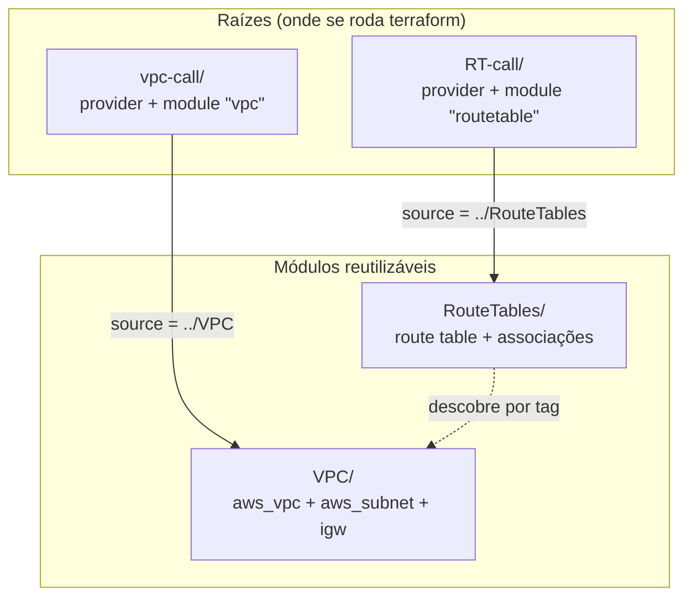
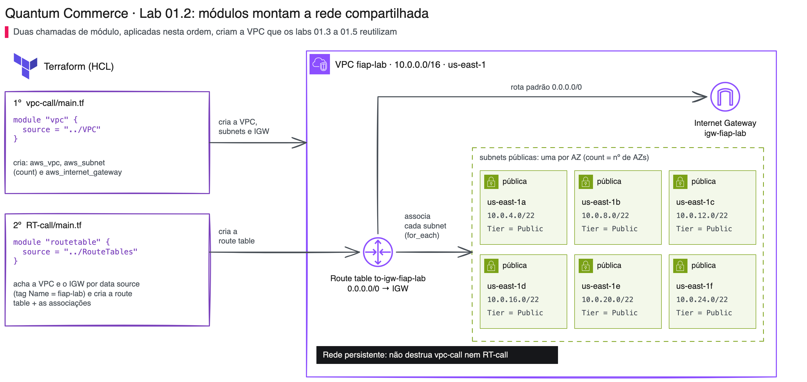
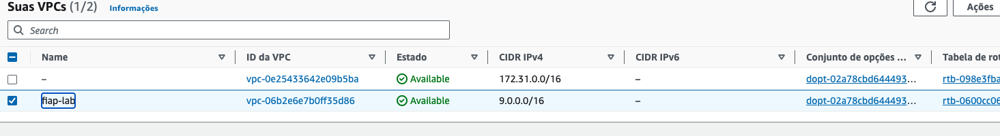
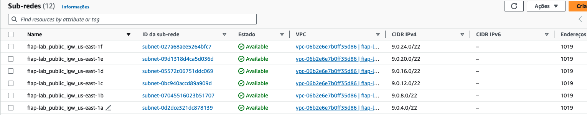

# 01.2 - Módulos: a rede compartilhada da Quantum Commerce

> **Terça-feira, 14h. Aula 2 na Quantum Commerce: a rede que todas as iniciativas de IA vão usar.**
> A EC2 da demo anterior provou que o time consegue criar e destruir um ambiente em código. Só que o Assistente de Rastreio e Políticas não está sozinho: o Personal Stylist Virtual e a Categorização do Catálogo também vão precisar de servidores, e servidor precisa de rede. **Helena Marques**, Head de Engenharia de IA e Entrega Contínua, já viu esse filme:
>
> > *— "Se cada equipe escrever a própria VPC, em seis meses teremos três redes diferentes, três jeitos de errar e ninguém sabendo qual é a certa. Quero a rede escrita **uma vez**, num bloco que qualquer equipe chame. E quero que ela fique de pé: as próximas demos vão colocar servidores dentro dela."*
>
> **Diego Tavares**, AI SRE sênior, complementa: *— "Isso tem nome no Terraform: **módulo**. É como uma receita: escrevemos a rede uma vez numa pasta e as outras pastas só dizem 'use aquela receita'. Mudou a regra de rede? Muda num lugar só."*

Os comandos `bash` deste lab rodam **no terminal do Codespaces**. As verificações visuais são feitas **no console da AWS** (painel VPC).

Nunca usou Terraform, um terminal ou Git? Tudo bem: cada passo diz o que fazer, onde rodar, o que deve aparecer e o que fazer se aparecer outra coisa. Copie o bloco cinza inteiro, cole no terminal do Codespaces e aperte Enter. Se aparecer uma mensagem começando com `Error:`, pare no passo em que está e abra o bloco **⚠ Se der erro** logo abaixo dele.

> [!WARNING]
> **Pré-requisitos obrigatórios antes de começar:**
>
> - [ ] [Lab 01.1 — Plan e Apply](../01-Plan-Apply/README.md) concluído (você entende o ciclo `init`/`plan`/`apply`/`destroy`)
> - [ ] Credenciais AWS do Academy atualizadas no Codespaces
> - [ ] Terraform instalado (`terraform -version` → 1.x)
> - [ ] Você consegue abrir o [painel VPC](https://us-east-1.console.aws.amazon.com/vpc/home?region=us-east-1#vpcs:)
>
> **Valide rapidamente:**
>
> ```bash
> aws sts get-caller-identity
> ```
>
> **O que você vai fazer:** subir uma VPC com subnets públicas em todas as AZs (via um módulo), depois subir as route tables (via outro módulo), ver os dois módulos colaborando e, por fim, adotar e renomear um Security Group criado à mão (`import` e `moved`). **Tempo estimado: ~45 min** (execução pura ~8 min + tempo para ler, copiar e conferir).

> [!IMPORTANT]
> **A rede que você cria aqui é permanente.** A VPC `fiap-lab`, as subnets, o Internet Gateway e as route tables ficam de pé até o fim do curso: as demos 01.3 (Count), 01.4 (State), 01.5 (Workspaces), o módulo de Ansible e o Trabalho Final colocam servidores **dentro desta rede** e a encontram pelo nome `fiap-lab`. **Nunca rode `terraform destroy` nas pastas `vpc-call` e `RT-call`.** VPC, subnets, IGW e route tables não cobram por hora; o que custa são as EC2 e os load balancers, que cada demo destrói ao final.

## Principais pontos de aprendizagem

- o que é um módulo e por que pastas com sufixo `-call` o invocam
- referenciar um módulo local com `source`
- criar recursos dinamicamente em todas as AZs com `count` + `data source`
- separar a criação de recursos (módulo) da invocação (raiz)

## O que você terá ao final

A rede compartilhada da Quantum Commerce (uma VPC com uma subnet pública por zona de disponibilidade, Internet Gateway e rotas para a internet) definida como **módulos reutilizáveis** e **de pé** para as próximas demos. Além disso, você adota no Terraform um recurso criado à mão (`import`) e o renomeia sem destruir (`moved`).

> [!TIP]
> Sempre que encontrar um bloco **💡 Clique para entender**, abra-o. Ele aprofunda sem atrapalhar quem só quer seguir o passo a passo.

## Mapa do lab

| Parte | O que você faz | Passos | Tempo |
|-------|----------------|--------|-------|
| [Parte 1](#parte-1---subindo-a-vpc-via-módulo) | Subindo a VPC via módulo | [1](#passo-1) · [2](#passo-2) · [3](#passo-3) · [4](#passo-4) · [5](#passo-5) | ~12 min |
| [Parte 2](#parte-2---subindo-as-route-tables-via-módulo) | Subindo as route tables via módulo | [6](#passo-6) · [7](#passo-7) · [8](#passo-8) · [9](#passo-9) · [10](#passo-10) | ~13 min |
| [Parte 3](#parte-3---adotando-um-recurso-criado-no-console-import) | Adotando um recurso criado no console (import) | [11](#passo-11) · [12](#passo-12) · [13](#passo-13) · [14](#passo-14) | ~12 min |
| [Parte 4](#parte-4---refatorando-sem-destruir-moved) | Refatorando sem destruir (moved) | [15](#passo-15) · [16](#passo-16) · [17](#passo-17) | ~8 min |

> [!TIP]
> Se travou em algum passo, clique no número dele na coluna **Passos**.

## Contexto

| Aspecto | Resposta curta |
|---------|----------------|
| **Problema de negócio** | Três iniciativas de IA da Quantum Commerce precisam de rede. Se cada equipe copiar e colar as 40 linhas de HCL da VPC, as cópias divergem com o tempo e ninguém sabe qual é a certa. |
| **Pergunta que módulo responde bem** | "Como reutilizar a mesma rede em N equipes ou ambientes mudando só os parâmetros?" |
| **Pergunta que módulo responde mal** | "Como representar uma rede totalmente diferente, sem nada em comum?" (aí o módulo só atrapalha). |
| **Quando acontece na vida real** | Toda empresa que cresce: a primeira VPC é escrita à mão; na terceira, vira módulo. |

A estrutura de pastas conta a história: as pastas `VPC` e `RouteTables` **definem** módulos (os blocos reutilizáveis); as pastas `vpc-call` e `RT-call` **invocam** esses módulos. A raiz (onde você roda `terraform init`) é sempre a `-call` — ela carrega o provider e chama o módulo.



O diagrama abaixo mostra a rede que fica de pé na AWS ao final da Parte 2: a VPC `fiap-lab` (10.0.0.0/16) na região us-east-1, com uma subnet pública em cada zona de disponibilidade (us-east-1a até us-east-1f), o Internet Gateway `igw-fiap-lab` anexado e a route table `to-igw-fiap-lab`, que manda todo o tráfego para a internet (`0.0.0.0/0`) ao IGW e está associada às seis subnets. Do lado do código, ele mostra quem cria o quê: o módulo `VPC/` (chamado por `vpc-call`) cria VPC, subnets e IGW; o módulo `RouteTables/` (chamado por `RT-call`) descobre a VPC pela tag `Name = fiap-lab` e cria a route table e as associações. Por fim, indica que as demos seguintes usam essa mesma rede.



<details>
<summary><b>💡 Clique para entender: o que é um módulo no Terraform</b></summary>
<blockquote>

Um **módulo** é um conjunto de arquivos `.tf` agrupados que encapsulam recursos relacionados, permitindo reúso e organização. Pense numa função: você escreve a lógica uma vez e chama com argumentos diferentes.

- As pastas com sufixo **`-call`** são os **pontos de entrada**: invocam módulos e passam parâmetros. É nelas que mora o `provider` e onde se roda `terraform init`/`apply`.
- As pastas de **módulo** (`VPC`, `RouteTables`) contêm a definição dos recursos e **não** declaram o provider — quem fornece o provider é a raiz que as chama.

Exemplo de invocação:

```hcl
module "vpc" {
  source = "../VPC"
}
```

Documentação oficial: [Módulos no Terraform](https://developer.hashicorp.com/terraform/language/modules)

</blockquote>
</details>

---

## Parte 1 - Subindo a VPC via módulo

### Resultado esperado desta parte

Uma VPC com uma subnet pública por zona de disponibilidade e um Internet Gateway, todos criados por um módulo invocado a partir de `vpc-call`.

---

<a id="passo-1"></a>

**1.** Entre na pasta que invoca o módulo de VPC:

```bash
cd /workspaces/FIAP-AI-Devops-CICD/01-Terraform/demos/02-Modules/vpc-call
```

---

<a id="passo-2"></a>

**2.** Inicialize (note que o `init` também baixa o módulo local `../VPC`):

```bash
cd /workspaces/FIAP-AI-Devops-CICD/01-Terraform/demos/02-Modules/vpc-call
terraform init
```

> Saída esperada: `Terraform has been successfully initialized!`

---

<a id="passo-3"></a>

**3.** Gere o plano (ele só **mostra** o que será criado, sem criar nada):

```bash
cd /workspaces/FIAP-AI-Devops-CICD/01-Terraform/demos/02-Modules/vpc-call
terraform plan
```

> Saída esperada (última linha):
>
> ```text
> Plan: 8 to add, 0 to change, 0 to destroy.
> ```

São 8 recursos: 1 VPC, 1 Internet Gateway e 6 subnets (us-east-1 tem 6 zonas de disponibilidade). Se aparecer `Error: No valid credential sources found`, suas credenciais do Academy expiraram: atualize-as e rode o passo de novo.

---

<a id="passo-4"></a>

**4.** Aplique (agora sim a rede é criada na AWS; leva cerca de 30 segundos):

> [!IMPORTANT]
> **Go/no-go antes do `apply`.** Se você já criou a rede numa aula anterior, NÃO rode este passo de novo: um segundo `apply` num Codespace novo cria uma SEGUNDA VPC `fiap-lab`, e as próximas demos passam a falhar com `multiple EC2 VPCs matched`. Confira primeiro:
>
> ```bash
> aws ec2 describe-vpcs --filters "Name=tag:Name,Values=fiap-lab" --query "Vpcs[].VpcId" --output text
> ```
>
> Saída vazia: siga com o `apply` abaixo. Saiu um `vpc-...`: a rede já existe; pule para o [passo 5](#passo-5).

```bash
cd /workspaces/FIAP-AI-Devops-CICD/01-Terraform/demos/02-Modules/vpc-call
terraform apply -auto-approve
```

> Saída esperada (última linha):
>
> ```text
> Apply complete! Resources: 8 added, 0 changed, 0 destroyed.
> ```

<details>
<summary><b>⚠ Se der erro: <code>multiple EC2 VPCs matched</code> (agora ou numa demo seguinte)</b></summary>
<blockquote>

Existem duas VPCs com o nome `fiap-lab`, normalmente porque o passo 4 rodou de novo num Codespace novo. Liste as duas:

```bash
aws ec2 describe-vpcs --filters "Name=tag:Name,Values=fiap-lab" --query "Vpcs[].[VpcId,CidrBlock]" --output table
```

Não apague nenhuma por conta própria: as demos seguintes podem já ter servidores dentro da VPC original. Leve essa tabela ao professor (veja "Como pedir ajuda" no fim do lab).

</blockquote>
</details>

<details>
<summary><b>💡 Clique para entender: o código do módulo VPC</b></summary>
<blockquote>

**`vpc-call/main.tf`** (a raiz) apenas chama o módulo:

```hcl
module "vpc" {
  source = "../VPC"
}
```

O provider fica em `vpc-call/provider.tf` e as versões em `vpc-call/versions.tf` — o módulo filho **não** repete isso.

Dentro do módulo `VPC/`:

**`vars.tf`** define variáveis e descobre as AZs da região:

```hcl
data "aws_availability_zones" "available" {}

variable "project"       { default = "fiap-lab" }
variable "vpc_cidr"      { default = "10.0.0.0/16" } # faixa privada RFC 1918
variable "subnet_escale" { default = 6 }
variable "env"           { default = "prod" }
```

**`vpc.tf`** cria a VPC e **uma subnet por AZ** usando `count`:

```hcl
resource "aws_vpc" "vpc_created" {
  cidr_block           = var.vpc_cidr
  enable_dns_support   = true
  enable_dns_hostnames = true
  tags = { Name = var.project, env = var.env }
}

resource "aws_subnet" "public_igw" {
  count                   = length(data.aws_availability_zones.available.names)
  vpc_id                  = aws_vpc.vpc_created.id
  cidr_block              = cidrsubnet(var.vpc_cidr, var.subnet_escale, count.index + 1)
  map_public_ip_on_launch = true
  availability_zone       = data.aws_availability_zones.available.names[count.index]
  tags = {
    Name = "${var.project}_public_igw_${data.aws_availability_zones.available.names[count.index]}"
    Tier = "Public"
    env  = var.env
  }
}
```

- `count = length(...)` cria tantas subnets quantas AZs existirem na região
- `cidrsubnet(...)` fatia o CIDR da VPC em blocos menores, um por subnet
- a tag `Tier = "Public"` é o que a Parte 2 vai usar para **descobrir** essas subnets

<details>
<summary><b>💡 Clique para entender: aqui usamos <code>count</code>, mas e <code>for_each</code>?</b></summary>
<blockquote>

Esta é uma das decisões mais importantes ao iterar recursos. Usamos `count` aqui porque o conjunto de AZs é estável dentro de uma região e queremos "uma subnet por AZ, na ordem". Mas vale conhecer o trade-off:

- **`count`** indexa por **número** (`aws_subnet.public_igw[0]`, `[1]`, ...). Se um item **no meio** da lista some, todos os índices seguintes "andam uma casa" — o Terraform acha que vários recursos mudaram e pode **destruir e recriar** o que era só um deslocamento.
- **`for_each`** indexa por **chave** (`aws_subnet.public_igw["us-east-1a"]`). Remover um item afeta **só aquele** — os demais ficam intactos.

Regra prática difundida (Brikman, *Terraform: Up & Running*): use `count` para "N cópias idênticas" e para liga/desliga (`count = var.flag ? 1 : 0`); use **`for_each` quando cada item tem identidade própria** (nomes, AZs, mapas de config). Aqui, como AZs têm identidade, `for_each = toset(data.aws_availability_zones.available.names)` seria a opção mais robusta — mantivemos `count` por ser o primeiro contato e mais simples de ler. Você verá `for_each` em ação na Parte 2 (associações de route table).

Documentação oficial: [for_each](https://developer.hashicorp.com/terraform/language/meta-arguments/for_each) · [count](https://developer.hashicorp.com/terraform/language/meta-arguments/count)

</blockquote>
</details>

**`igw.tf`** conecta a VPC à internet:

```hcl
resource "aws_internet_gateway" "igw" {
  vpc_id = aws_vpc.vpc_created.id
  tags   = { Name = "igw-${var.project}", env = var.env }
}
```

Documentação oficial: [aws_vpc](https://registry.terraform.io/providers/hashicorp/aws/latest/docs/resources/vpc) · [count](https://developer.hashicorp.com/terraform/language/meta-arguments/count)

</blockquote>
</details>

---

<a id="passo-5"></a>

**5.** Confirme pelo terminal que a VPC existe e tem as subnets públicas:

```bash
VPC_ID=$(aws ec2 describe-vpcs --filters "Name=tag:Name,Values=fiap-lab" --query "Vpcs[0].VpcId" --output text)
echo "VPC: $VPC_ID"
aws ec2 describe-subnets --filters "Name=vpc-id,Values=$VPC_ID" "Name=tag:Tier,Values=Public" \
  --query "sort_by(Subnets,&AvailabilityZone)[].[AvailabilityZone,CidrBlock,MapPublicIpOnLaunch]" --output table
```

> Saída esperada: uma linha `VPC: vpc-...` e uma tabela com 6 linhas, de `us-east-1a` (`10.0.4.0/22`) até `us-east-1f` (`10.0.24.0/22`), todas com `True` (a subnet entrega IP público para quem nascer nela). O `vpc-...` muda de aluno para aluno; os CIDRs e as AZs são iguais para todos.

Se a primeira linha vier `VPC: None`, o `apply` do passo 4 não terminou: volte a ele. Para ver o mesmo pelo console: [VPCs](https://us-east-1.console.aws.amazon.com/vpc/home?region=us-east-1#vpcs:) e [Subnets](https://us-east-1.console.aws.amazon.com/vpc/home?region=us-east-1#subnets:).

<!-- TROCAR-IMAGEM: images/vpccreated.png | motivo: mostra o CIDR antigo 9.0.x; o código cria 10.0.0.0/16 e subnets 10.0.4.0/22 a 10.0.24.0/22 | capturar: console VPC > Suas VPCs filtrando por fiap-lab, depois do passo 4 -->


*Print de uma execução anterior: os nomes estão certos, mas o seu console mostra o CIDR 10.0.x, como na tabela acima.*

<!-- TROCAR-IMAGEM: images/subnetscreated.png | motivo: mostra o CIDR antigo 9.0.x; o código cria 10.0.0.0/16 e subnets 10.0.4.0/22 a 10.0.24.0/22 | capturar: console VPC > Sub-redes filtrando por fiap-lab, depois do passo 4 -->


*Print de uma execução anterior: os nomes estão certos, mas o seu console mostra o CIDR 10.0.x, como na tabela acima.*

### Checkpoint

Se chegou até aqui:

- a VPC `fiap-lab` existe
- há uma subnet pública por AZ (tag `Tier=Public`)
- o Internet Gateway está associado à VPC

---

## Parte 2 - Subindo as route tables via módulo

### Resultado esperado desta parte

Uma route table apontando para o Internet Gateway, associada a todas as subnets públicas — criada por um segundo módulo que **descobre** a VPC e o IGW criados na Parte 1.

---

<a id="passo-6"></a>

**6.** Volte para a pasta de módulos e entre na que invoca as route tables:

```bash
cd /workspaces/FIAP-AI-Devops-CICD/01-Terraform/demos/02-Modules/RT-call
```

> [!NOTE]
> A pasta se chama exatamente `RT-call` (com `RT` maiúsculo). O `cd` acima já usa o nome correto.

---

<a id="passo-7"></a>

**7.** Inicialize:

```bash
cd /workspaces/FIAP-AI-Devops-CICD/01-Terraform/demos/02-Modules/RT-call
terraform init
```

---

<a id="passo-8"></a>

**8.** Gere o plano:

```bash
cd /workspaces/FIAP-AI-Devops-CICD/01-Terraform/demos/02-Modules/RT-call
terraform plan
```

> Saída esperada (última linha):
>
> ```text
> Plan: 7 to add, 0 to change, 0 to destroy.
> ```

São 7 recursos: 1 route table e 6 associações (uma por subnet). Repare que o plano **não** cria VPC nem IGW: ele só os **encontra**.

<details>
<summary><b>⚠ Se der erro: <code>no matching EC2 VPC found</code></b></summary>
<blockquote>

O módulo de rotas procura a VPC pela tag `Name = fiap-lab` e não achou. A Parte 1 não foi aplicada (ou foi aplicada em outra região). Volte ao [passo 4](#passo-4), confirme o `Apply complete!` e rode este passo de novo.

</blockquote>
</details>

---

<a id="passo-9"></a>

**9.** Aplique:

```bash
cd /workspaces/FIAP-AI-Devops-CICD/01-Terraform/demos/02-Modules/RT-call
terraform apply -auto-approve
```

> Saída esperada (última linha):
>
> ```text
> Apply complete! Resources: 7 added, 0 changed, 0 destroyed.
> ```

<details>
<summary><b>💡 Clique para entender: o código do módulo RouteTables</b></summary>
<blockquote>

**`RT-call/main.tf`** chama o módulo:

```hcl
module "routetable" {
  source = "../RouteTables"
}
```

Dentro de `RouteTables/`:

**`vars.tf`** **descobre** a VPC e o IGW que a Parte 1 criou, usando data sources por tag/filtro (não recria nada):

```hcl
data "aws_vpc" "vpc" {
  tags = { Name = var.project }
}

data "aws_internet_gateway" "igw" {
  filter {
    name   = "attachment.vpc-id"
    values = [data.aws_vpc.vpc.id]
  }
}
```

**`routetable.tf`** cria a rota padrão para a internet:

```hcl
resource "aws_route_table" "to-igw" {
  vpc_id = data.aws_vpc.vpc.id
  route {
    cidr_block = "0.0.0.0/0"
    gateway_id = data.aws_internet_gateway.igw.id
  }
  tags = { Name = "to-igw-${var.project}", env = var.env }
}
```

**`public.tf`** descobre as subnets públicas (pela tag `Tier=Public`) e associa cada uma à route table:

```hcl
data "aws_subnets" "all" {
  filter { name = "tag:Tier", values = ["Public"] }
  filter { name = "vpc-id",   values = [data.aws_vpc.vpc.id] }
}

data "aws_subnet" "public" {
  for_each = toset(data.aws_subnets.all.ids)
  id       = each.value
}

resource "aws_route_table_association" "public_association" {
  for_each       = data.aws_subnet.public
  subnet_id      = each.value.id
  route_table_id = aws_route_table.to-igw.id
}
```

Esse é o padrão profissional: **um módulo entrega a rede, outro entrega o roteamento**, e o segundo descobre o primeiro por tags — sem acoplamento rígido.

Documentação oficial: [aws_route_table](https://registry.terraform.io/providers/hashicorp/aws/latest/docs/resources/route_table) · [for_each](https://developer.hashicorp.com/terraform/language/meta-arguments/for_each)

</blockquote>
</details>

---

<a id="passo-10"></a>

**10.** Confirme que a rede está completa e que o Terraform não quer mudar mais nada:

```bash
VPC_ID=$(aws ec2 describe-vpcs --filters "Name=tag:Name,Values=fiap-lab" --query "Vpcs[0].VpcId" --output text)
aws ec2 describe-route-tables --filters "Name=vpc-id,Values=$VPC_ID" "Name=tag:Name,Values=to-igw-fiap-lab" \
  --query "RouteTables[0].{rotas:Routes[].[DestinationCidrBlock,GatewayId],associacoes:length(Associations)}" --output json
cd /workspaces/FIAP-AI-Devops-CICD/01-Terraform/demos/02-Modules/vpc-call && terraform plan
cd /workspaces/FIAP-AI-Devops-CICD/01-Terraform/demos/02-Modules/RT-call && terraform plan
```

> Saída esperada: o JSON mostra a rota `0.0.0.0/0` apontando para um `igw-...` e `"associacoes": 6`. Os dois `plan` terminam com:
>
> ```text
> No changes. Your infrastructure matches the configuration.
> ```

`No changes` é a prova de que o código e a AWS estão iguais. Se um dos `plan` mostrar `to add`, o `apply` daquela pasta não terminou: rode o passo 4 (vpc-call) ou o 9 (RT-call) de novo, ele pode ser repetido sem duplicar nada. Pelo console: [painel VPC → Route Tables](https://us-east-1.console.aws.amazon.com/vpc/home?region=us-east-1#RouteTables:), route table `to-igw-fiap-lab`.

### Checkpoint

Se chegou até aqui:

- existe uma route table apontando para o IGW
- todas as subnets públicas estão associadas a ela
- a rede da Quantum Commerce está pronta para receber servidores e **fica de pé** (não destrua `vpc-call` nem `RT-call`)

---

## Parte 3 - Adotando um recurso criado no console (import)

> Diego puxa uma cadeira: *— "Os protótipos de IA da Quantum nasceram clicados no console. Tem um Security Group que alguém criou na mão e ninguém colocou no código. Não dá para apagar e recriar: tem regra de produção nele. Vamos **adotar** esse recurso no Terraform, sem destruir."*

### Resultado esperado desta parte

Você vai pegar um recurso que existe na AWS mas **não** está no seu código, e trazê-lo para o Terraform com um **`import` block** — sem recriar o recurso. Para simular o "criado na mão", nós mesmos criamos um Security Group pela AWS CLI.

---

<a id="passo-11"></a>

**11.** Crie um Security Group **por fora do Terraform** (simulando o que alguém fez no console), na VPC `fiap-lab` que você acabou de criar:

```bash
cd /workspaces/FIAP-AI-Devops-CICD/01-Terraform/demos/02-Modules
VPC_ID=$(aws ec2 describe-vpcs --filters "Name=tag:Name,Values=fiap-lab" --query "Vpcs[0].VpcId" --output text)
SG_ID=$(aws ec2 create-security-group \
  --group-name quantum-legado-sg \
  --description "SG criado na mao para demo de import" \
  --vpc-id "$VPC_ID" \
  --query 'GroupId' --output text)
echo "Security Group criado na mão: $SG_ID (na VPC $VPC_ID)"
```

> Saída esperada: `Security Group criado na mão: sg-... (na VPC vpc-...)`. Os IDs mudam de aluno para aluno.

<details>
<summary><b>⚠ Se der erro: <code>InvalidGroup.Duplicate</code> ou o terminal foi fechado</b></summary>
<blockquote>

O SG `quantum-legado-sg` já existe (você rodou o passo duas vezes) ou o terminal perdeu a variável `$SG_ID`. Recupere o ID do SG que já existe, sem criar outro:

```bash
SG_ID=$(aws ec2 describe-security-groups --filters "Name=group-name,Values=quantum-legado-sg" --query "SecurityGroups[0].GroupId" --output text)
echo "$SG_ID"
```

Use o mesmo comando sempre que um passo adiante reclamar de `sg_id` vazio.

</blockquote>
</details>

> [!NOTE]
> Esse SG agora existe na AWS, mas o Terraform **não sabe** que ele existe — não está em nenhum `.tf` nem no estado. É o cenário clássico de infraestrutura legada.

---

<a id="passo-12"></a>

**12.** Entre na pasta `import-demo`, que **já existe no repositório** com o arquivo `import.tf` pronto. Você **não precisa criar nem editar nada aqui** — só entrar e abrir o arquivo para ver o que ele faz:

```bash
cd /workspaces/FIAP-AI-Devops-CICD/01-Terraform/demos/02-Modules/import-demo
code import.tf
```

O arquivo `import.tf` já está assim (não altere — apenas leia):

```hcl
# ID do Security Group criado "na mao" no passo 11. Voce passa este valor na linha
# de comando (-var "sg_id=$SG_ID"), entao NAO precisa editar este arquivo.
variable "sg_id" {
  type = string
}

# A VPC da Quantum Commerce e descoberta por tag (igual as outras demos), entao nao e
# preciso colar o id da VPC em lugar nenhum.
data "aws_vpc" "vpc" {
  tags = { Name = "fiap-lab" }
}

# O import block diz: "este recurso ja existe na AWS com este id; passe a
# gerencia-lo com este endereco no Terraform". Declarativo e versionavel.
import {
  to = aws_security_group.legado
  id = var.sg_id
}

resource "aws_security_group" "legado" {
  name        = "quantum-legado-sg"
  description = "SG criado na mao para demo de import"
  vpc_id      = data.aws_vpc.vpc.id
}
```

> [!NOTE]
> Repare: não há `sg-xxxx` nem `vpc-xxxx` para você substituir. O **ID do Security Group** entra pela variável `sg_id` (você passa na linha de comando, com a variável `$SG_ID` que já está no seu terminal desde o passo 11), e a **VPC** é descoberta automaticamente pela tag `fiap-lab`. Assim você não corre o risco de colar o ID errado no arquivo.

<details>
<summary><b>💡 Clique para entender: import block vs. terraform import (CLI)</b></summary>
<blockquote>

Existem duas formas de adotar um recurso existente:

- **`terraform import` (CLI, forma antiga):** um comando imperativo que mexe direto no estado. Não fica registrado em lugar nenhum — quem revisar o PR não vê o que foi importado.
- **`import {}` block (TF 1.5+, forma moderna):** declarativo, **versionado no código**, revisável em PR, e funciona com `-generate-config-out` para gerar o HCL do recurso automaticamente. É o caminho recomendado hoje.

A vantagem do bloco: a adoção de infra legada vira parte do histórico do repositório, não um comando solto que alguém rodou uma vez.

Documentação oficial: [Import block](https://developer.hashicorp.com/terraform/language/import)

</blockquote>
</details>

---

<a id="passo-13"></a>

**13.** Inicialize e rode o `plan`, passando o ID do Security Group pela variável `sg_id` (a variável `$SG_ID` já está no seu terminal desde o passo 11). O Terraform mostra `1 to import` — ele vai **adotar** o recurso, não criar um novo:

```bash
cd /workspaces/FIAP-AI-Devops-CICD/01-Terraform/demos/02-Modules/import-demo
terraform init
terraform plan -var "sg_id=$SG_ID"
```

> Saída esperada (última linha):
>
> ```text
> Plan: 1 to import, 0 to add, 0 to change, 0 to destroy.
> ```

<details>
<summary><b>⚠ Se der erro: o <code>plan</code> pede <code>var.sg_id</code> ou reclama de ID vazio</b></summary>
<blockquote>

A variável `$SG_ID` está vazia: o terminal foi reaberto depois do passo 11. Recupere o ID com o comando do troubleshoot do [passo 11](#passo-11) e rode este passo de novo.

</blockquote>
</details>

> [!TIP]
> O `-var "sg_id=$SG_ID"` injeta o ID na variável do arquivo, sem você editar nada. Se preferir nem escrever o `resource` à mão, o Terraform também consegue **gerá-lo** a partir do que existe na AWS com `terraform plan -generate-config-out=gerado.tf` — ótimo para recursos grandes (um SG com dezenas de regras).

---

<a id="passo-14"></a>

**14.** Aplique a adoção e confirme que o recurso entrou no estado:

```bash
cd /workspaces/FIAP-AI-Devops-CICD/01-Terraform/demos/02-Modules/import-demo
terraform apply -auto-approve -var "sg_id=$SG_ID"
terraform state list
```

> Saída esperada:
>
> ```text
> Apply complete! Resources: 1 imported, 0 added, 0 changed, 0 destroyed.
> data.aws_vpc.vpc
> aws_security_group.legado
> ```

Você verá `aws_security_group.legado` no estado. **O recurso não foi recriado** — o mesmo `SG_ID` de antes agora é gerenciado pelo Terraform.

### Checkpoint

Se chegou até aqui, você:

- criou um recurso "na mão" (fora do Terraform)
- adotou esse recurso com um `import` block, sem recriá-lo
- confirmou que ele agora vive no estado do Terraform

---

## Parte 4 - Refatorando sem destruir (moved)

> Diego de novo: *— "Esse nome `legado` foi só para a demo. Na vida real você vai querer **renomear** recursos conforme o código evolui. Só que renomear um recurso no Terraform, ingenuamente, faz ele **destruir e recriar**. Existe um jeito de avisar o Terraform que é só um rename."*

### Resultado esperado desta parte

Você vai renomear o recurso importado usando um **`moved` block**, provando que o Terraform apenas **move o endereço no estado** — sem destruir nem recriar nada.

---

<a id="passo-15"></a>

**15.** Agora vamos **renomear** o recurso de `legado` para `quantum` sem destruí-lo. A adoção (import) já aconteceu, então faça **três pequenas mudanças** no `import.tf`. Abra o arquivo:

```bash
cd /workspaces/FIAP-AI-Devops-CICD/01-Terraform/demos/02-Modules/import-demo
code import.tf
```

Faça exatamente estas três alterações (o resto do arquivo continua igual — não mexa na `variable`, no `data` nem no `provider`):

**15.1.** **Apague** o bloco `import { ... }` inteiro (a adoção já foi feita, ele não é mais necessário):

```hcl
# APAGUE estas 4 linhas:
import {
  to = aws_security_group.legado
  id = var.sg_id
}
```

**15.2.** **No lugar dele**, adicione o bloco `moved`:

```hcl
# moved diz: "o recurso que se chamava .legado agora se chama .quantum".
# O Terraform so atualiza o endereco no estado, nao destroi nada.
moved {
  from = aws_security_group.legado
  to   = aws_security_group.quantum
}
```

**15.3.** Na linha que abre o `resource`, troque o nome `legado` por `quantum` (só o nome depois de `aws_security_group`; o `name = "quantum-legado-sg"` dentro do bloco continua igual):

```hcl
resource "aws_security_group" "quantum" {
```

**15.4.** Salve o arquivo (**File → Save**, ou `Ctrl+S` / `Cmd+S`).

> [!NOTE]
> Você **não** precisa mexer no `vpc_id` — ele continua descobrindo a VPC pela tag automaticamente. A única coisa que muda é o **nome** do recurso (`legado` → `quantum`) e a troca do `import` pelo `moved`.

---

<a id="passo-16"></a>

**16.** Rode o `plan` (continue passando o `-var`). A mensagem-chave é `has moved to`, e o resumo é `0 to add, 0 to change, 0 to destroy`:

```bash
cd /workspaces/FIAP-AI-Devops-CICD/01-Terraform/demos/02-Modules/import-demo
terraform plan -var "sg_id=$SG_ID"
```

> Saída esperada:
>
> ```text
>   # aws_security_group.legado has moved to aws_security_group.quantum
> Plan: 0 to add, 0 to change, 0 to destroy.
> ```

Se o plano mostrar `1 to add` e `1 to destroy`, faltou o bloco `moved` (passo 15.2) ou o nome no `moved` não bate com o do `resource`: confira as duas linhas e rode de novo.

<details>
<summary><b>💡 Clique para entender: moved vs. renomear ingenuamente</b></summary>
<blockquote>

O endereço de um recurso no Terraform (ex: `aws_security_group.legado`) é a chave que liga o código ao objeto real no estado. Se você simplesmente troca o nome no código, o Terraform pensa que o recurso antigo **sumiu** (destrói) e que um novo **apareceu** (cria) — em produção, isso é downtime.

O **`moved` block** (TF 1.1+) avisa: "isto é um rename, não uma troca". O Terraform só atualiza o endereço no estado, mantendo o recurso real intacto. Fica versionado no código, então o histórico explica a refatoração — e você pode remover o bloco depois que todos os ambientes aplicaram.

Documentação oficial: [moved block](https://developer.hashicorp.com/terraform/language/moved)

</blockquote>
</details>

---

<a id="passo-17"></a>

**17.** Aplique o rename, limpe o recurso da demo e devolva o arquivo ao original. Em três etapas separadas, para ler cada saída com calma:

**17.1.** Aplique o `moved`:

```bash
cd /workspaces/FIAP-AI-Devops-CICD/01-Terraform/demos/02-Modules/import-demo
terraform apply -auto-approve -var "sg_id=$SG_ID"
```

> [!NOTE]
> Observe na saída a mensagem `aws_security_group.legado has moved to aws_security_group.quantum` e o resumo `0 added, 0 changed, 0 destroyed` — o recurso **não foi recriado**, só mudou de nome no estado.

**17.2.** Destrua **só o Security Group** da demo. Ele existiu apenas para o exercício de import/moved. Este `destroy` roda dentro de `import-demo`, cujo estado conhece um único recurso (o SG); a VPC e as route tables pertencem aos estados de `vpc-call` e `RT-call` e não são tocadas:

```bash
cd /workspaces/FIAP-AI-Devops-CICD/01-Terraform/demos/02-Modules/import-demo
terraform destroy -auto-approve -var "sg_id=$SG_ID"
```

> Saída esperada (última linha):
>
> ```text
> Destroy complete! Resources: 1 destroyed.
> ```

Se o número for diferente de `1`, pare e confira se você está na pasta `import-demo`: o `cd` acima garante isso.

**17.3.** Desfaça a edição que o passo 15 fez no `import.tf`, para o arquivo voltar ao original e o `git pull` da próxima aula não esbarrar nele:

```bash
cd /workspaces/FIAP-AI-Devops-CICD && git restore 01-Terraform/demos/02-Modules/import-demo/import.tf && git status --short 01-Terraform/demos/02-Modules/import-demo/import.tf
```

> Saída esperada: nenhuma linha (o arquivo voltou a ser igual ao do repositório).

### Checkpoint

Se chegou até aqui, você:

- adotou um recurso existente com `import` (sem recriá-lo)
- renomeou esse recurso com `moved`, sem destruí-lo (`0 to destroy`)
- destruiu só o SG da demo (a VPC, as subnets e as route tables permanecem de pé)

---

## Conclusão

Componentizamos a rede da Quantum Commerce em dois módulos reutilizáveis: um para VPC, subnets e IGW, outro para o roteamento. A raiz (`-call`) só invoca; o módulo define. Mudou a regra de rede? Muda no módulo, uma vez. E fomos além: **adotamos** um recurso criado à mão (`import`) e o **renomeamos sem destruir** (`moved`), duas ferramentas essenciais para quem herda infraestrutura clicada no console, exatamente o caso dos protótipos de IA da Quantum.

**Mensagem para Helena:** a rede agora é um módulo e está de pé. O Personal Stylist e a Categorização do Catálogo não escrevem a própria VPC: usam esta, encontrando-a pelo nome `fiap-lab`. O próximo passo é colocar servidores nessa rede e escalá-los só mudando um número.

**⏱️ Cronômetro de reprodutibilidade:** *recriar a rede de uma equipe*. Antes: dezenas de cliques no console, propenso a erro e impossível de auditar. Agora: **dois `apply` (VPC + rotas), idênticos para qualquer equipe.**

## Próximo passo

Abra o próximo lab: **[Lab 01.3 — Count](../03-Count/README.md)**.

Lá vamos subir uma frota de servidores web **dentro desta VPC**, atrás de um load balancer, e escalá-la de 2 para 3 e de volta para 1 só mudando o `count` — sem reescrever nada.

> [!CAUTION]
> **Não destrua a rede, nem agora nem depois.** A VPC `fiap-lab` é a fundação compartilhada do curso: Count, State, Workspaces, Ansible e Trabalho Final a usam. Cada demo destrói só o que ela mesma criou (EC2, load balancer); `vpc-call` e `RT-call` ficam de pé.

---

<details>
<summary><b>💡 Glossário rápido — termos que aparecem neste lab</b></summary>
<blockquote>

| Termo | O que é |
|-------|---------|
| **Módulo** | Conjunto de `.tf` reutilizável, invocado com `module "x" { source = ... }`. |
| **VPC** | Virtual Private Cloud — rede virtual isolada na AWS. |
| **Subnet** | Faixa de IPs dentro da VPC, atrelada a uma zona de disponibilidade. |
| **AZ (Availability Zone)** | Data center isolado dentro de uma região AWS. |
| **Internet Gateway (IGW)** | Componente que conecta a VPC à internet. |
| **Route Table** | Tabela de rotas que diz para onde o tráfego de uma subnet vai. |
| **Data source** | Bloco `data` que lê recursos existentes (aqui, descobre a VPC por tag). |
| **`count` / `for_each`** | Meta-argumentos que criam vários recursos a partir de uma definição. |
| **`cidrsubnet()`** | Função que fatia um bloco CIDR em sub-blocos menores. |

</blockquote>
</details>

<details>
<summary><b>💡 Como pedir ajuda se travou</b></summary>
<blockquote>

Antes de pedir ajuda, colete estas 4 informações:

1. **Em que passo você está** (ex.: "passo 9, `apply` do RT-call")
2. **Mensagem de erro literal** (texto do terminal, não screenshot)
3. **Saída de** `terraform state list` (na pasta do passo em que travou) e `aws sts get-caller-identity`
4. **O que você já tentou**

Canais (em ordem de prioridade):

- **Issues do repositório**: [github.com/vamperst/FIAP-AI-Devops-CICD/issues](https://github.com/vamperst/FIAP-AI-Devops-CICD/issues)
- **E-mail do professor**: `Rafael@rfbarbosa.com`
- **Antes de tudo**: se o `RT-call` reclamar que não acha a VPC, confirme que a Parte 1 (`vpc-call`) rodou com sucesso — o módulo de route table **descobre** a VPC por tag e precisa que ela exista.

</blockquote>
</details>
