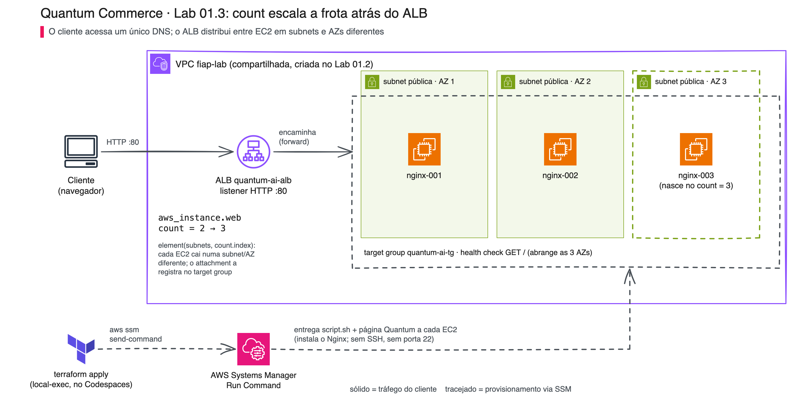
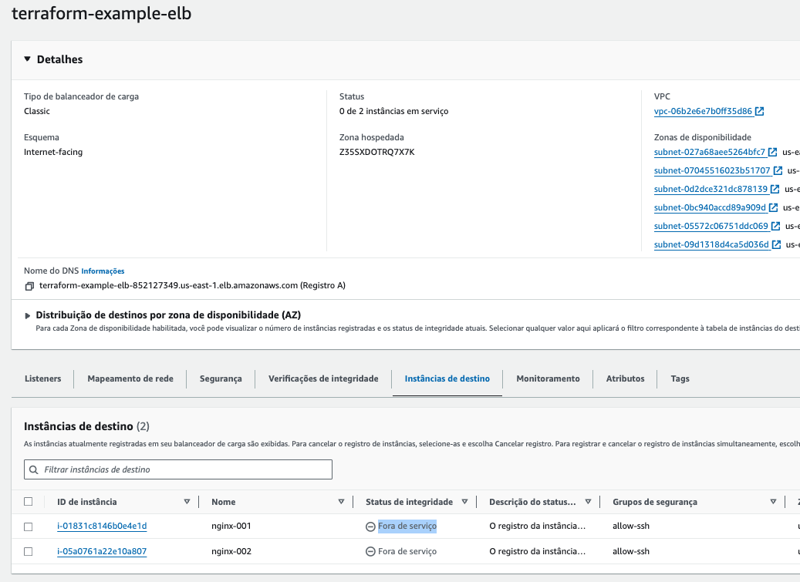
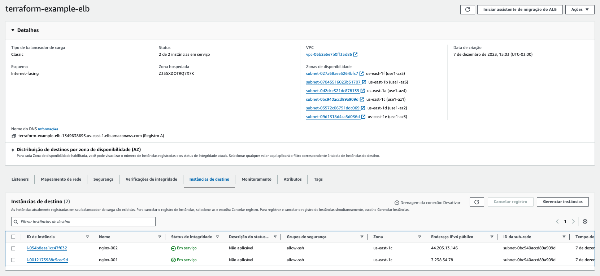
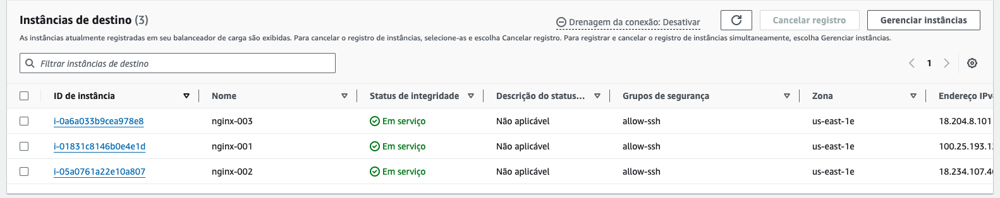

# 01.3 - Count: a camada web do assistente escala mudando um número

> **Quinta-feira, 11h. Aula 2 na Quantum Commerce: a primeira campanha de moda chega ao assistente.**
> A rede da demo anterior está de pé, e o Assistente de Rastreio e Políticas já tem uma página publicada. O Marketing confirmou a campanha de sexta: muito mais clientes vão abrir a página para perguntar "onde está meu pedido?". **Helena Marques**, Head de Engenharia de IA e Entrega Contínua, chega com a preocupação da operação:
>
> > *— "Uma única EC2 não aguenta o pico da campanha, e se ela cair o assistente some do ar. Quero **várias máquinas** atrás de um balanceador. Quero começar com 2, subir para 3 na sexta e voltar para 2 no sábado. E não quero reescrever a infraestrutura a cada vez: quero mudar **um número**."*
>
> **Diego Tavares**, AI SRE sênior, sorri: *— "É exatamente para isso que existe o `count`. Você descreve **uma** máquina e diz quantas quer. O Terraform cria as cópias e registra cada uma no balanceador. E a página vai dizer qual máquina respondeu, então dá para **ver** o balanceamento acontecendo."*

Os comandos `bash` deste lab rodam **no terminal do Codespaces**. As verificações visuais são feitas **no console da AWS** (painel EC2, menu **Target Groups**) e **no navegador**.

Nunca usou Terraform, um terminal ou Git? Tudo bem: cada passo diz o que fazer, onde rodar, o que deve aparecer e o que fazer se aparecer outra coisa. Copie o bloco cinza inteiro (ícone de copiar no canto do bloco), cole no terminal do Codespaces e aperte Enter. Se aparecer uma mensagem começando com `Error:` ou `ERRO:`, pare no passo em que está e abra o bloco **⚠ Se der erro** logo abaixo dele.

> [!WARNING]
> **Pré-requisitos obrigatórios antes de começar:**
>
> - [ ] [Lab 01.2 — Módulos](../02-Modules/README.md) concluído: a rede `fiap-lab` (VPC, subnets e rotas para o Internet Gateway) está de pé. Esta demo **só lê** essa rede; nada aqui a cria, altera ou destrói
> - [ ] Credenciais AWS do Academy atualizadas no Codespaces — ver [Preparando Credenciais](../../../00-create-codespaces/Inicio-de-aula.md)
> - [ ] AWS CLI e `jq` disponíveis (o devcontainer já entrega; o passo 2 confirma)
> - [ ] Você consegue abrir o [painel EC2 → Target Groups](https://us-east-1.console.aws.amazon.com/ec2/home?region=us-east-1#TargetGroups:): é nele que você vê as máquinas entrando e saindo do balanceador
>
> **Tempo estimado: ~35 min** (execução pura ~10 min, a maior parte esperando o load balancer ficar pronto, + tempo para ler, copiar comandos e observar o console).

**O que vamos fazer:** subir 2 servidores web atrás de um Application Load Balancer (ALB), escalar para 3 mudando um número, reduzir de volta para 2 e, no fim, destruir **só o que esta demo criou** (EC2, load balancer e security group). A rede continua de pé para os próximos labs.

## Principais pontos de aprendizagem

- usar `count` para criar N cópias de um recurso a partir de uma única definição
- distribuir as cópias entre subnets de zonas de disponibilidade diferentes com `element()` e `count.index`
- entender os papéis de **target group**, **listener** e **target group attachment** num ALB
- escalar para cima e para baixo mudando só o `count`, e ler o plano para saber o que vai mudar
- **ver** o balanceamento: cada máquina serve a mesma página, mas com o próprio hostname no rodapé

## O que você terá ao final

Uma camada web do assistente atrás de um load balancer, que escala de 2 para 3 (e volta) **mudando um número**. Recarregando a página, você vê máquinas diferentes respondendo. Ainda não há IA integrada: a página é estática, e diz isso.

> [!TIP]
> Sempre que encontrar um bloco **💡 Clique para entender**, abra-o. Ele aprofunda, mas não é obrigatório para seguir.

## Mapa do lab

| Parte | O que você faz | Passos | Tempo |
|-------|----------------|--------|-------|
| [Parte 1](#parte-1---subindo-a-camada-web-com-2-máquinas) | Confere a rede, sobe 2 EC2 atrás do ALB e vê o balanceamento | [1](#passo-1) · [2](#passo-2) · [3](#passo-3) · [4](#passo-4) · [5](#passo-5) · [6](#passo-6) · [7](#passo-7) · [8](#passo-8) | ~22 min |
| [Parte 2](#parte-2---escalando-e-reduzindo-com-um-número) | Escala para 3, reduz para 2 e limpa só o que é desta demo | [9](#passo-9) · [10](#passo-10) · [11](#passo-11) · [12](#passo-12) · [13](#passo-13) · [14](#passo-14) · [15](#passo-15) | ~13 min |

## Por que essa abordagem existe

| Aspecto | Resposta curta |
|---------|----------------|
| **Problema de negócio** | A Quantum Commerce precisa variar a capacidade da camada web conforme a demanda (campanha, fim de semana), rápido e sem retrabalho. |
| **Pergunta que responde bem** | "Quero N servidores **idênticos** atrás de um balanceador." |
| **Pergunta que responde mal** | "Quero servidores **diferentes entre si**": aí `count` é fraco e `for_each` ou módulos servem melhor. |
| **Quando acontece na vida real** | Escalar servidores web, workers de fila, réplicas de uma API de inferência. |

## Contexto

`count` é o jeito mais direto de criar várias cópias de um recurso. Você descreve a EC2 uma vez e escreve `count = 2`; o Terraform cria `aws_instance.web[0]` e `aws_instance.web[1]`. O load balancer não recebe as máquinas diretamente: cada EC2 é registrada num **target group** por um `aws_lb_target_group_attachment`, e como esse attachment também usa `count`, todas as máquinas entram no balanceador sozinhas. Para escalar, mudamos o número e rodamos `apply` de novo: o Terraform calcula a diferença e cria (ou destrói) só o que mudou.



O cliente acessa um único endereço (o DNS do `quantum-ai-alb`), e o ALB repassa cada requisição a uma das EC2 do `quantum-ai-tg`, cada uma numa zona diferente da VPC `fiap-lab`. A linha tracejada é o provisionamento: o `terraform apply` usa o SSM para entregar o `script.sh` e a página a cada máquina; a `nginx-003` só existe quando o `count` passa de 2 para 3.

O que é **infraestrutura real** e o que **ainda não existe** nesta demo:

| Componente | Estado nesta demo |
|---|---|
| Rede `fiap-lab` (VPC, subnets, rotas) | já existe, criada no Lab 01.2; aqui só é **lida** |
| ALB, target group, listener, security group | **criados** por esta demo |
| 2 ou 3 EC2 com Nginx | **criadas** por esta demo, provisionadas via SSM |
| Página do assistente | estática, a mesma em todas as máquinas; muda só o hostname |
| API de pedidos, RAG, modelo de IA | **ainda não integrados** (a própria página diz isso) |

---

## Parte 1 - Subindo a camada web com 2 máquinas

### Resultado esperado desta parte

Duas EC2 com Nginx registradas no target group de um ALB, ambas `healthy`, e o DNS do ALB servindo a página do assistente. Recarregando, o rodapé alterna entre os dois hostnames. As máquinas são provisionadas **via AWS Systems Manager (SSM), em paralelo, sem chave SSH e sem porta 22**.

---

<a id="passo-1"></a>

**1. Confira que a rede do Lab 01.2 está de pé**

Esta demo não cria rede: ela procura a VPC pela tag `Name=fiap-lab` e usa as subnets públicas dela. Se a rede não existir, o `plan` falha. Conferir agora custa 10 segundos. No terminal do Codespaces, rode:

```bash
VPC_ID=$(aws ec2 describe-vpcs --filters "Name=tag:Name,Values=fiap-lab" --query "Vpcs[0].VpcId" --output text)
echo "VPC: $VPC_ID"
aws ec2 describe-subnets --filters "Name=vpc-id,Values=$VPC_ID" "Name=tag:Tier,Values=Public" \
  --query "length(Subnets)" --output text
aws ec2 describe-route-tables --filters "Name=vpc-id,Values=$VPC_ID" \
  --query "RouteTables[].Routes[?GatewayId!='local'].GatewayId" --output text
```

> Saída esperada (os IDs variam por conta; o que importa é o formato):
>
> ```text
> VPC: vpc-0xxxxxxxxxxxxxxxx
> 6
> igw-0xxxxxxxxxxxxxxxx
> ```

São três provas: a VPC existe (`vpc-...`), ela tem subnets públicas (em `us-east-1`, normalmente 6, uma por zona) e há rota para a internet (`igw-...`). Sem a rota, as máquinas sobem mas não falam com o SSM, e o provisionamento falha.

<details>
<summary><b>⚠ Se der erro: aparece <code>VPC: None</code>, <code>0</code> ou nenhuma linha <code>igw-...</code></b></summary>
<blockquote>

- **`VPC: None`**: a rede não foi criada nesta conta (ou o Learner Lab foi reiniciado e a conta mudou). Volte ao [Lab 01.2](../02-Modules/README.md) e rode o `vpc-call`.
- **VPC existe, mas `0` subnets**: o `vpc-call` não terminou. Rode o `apply` dele de novo.
- **VPC existe, mas sem `igw-...`**: falta o `RT-call` (as rotas). Volte ao Lab 01.2 e rode o `apply` do `RT-call`.
- **`Unable to locate credentials`** ou **`ExpiredToken`**: as credenciais do Academy expiraram. Refaça o [Preparando Credenciais](../../../00-create-codespaces/Inicio-de-aula.md).

</blockquote>
</details>

---

<a id="passo-2"></a>

**2. Confira as ferramentas do provisionamento**

Cada EC2 é provisionada via SSM, e quem envia o script é a **AWS CLI**, com ajuda do **`jq`**, rodando no seu Codespaces. O devcontainer já instala os dois; este passo só confirma:

```bash
aws --version && jq --version
```

> Saída esperada (os números de versão variam):
>
> ```text
> aws-cli/2.x.x Python/3.x.x Linux/...
> jq-1.x
> ```

<details>
<summary><b>⚠ Se der erro: <code>aws: command not found</code> ou <code>jq: command not found</code></b></summary>
<blockquote>

Use estes comandos **só se a verificação acima falhar** (por exemplo, se você abriu o lab fora do Codespaces do curso). Rode no terminal do Codespaces:

```bash
# unzip e necessario para o instalador oficial da AWS CLI
sudo apt-get update -y && sudo apt-get install -y jq unzip

command -v aws >/dev/null || {
  curl -s "https://awscli.amazonaws.com/awscli-exe-linux-x86_64.zip" -o /tmp/awscliv2.zip
  unzip -q /tmp/awscliv2.zip -d /tmp
  sudo /tmp/aws/install --update
}

aws --version && jq --version
```

As duas últimas linhas devem imprimir as versões. Depois disso, siga para o passo 3.

</blockquote>
</details>

---

<a id="passo-3"></a>

**3. Entre na pasta da demo e inicialize o Terraform**

O `init` baixa os providers que a demo usa (`aws` e `http`). Ele não cria nada na AWS.

```bash
cd /workspaces/FIAP-AI-Devops-CICD/01-Terraform/demos/03-Count
terraform init
```

> Saída esperada (a linha que importa; o resto da saída varia):
>
> ```text
> Terraform has been successfully initialized!
> ```

---

<a id="passo-4"></a>

**4. Veja o plano antes de criar**

O `plan` mostra o que **vai** ser criado, sem criar nada. Repare que nenhum recurso de rede aparece na lista: a rede é só lida.

```bash
cd /workspaces/FIAP-AI-Devops-CICD/01-Terraform/demos/03-Count
terraform plan
```

> Saída esperada (as linhas que importam; a ordem pode variar):
>
> ```text
>   # aws_instance.web[0] will be created
>   # aws_instance.web[1] will be created
>   # aws_lb.web will be created
>   # aws_lb_listener.web will be created
>   # aws_lb_target_group.web will be created
>   # aws_lb_target_group_attachment.web[0] will be created
>   # aws_lb_target_group_attachment.web[1] will be created
>   # aws_security_group.web will be created
>   # terraform_data.provisiona[0] will be created
>   # terraform_data.provisiona[1] will be created
> Plan: 10 to add, 0 to change, 0 to destroy.
> ```

São 10 recursos: 4 que existem uma vez só (ALB, listener, target group, security group) e 3 que aparecem duas vezes por causa do `count = 2` (a EC2, o provisionamento dela e o registro dela no target group).

<details>
<summary><b>⚠ Se der erro: <code>no matching EC2 VPC found</code> ou <code>Unsupported instance type</code></b></summary>
<blockquote>

- **`no matching EC2 VPC found`**: o Terraform não achou a VPC com a tag `Name=fiap-lab`. Volte ao [passo 1](#passo-1).
- **`Unsupported instance type`**: não deve acontecer, porque a demo descobre sozinha quais zonas oferecem `t3.micro` (a `us-east-1e` não oferece). Se aparecer, confira se você mudou o `instance_type` no `variables.tf`.

</blockquote>
</details>

<details>
<summary><b>💡 Clique para entender: o código desta demo, arquivo por arquivo</b></summary>
<blockquote>

| Arquivo | O que tem |
|---|---|
| `versions.tf` | os providers: `aws ~> 6.0` e `http ~> 3.0` (o `http` é usado pelo check block) |
| `variables.tf` | região (`us-east-1`), tipo de instância (`t3.micro`) e a busca da AMI Amazon Linux 2023 mais recente |
| `main.tf` | leitura da rede, ALB, target group, listener, as EC2 com `count`, o provisionamento via SSM e o registro no target group |
| `securitygroup.tf` | o security group `quantum-ai-http`, que libera só a porta 80 |
| `check.tf` | verificação pós-deploy: o ALB responde HTTP 200? |
| `outputs.tf` | o DNS do ALB (`alb_public`) e o endereço de cada EC2 (`address`) |
| `script.sh` | o que roda dentro de cada EC2: instala o Nginx e publica a página |
| `site/index.html` | a página do assistente, a mesma do Lab 01.1, com 3 marcadores trocados em cada máquina |

**A rede é lida, nunca criada.** Os blocos `data` procuram o que já existe:

```hcl
data "aws_vpc" "vpc" {
  tags = { Name = var.project }   # "fiap-lab"
}

data "aws_subnets" "all" {
  filter {
    name   = "tag:Tier"
    values = ["Public"]
  }
  filter {
    name   = "vpc-id"
    values = [data.aws_vpc.vpc.id]
  }
}
```

Nem toda zona oferece todo tipo de instância (a `us-east-1e` não tem `t3.micro`). Por isso a demo pergunta à AWS quais zonas oferecem o tipo escolhido e fica só com as subnets dessas zonas, em ordem fixa:

```hcl
data "aws_ec2_instance_type_offerings" "supported" {
  filter {
    name   = "instance-type"
    values = [var.instance_type]
  }
  location_type = "availability-zone"
}

locals {
  eligible_subnet_ids = sort([
    for s in data.aws_subnet.public : s.id
    if contains(toset(data.aws_ec2_instance_type_offerings.supported.locations), s.availability_zone)
  ])
}
```

**O load balancer em três peças.** O ALB recebe o tráfego, o listener escuta a porta 80 e o target group agrupa as máquinas e verifica a saúde delas:

```hcl
resource "aws_lb" "web" {
  name               = "quantum-ai-alb"
  load_balancer_type = "application"
  subnets            = local.eligible_subnet_ids   # o ALB exige subnets em >= 2 zonas
  security_groups    = [aws_security_group.web.id]
}

resource "aws_lb_target_group" "web" {
  name                 = "quantum-ai-tg"
  port                 = 80
  protocol             = "HTTP"
  vpc_id               = data.aws_vpc.vpc.id
  deregistration_delay = 30   # o padrao da AWS e 300 s; 30 s deixam a reducao visivel em aula

  health_check {
    path                = "/"
    healthy_threshold   = 2
    unhealthy_threshold = 2
    timeout             = 3
    interval            = 6
  }
}

resource "aws_lb_listener" "web" {
  load_balancer_arn = aws_lb.web.arn
  port              = 80
  protocol          = "HTTP"
  default_action {
    type             = "forward"
    target_group_arn = aws_lb_target_group.web.arn
  }
}
```

**As máquinas, com `count`.** É o único número que você vai mudar neste lab:

```hcl
resource "aws_instance" "web" {
  count = 2

  instance_type          = var.instance_type
  ami                    = data.aws_ami.amazon_linux.id
  subnet_id              = element(local.eligible_subnet_ids, count.index)
  vpc_security_group_ids = [aws_security_group.web.id]
  iam_instance_profile   = "LabInstanceProfile"

  tags = {
    Name = format("nginx-%03d", count.index + 1)
  }
}

resource "aws_lb_target_group_attachment" "web" {
  count            = length(aws_instance.web)
  target_group_arn = aws_lb_target_group.web.arn
  target_id        = aws_instance.web[count.index].id
  port             = 80
}
```

- `count = 2` cria `aws_instance.web[0]` e `aws_instance.web[1]`.
- `element(local.eligible_subnet_ids, count.index)` põe cada máquina numa subnet (e numa zona) diferente. Se uma zona tiver problema, a outra continua respondendo.
- `format("nginx-%03d", count.index + 1)` nomeia as máquinas `nginx-001`, `nginx-002`... (o Trabalho Final reaproveita esse padrão, por isso o nome segue o servidor e não a empresa)
- `count = length(aws_instance.web)` no attachment faz o registro no target group acompanhar o número de máquinas sozinho.

**O provisionamento via SSM.** Um `terraform_data.provisiona` por máquina (também com `count`) roda, no seu Codespaces, a AWS CLI para enviar o `script.sh` à EC2. A página viaja junto, em base64, e mais duas linhas dizem à máquina a posição dela na frota:

```hcl
  triggers_replace = {
    instance_id = aws_instance.web[count.index].id
    script_hash = filesha256("${path.module}/script.sh")
    site_hash   = filesha256("${path.module}/site/index.html")
    fleet_size  = length(aws_instance.web)
  }
```

```bash
SITE_B64=$(base64 < site/index.html | tr -d '\n')
PARAMS=$({
  printf 'SITE_B64=%s\n' "$SITE_B64"
  printf 'QC_INDEX=%s\n' "<posicao desta maquina>"
  printf 'QC_TOTAL=%s\n' "<tamanho da frota>"
  cat script.sh
} | jq -R . | jq -s '{commands: .}')
aws ssm send-command --document-name "AWS-RunShellScript" --parameters "$PARAMS" ...
```

O `fleet_size` nos gatilhos é o que mantém a página honesta: ela diz "Instância N de M", então, quando o `count` muda, o Terraform reenvia a página para **todas** as máquinas (sem recriar nenhuma EC2) e o M fica certo.

📚 Documentação oficial: [count](https://developer.hashicorp.com/terraform/language/meta-arguments/count) (o meta-argumento e o `count.index`) · [aws_lb](https://registry.terraform.io/providers/hashicorp/aws/latest/docs/resources/lb) e [aws_lb_target_group](https://registry.terraform.io/providers/hashicorp/aws/latest/docs/resources/lb_target_group) (todos os argumentos do ALB e do target group) · [aws ssm send-command](https://docs.aws.amazon.com/cli/latest/reference/ssm/send-command.html) (o formato JSON do `--parameters`).

</blockquote>
</details>

---

<a id="passo-5"></a>

**5. Crie a camada web**

O `apply` cria os 10 recursos do plano. As duas EC2 são provisionadas **em paralelo**: cada uma espera ficar `Online` no SSM, recebe o `script.sh` e a página, e devolve o log. A parte mais demorada é o ALB, que leva uns 2 a 3 minutos para ficar pronto.

```bash
cd /workspaces/FIAP-AI-Devops-CICD/01-Terraform/demos/03-Count
terraform apply -auto-approve
```

> Saída esperada (trecho de uma execução real; IDs, hostnames e DNS variam, e as linhas das duas máquinas aparecem misturadas):
>
> ```text
> terraform_data.provisiona[0] (local-exec): ----- log de i-0xxxxxxxxxxxxxxxx -----
> terraform_data.provisiona[0] (local-exec): == provisionando servidor web da Quantum Commerce (frota atrás do ALB) ==
> terraform_data.provisiona[0] (local-exec): nginx: active
> terraform_data.provisiona[0] (local-exec): pagina: <title>Quantum Commerce · AI Customer Assistant</title>
> terraform_data.provisiona[0] (local-exec): frota: instancia 1 de 2
> terraform_data.provisiona[0] (local-exec): host: ip-10-0-17-210.ec2.internal
> terraform_data.provisiona[0] (local-exec): == provisionamento concluido ==
> terraform_data.provisiona[0] (local-exec): Status=Success
> (... o mesmo bloco para terraform_data.provisiona[1], com "instancia 2 de 2" ...)
> aws_lb.web: Creation complete after 2m24s [id=...]
>
> Warning: Error making request
>   with data.http.alb,
>   on check.tf line 7, in check "alb_esta_no_ar":
>
> Apply complete! Resources: 10 added, 0 changed, 0 destroyed.
>
> Outputs:
>
> address = {
>   "i-0xxxxxxxxxxxxxxxx" = "http://ec2-XX-XX-XX-XX.compute-1.amazonaws.com"
>   "i-0yyyyyyyyyyyyyyyy" = "http://ec2-YY-YY-YY-YY.compute-1.amazonaws.com"
> }
> alb_public = "quantum-ai-alb-XXXXXXXXX.us-east-1.elb.amazonaws.com"
> ```

No teste real, o `apply` levou cerca de 2 min 35 s. Antes de cada bloco de log aparece uma linha `Executing: [...]` muito longa, com o script inteiro: é normal e não precisa ser lida. Também aparecem linhas `Installed:` do `dnf`, com nomes e versões que mudam de uma execução para outra.

**O `Warning` no fim é esperado.** O `check.tf` tenta abrir o ALB no instante em que ele acabou de nascer, quando ainda não aceita conexões. Um `check` que falha gera **aviso, não erro**: não bloqueia nem desfaz o `apply`. O passo 6 mostra o aviso sumindo.

<details>
<summary><b>⚠ Se der erro: <code>ERRO: a instancia ... nao ficou online no SSM a tempo</code> ou <code>Status=Failed</code></b></summary>
<blockquote>

- **Não ficou online no SSM**: a máquina subiu, mas não conseguiu falar com o serviço SSM em 5 minutos. A causa quase sempre é rede sem rota para a internet: refaça o [passo 1](#passo-1) e confira a linha `igw-...`.
- **`Status=Failed`** com uma mensagem logo abaixo: o `script.sh` falhou dentro da máquina, e a mensagem é o erro dele. Rode o `apply` de novo: o Terraform só refaz o que falhou, sem recriar o que deu certo.
- **`AccessDeniedException`** ao chamar o SSM: as credenciais expiraram no meio do `apply`. Atualize as credenciais e rode o `apply` de novo.

Pode rodar `terraform apply -auto-approve` quantas vezes precisar: ele retoma de onde parou e não duplica nada.

</blockquote>
</details>

---

<a id="passo-6"></a>

**6. Espere as duas máquinas ficarem `healthy`**

Registrar uma EC2 no target group não basta: o ALB só manda tráfego para ela depois de 2 verificações de saúde seguidas (`GET /` a cada 6 s). Este comando pergunta ao ALB o estado de cada máquina, de 6 em 6 segundos, até as duas ficarem saudáveis:

```bash
cd /workspaces/FIAP-AI-Devops-CICD/01-Terraform/demos/03-Count
TG_ARN=$(aws elbv2 describe-target-groups --names quantum-ai-tg --query "TargetGroups[0].TargetGroupArn" --output text)
for i in $(seq 1 20); do
  ESTADOS=$(aws elbv2 describe-target-health --target-group-arn "$TG_ARN" \
    --query "TargetHealthDescriptions[].TargetHealth.State" --output text)
  echo "$(date +%T) $ESTADOS"
  [ "$(echo "$ESTADOS" | tr -s ' \t' '\n' | grep -c '^healthy$')" -ge 2 ] && break
  sleep 6
done
```

> Saída esperada (execução real; o horário varia, e podem aparecer antes algumas linhas com `initial` ou `unhealthy`; o que importa é a última):
>
> ```text
> 12:47:35 healthy	healthy
> ```

Com as duas `healthy`, rode o plano de novo para ver o aviso do check block sumir:

```bash
cd /workspaces/FIAP-AI-Devops-CICD/01-Terraform/demos/03-Count
terraform plan
```

> Saída esperada (sem nenhum `Warning`):
>
> ```text
>   # data.http.alb will be read during apply
>   # (config will be reloaded to verify a check block)
> Plan: 0 to add, 0 to change, 0 to destroy.
> ```

O `0 to add, 0 to change, 0 to destroy` diz que nada vai mudar. A linha `data.http.alb will be read` é o check block avisando que vai testar o ALB de novo no próximo `apply`; não é uma mudança.

Se preferir ver no console: abra o [painel EC2 → Target Groups](https://us-east-1.console.aws.amazon.com/ec2/home?region=us-east-1#TargetGroups:), clique em `quantum-ai-tg` e vá até a aba **Targets**. As duas máquinas passam de `initial` (ou `unhealthy`) para `healthy`.

<!-- TROCAR-IMAGEM: images/stillinregistration.png | motivo: Classic ELB e código antigo | capturar: aba Targets do quantum-ai-tg logo apos o passo 5, com 2 alvos em initial -->


<!-- TROCAR-IMAGEM: images/inservice2.png | motivo: Classic ELB e código antigo | capturar: aba Targets do quantum-ai-tg com 2 alvos healthy -->


Print de uma versão anterior do lab (Classic ELB e código antigo). No seu console aparece o target group `quantum-ai-tg` com `Health status: healthy`.

<details>
<summary><b>⚠ Se der erro: o laço termina e as máquinas continuam <code>unhealthy</code></b></summary>
<blockquote>

O ALB pergunta `GET /` na porta 80 e não recebe `200`. Confira, em ordem:

1. **O log do `apply` tem `Status=Success` para as duas máquinas?** Se não, o Nginx não foi instalado: rode `terraform apply -auto-approve` de novo.
2. **O security group `quantum-ai-http` libera a porta 80?** Ele é criado pela demo; se alguém o editou no console, rode `terraform apply -auto-approve` para o Terraform restaurá-lo.
3. **Ainda está cedo?** Uma máquina recém-provisionada pode levar até 1 minuto. Rode o bloco do passo 6 de novo.

</blockquote>
</details>

<details>
<summary><b>💡 Clique para entender: health check do ALB e o check block do Terraform</b></summary>
<blockquote>

São duas verificações diferentes, feitas por quem tem papéis diferentes:

- **Health check do target group** (AWS): o ALB pergunta `GET /` a cada 6 s. Com 2 respostas `200` seguidas (`healthy_threshold = 2`), a máquina vira `healthy` e começa a receber clientes. Com 2 falhas seguidas, vira `unhealthy` e sai do rodízio. É isso que protege o cliente de uma máquina quebrada.
- **Check block** (`check.tf`, Terraform 1.5+): no fim de cada `plan`/`apply`, o Terraform tenta abrir `http://<dns-do-alb>/` e confere se veio `200`. Se não veio, mostra um **aviso**. Ele não muda nada na AWS: só avisa quem está rodando o Terraform que "subiu, mas ainda não está respondendo".

📚 Documentação oficial: [Health checks de target group](https://docs.aws.amazon.com/elasticloadbalancing/latest/application/target-group-health-checks.html) (todos os estados possíveis de um alvo e o que cada um significa) · [Checks no Terraform](https://developer.hashicorp.com/terraform/language/checks) (por que um check gera aviso e não erro).

</blockquote>
</details>

---

<a id="passo-7"></a>

**7. Abra a página pelo load balancer**

Mostre o endereço do ALB:

```bash
cd /workspaces/FIAP-AI-Devops-CICD/01-Terraform/demos/03-Count
echo "http://$(terraform output -raw alb_public)/"
```

> Saída esperada (o número no meio do endereço varia):
>
> ```text
> http://quantum-ai-alb-XXXXXXXXX.us-east-1.elb.amazonaws.com/
> ```

Copie o endereço e cole na barra do navegador. Você verá a página do **Quantum Commerce AI Customer Assistant**, com o título **A camada web do assistente está escalando.** e, no topo, o status **Instância 1 de 2 atrás do ALB — servida por ip-10-0-...** (ou **Instância 2 de 2**). O mesmo hostname aparece no rodapé, na linha **Servido por:**. A lista **O que ainda falta** continua dizendo que API, RAG e modelo de IA ainda não estão integrados: é verdade, e a página não finge o contrário.

<!-- NOVA-IMAGEM: images/qc-count-alb.png | capturar: navegador em http://<alb_public>/ apos o passo 6, janela 1440x900, mostrando o status "Instância N de 2 atrás do ALB — servida por ip-..." e o rodapé "Servido por" -->

Recarregue a página algumas vezes (`F5`): o hostname muda entre as duas máquinas. Se ele não mudar, é o navegador reaproveitando a conexão; o passo 8 mostra o balanceamento sem essa interferência.

<details>
<summary><b>⚠ Se der erro: a página não carrega, dá <code>503</code> ou aparece <code>pré-visualização local</code></b></summary>
<blockquote>

- **Não carrega / timeout**: o ALB ainda está ficando pronto, ou você colou com `https://`. Use `http://` e espere 1 minuto.
- **`503 Service Temporarily Unavailable`**: o ALB está de pé, mas nenhuma máquina está `healthy` ainda. Volte ao [passo 6](#passo-6).
- **O rodapé diz `pré-visualização local`**: a página chegou à máquina sem passar pelas trocas do `script.sh`. Force o reenvio da página para todas as máquinas, sem recriar nenhuma EC2:

```bash
cd /workspaces/FIAP-AI-Devops-CICD/01-Terraform/demos/03-Count
terraform apply -replace='terraform_data.provisiona[0]' -replace='terraform_data.provisiona[1]' -auto-approve
```

</blockquote>
</details>

---

<a id="passo-8"></a>

**8. Prove o balanceamento pelo terminal**

Este comando faz 8 requisições seguidas ao ALB, guarda só a linha de status de cada resposta e conta quantas vezes cada máquina respondeu:

```bash
cd /workspaces/FIAP-AI-Devops-CICD/01-Terraform/demos/03-Count
ALB=$(terraform output -raw alb_public)
for i in $(seq 1 8); do
  curl -s "http://$ALB/" | grep -oE 'Instância [0-9]+ de [0-9]+ atrás do ALB — servida por [a-z0-9.-]+'
done | sort | uniq -c
```

> Saída esperada (execução real; os hostnames e a contagem exata variam, o que importa são **2 linhas diferentes**):
>
> ```text
>    4 Instância 1 de 2 atrás do ALB — servida por ip-10-0-17-210.ec2.internal
>    4 Instância 2 de 2 atrás do ALB — servida por ip-10-0-5-11.ec2.internal
> ```

Cada linha é uma máquina diferente, e o número à esquerda é quantas das 8 requisições ela atendeu. O ALB distribui as requisições entre as máquinas `healthy` (algoritmo *round robin*), então as respostas se espalham entre as máquinas; a divisão raramente é exata (ex.: 3 e 5).

<details>
<summary><b>⚠ Se der erro: aparece só 1 linha</b></summary>
<blockquote>

Uma das máquinas ainda não está `healthy` e o ALB manda tudo para a outra. Rode o bloco do [passo 6](#passo-6) até as duas aparecerem como `healthy` e repita este passo.

</blockquote>
</details>

### Checkpoint

Se chegou até aqui:

- duas EC2 (`nginx-001` e `nginx-002`) estão rodando, em zonas diferentes
- as duas estão `healthy` no target group `quantum-ai-tg`
- o DNS do ALB serve a página do assistente, e o teste do passo 8 mostra 2 hostnames diferentes

---

## Parte 2 - Escalando e reduzindo com um número

### Resultado esperado desta parte

Escalamos de 2 para 3 máquinas e voltamos para 2 mudando só o `count`, lendo o plano antes de cada `apply`. No fim, destruímos **só os recursos desta demo**: a rede `fiap-lab` continua de pé.

---

<a id="passo-9"></a>

**9. Mude o `count` para 3**

Abra o `main.tf` no editor do Codespaces:

```bash
code /workspaces/FIAP-AI-Devops-CICD/01-Terraform/demos/03-Count/main.tf
```

No bloco `resource "aws_instance" "web"`, troque `count = 2` por `count = 3` e salve (`Ctrl+S`). Se preferir não abrir o editor, este comando faz a mesma troca e mostra a linha alterada:

```bash
cd /workspaces/FIAP-AI-Devops-CICD/01-Terraform/demos/03-Count
sed -i 's/^  count = 2$/  count = 3/' main.tf
grep -n '^  count = [0-9]' main.tf
```

> Saída esperada:
>
> ```text
> 110:  count = 3
> ```

<!-- TROCAR-IMAGEM: images/countmod.png | motivo: Classic ELB e código antigo (t2.micro, key_name, SSH); oculto porque o bloco de código do passo 4 já mostra o trecho certo | capturar: editor com o bloco aws_instance.web e a linha count = 3 -->
<!--  -->

---

<a id="passo-10"></a>

**10. Leia o plano da escala**

```bash
cd /workspaces/FIAP-AI-Devops-CICD/01-Terraform/demos/03-Count
terraform plan
```

> Saída esperada (as linhas que importam):
>
> ```text
>   # aws_instance.web[2] will be created
>   # aws_lb_target_group_attachment.web[2] will be created
>   # terraform_data.provisiona[0] must be replaced
>   # terraform_data.provisiona[1] must be replaced
>   # terraform_data.provisiona[2] will be created
> Plan: 5 to add, 0 to change, 2 to destroy.
> ```

Leia com calma, porque é aqui que está a lição:

- **`aws_instance.web[2]` e `aws_lb_target_group_attachment.web[2]`**: a máquina nova e o registro dela no ALB. As EC2 `[0]` e `[1]` **não aparecem**: elas não mudam.
- **`terraform_data.provisiona[0]` e `[1]` `must be replaced`**: o "destroy" do resumo é só isto. Esses recursos não são máquinas: são o **envio da página**. Como a página de cada máquina diz "Instância N de M", e o M passou de 2 para 3, o Terraform reenvia a página para as máquinas antigas. Nenhuma EC2 é destruída.

<!-- TROCAR-IMAGEM: images/plan.png | motivo: print da versao anterior (3 to add) | capturar: terminal com o plan do passo 10 mostrando "Plan: 5 to add, 0 to change, 2 to destroy." -->

---

<a id="passo-11"></a>

**11. Aplique a escala e veja 3 máquinas respondendo**

```bash
cd /workspaces/FIAP-AI-Devops-CICD/01-Terraform/demos/03-Count
terraform apply -auto-approve
```

> Saída esperada (trecho; no teste real levou cerca de 1 min 20 s):
>
> ```text
> terraform_data.provisiona[0] (local-exec): frota: instancia 1 de 3
> terraform_data.provisiona[1] (local-exec): frota: instancia 2 de 3
> terraform_data.provisiona[2] (local-exec): frota: instancia 3 de 3
> Apply complete! Resources: 5 added, 0 changed, 2 destroyed.
> ```

Agora espere a terceira máquina ficar `healthy` e repita o teste de balanceamento, com 12 requisições:

```bash
cd /workspaces/FIAP-AI-Devops-CICD/01-Terraform/demos/03-Count
TG_ARN=$(aws elbv2 describe-target-groups --names quantum-ai-tg --query "TargetGroups[0].TargetGroupArn" --output text)
for i in $(seq 1 20); do
  ESTADOS=$(aws elbv2 describe-target-health --target-group-arn "$TG_ARN" \
    --query "TargetHealthDescriptions[].TargetHealth.State" --output text)
  echo "$(date +%T) $ESTADOS"
  [ "$(echo "$ESTADOS" | tr -s ' \t' '\n' | grep -c '^healthy$')" -ge 3 ] && break
  sleep 6
done
ALB=$(terraform output -raw alb_public)
for i in $(seq 1 12); do
  curl -s "http://$ALB/" | grep -oE 'Instância [0-9]+ de [0-9]+ atrás do ALB — servida por [a-z0-9.-]+'
done | sort | uniq -c
```

> Saída esperada (execução real; hostnames e contagens variam, o que importa são **3 linhas diferentes**, todas com "de 3"):
>
> ```text
> 12:50:09 healthy	healthy	healthy
>    3 Instância 1 de 3 atrás do ALB — servida por ip-10-0-17-210.ec2.internal
>    5 Instância 2 de 3 atrás do ALB — servida por ip-10-0-5-11.ec2.internal
>    4 Instância 3 de 3 atrás do ALB — servida por ip-10-0-25-14.ec2.internal
> ```

No [painel EC2 → Target Groups](https://us-east-1.console.aws.amazon.com/ec2/home?region=us-east-1#TargetGroups:) → `quantum-ai-tg` → aba **Targets**, a terceira máquina apareceu na lista: você está **vendo a camada web crescer**.

<!-- TROCAR-IMAGEM: images/inservice3.png | motivo: Classic ELB e código antigo | capturar: aba Targets do quantum-ai-tg com 3 alvos healthy -->


Print de uma versão anterior do lab (Classic ELB e código antigo). No seu console aparece o target group `quantum-ai-tg` com `Health status: healthy`.

<details>
<summary><b>⚠ Se der erro: aparecem só 2 linhas, ou alguma ainda diz "de 2"</b></summary>
<blockquote>

- **Só 2 linhas**: a terceira máquina ainda não está `healthy`. Rode o bloco de novo em 30 segundos.
- **Alguma linha diz "de 2"**: o reenvio da página para aquela máquina falhou. Procure `Status=` no log do `apply` e rode `terraform apply -auto-approve` de novo; ele refaz só o que falhou.

</blockquote>
</details>

---

<a id="passo-12"></a>

**12. Reduza o `count` para 2**

Sábado de manhã, a campanha acabou e a terceira máquina só gera custo. Volte o número:

```bash
cd /workspaces/FIAP-AI-Devops-CICD/01-Terraform/demos/03-Count
sed -i 's/^  count = 3$/  count = 2/' main.tf
grep -n '^  count = [0-9]' main.tf
terraform plan
```

> Saída esperada (as linhas que importam):
>
> ```text
> 110:  count = 2
>   # aws_instance.web[2] will be destroyed
>   # aws_lb_target_group_attachment.web[2] will be destroyed
>   # terraform_data.provisiona[0] must be replaced
>   # terraform_data.provisiona[1] must be replaced
>   # terraform_data.provisiona[2] will be destroyed
> Plan: 2 to add, 0 to change, 5 to destroy.
> ```

O `count` sempre remove **do fim da lista**: sai a `web[2]`, a última que entrou. As máquinas `[0]` e `[1]` continuam, e só recebem a página de novo, agora dizendo "de 2".

---

<a id="passo-13"></a>

**13. Aplique a redução e confira 2 hostnames**

```bash
cd /workspaces/FIAP-AI-Devops-CICD/01-Terraform/demos/03-Count
terraform apply -auto-approve
```

> Saída esperada (a linha final; no teste real levou menos de 1 minuto):
>
> ```text
> Apply complete! Resources: 2 added, 0 changed, 5 destroyed.
> ```

Repita o teste de balanceamento:

```bash
cd /workspaces/FIAP-AI-Devops-CICD/01-Terraform/demos/03-Count
ALB=$(terraform output -raw alb_public)
for i in $(seq 1 8); do
  curl -s "http://$ALB/" | grep -oE 'Instância [0-9]+ de [0-9]+ atrás do ALB — servida por [a-z0-9.-]+'
done | sort | uniq -c
```

> Saída esperada (execução real; o que importa são **2 linhas**, ambas com "de 2", com os mesmos hostnames do passo 8; a contagem de cada uma varia):
>
> ```text
>    2 Instância 1 de 2 atrás do ALB — servida por ip-10-0-17-210.ec2.internal
>    6 Instância 2 de 2 atrás do ALB — servida por ip-10-0-5-11.ec2.internal
> ```

No console (`quantum-ai-tg` → aba **Targets**), a máquina removida passa por `draining` (o ALB para de mandar clientes novos e espera 30 s pelos que estavam em andamento) e some da lista.

<!-- TROCAR-IMAGEM: images/inservice1.png | motivo: mostra o target group antigo com 1 alvo; o lab agora reduz para 2 | capturar: aba Targets do quantum-ai-tg com 2 alvos healthy e 1 em draining -->

---

<a id="passo-14"></a>

**14. Destrua só os recursos desta demo**

O `destroy` desta pasta remove apenas o que **esta pasta** criou: as 2 EC2, o ALB, o listener, o target group, os registros e o security group `quantum-ai-http`. A VPC, as subnets, o Internet Gateway e as rotas foram **lidos** (blocos `data`), não criados, então o Terraform não tem como destruí-los daqui.

```bash
cd /workspaces/FIAP-AI-Devops-CICD/01-Terraform/demos/03-Count
terraform destroy -auto-approve
```

> Saída esperada (a linha final; no teste real levou cerca de 50 s):
>
> ```text
> Destroy complete! Resources: 10 destroyed.
> ```

São os mesmos 10 recursos do plano do passo 4: 4 únicos (ALB, listener, target group e security group) e 6 da frota, porque o `count = 2` dobra a EC2, o provisionamento e o registro no target group. Nenhum deles é de rede.

> [!CAUTION]
> **Não destrua a rede.** Nunca rode `terraform destroy` nas pastas `vpc-call` ou `RT-call` do Lab 01.2. A VPC `fiap-lab` é a fundação compartilhada do curso: os labs 01.4 (State), 01.5 (Workspaces), o módulo de Ansible, o módulo de CI/CD e o Trabalho Final a usam. Ela não tem custo por hora; o que custa são as EC2 e o ALB, e esses você acabou de destruir.

---

<a id="passo-15"></a>

**15. Confira que nada da demo ficou e que a rede continua de pé**

```bash
aws elbv2 describe-load-balancers --names quantum-ai-alb 2>&1 | grep -oE 'LoadBalancerNotFound|quantum-ai-alb-[0-9]+'
aws elbv2 describe-target-groups --names quantum-ai-tg 2>&1 | grep -oE 'TargetGroupNotFound|quantum-ai-tg'
aws ec2 describe-instances --filters "Name=tag:Name,Values=nginx-0*" \
  "Name=instance-state-name,Values=pending,running,stopping,stopped" \
  --query "length(Reservations[].Instances[])" --output text
aws ec2 describe-vpcs --filters "Name=tag:Name,Values=fiap-lab" --query "Vpcs[0].State" --output text
```

> Saída esperada:
>
> ```text
> LoadBalancerNotFound
> TargetGroupNotFound
> 0
> available
> ```

As três primeiras linhas provam que nada da demo ficou cobrando; a última prova que a rede continua de pé. Se a terceira linha mostrar um número maior que `0`, uma EC2 ainda está terminando: espere 1 minuto e rode de novo.

<details>
<summary><b>⚠ Se der erro: o ALB ou o target group ainda aparecem</b></summary>
<blockquote>

O `destroy` não terminou (por exemplo, as credenciais expiraram no meio). Atualize as credenciais e rode o `terraform destroy -auto-approve` do [passo 14](#passo-14) de novo: ele remove só o que sobrou.

</blockquote>
</details>

### Checkpoint

Se chegou até aqui:

- você escalou a camada web 2 → 3 → 2 mudando só o `count`, e leu o plano antes de cada mudança
- viu, pelos hostnames, o ALB distribuindo as requisições entre as máquinas
- destruiu só os recursos desta demo: nada `quantum-ai-alb`/`quantum-ai-tg` ficou cobrando
- a rede `fiap-lab` continua `available` para os próximos labs

---

## Conclusão

Escalamos uma camada web inteira mudando um número. O `count` transforma capacidade em parâmetro, e o load balancer acompanha sozinho, porque o registro no target group também é regido pelo `count`. O hostname no rodapé tornou visível algo que normalmente fica escondido: o cliente não sabe (nem precisa saber) qual máquina respondeu.

**Mensagem para Helena:** a camada web do assistente agora é elástica. Campanha de sexta? `count = 3`. Sábado? `count = 2`. Um número, um `apply`, e o load balancer se ajusta. O assistente ainda não responde nada sozinho: API, políticas e modelo vêm nas próximas aulas, e vão rodar sobre esta mesma base. O próximo problema é outro: com mais gente mexendo nesta infraestrutura, **onde fica o estado do Terraform** para ninguém atropelar ninguém?

## Próximo passo

Abra o próximo lab: **[Lab 01.4 — State remoto](../04-State/README.md)**.

Lá vamos mover o estado do Terraform para um bucket S3 compartilhado, com lock, para que duas pessoas trabalhem na mesma infraestrutura sem corromper o estado.

> [!CAUTION]
> **Custo:** este lab roda até 3 EC2 `t3.micro` (~US$ 0,01/h cada) e 1 Application Load Balancer (~US$ 0,0225/h + uso). Esquecer tudo ligado por um dia consome cerca de US$ 1,20 do orçamento do Learner Lab. Se o passo 15 mostrou `LoadBalancerNotFound`, `TargetGroupNotFound` e `0`, não sobrou nada cobrando. A VPC continua de pé de propósito e não tem custo por hora.

---

### Exercício

Para fixar, faça o exercício prático: **[Exercício — Count com SQS](../../exercicios/count/README.md)**.

---

<details>
<summary><b>💡 Glossário rápido — termos que aparecem neste lab</b></summary>
<blockquote>

| Termo | O que é |
|-------|---------|
| **`count`** | Meta-argumento que cria N cópias numeradas de um recurso (`web[0]`, `web[1]`...). |
| **`count.index`** | A posição (0, 1, 2...) da cópia atual; usada para dar nomes e escolher a subnet. |
| **`element(lista, i)`** | Pega o item `i` de uma lista, voltando ao início se `i` passar do fim; aqui espalha as EC2 entre as subnets. |
| **Application Load Balancer (ALB)** | Balanceador de carga HTTP da AWS. Recebe o cliente e repassa para uma das máquinas saudáveis. Exige subnets em pelo menos 2 zonas. |
| **Target group** | O grupo de máquinas atrás do ALB, com a regra de verificação de saúde. |
| **Listener** | A "porta de entrada" do ALB (aqui, HTTP:80), que encaminha ao target group. |
| **Target group attachment** | O registro de uma EC2 no target group; com `count`, registra todas. |
| **Health check** | A pergunta periódica (`GET /`) que o ALB faz para decidir se uma máquina recebe clientes. |
| **healthy / unhealthy / draining** | Aprovada no health check / reprovada / saindo do rodízio, terminando as requisições em andamento. |
| **Check block (`check.tf`)** | Verificação pós-deploy do Terraform; se falha, gera aviso, não erro. |
| **SSM (Systems Manager)** | Serviço da AWS que executa o `script.sh` em cada EC2 sem SSH nem porta 22. |
| **`LabInstanceProfile`** | Permissão anexada a cada EC2 que a deixa falar com o SSM no Learner Lab. |
| **Data source (`data`)** | Bloco que só **lê** algo que já existe na AWS (aqui, a rede). O Terraform nunca cria nem destrói o que leu. |

</blockquote>
</details>

<details>
<summary><b>💡 Como pedir ajuda se travou</b></summary>
<blockquote>

Antes de pedir ajuda, colete estas 4 informações:

1. **Em que passo você está** (ex.: "passo 11, escalei para 3")
2. **Mensagem de erro literal** (o texto do terminal, a partir da linha `Error:` ou `ERRO:`)
3. **Saída do bloco do [passo 1](#passo-1)** (prova se a rede está de pé)
4. **O que você já tentou**

Canais (em ordem de prioridade):

- **Issues do repositório**: [github.com/vamperst/FIAP-AI-Devops-CICD/issues](https://github.com/vamperst/FIAP-AI-Devops-CICD/issues)
- **E-mail do professor**: `Rafael@rfbarbosa.com`

</blockquote>
</details>
