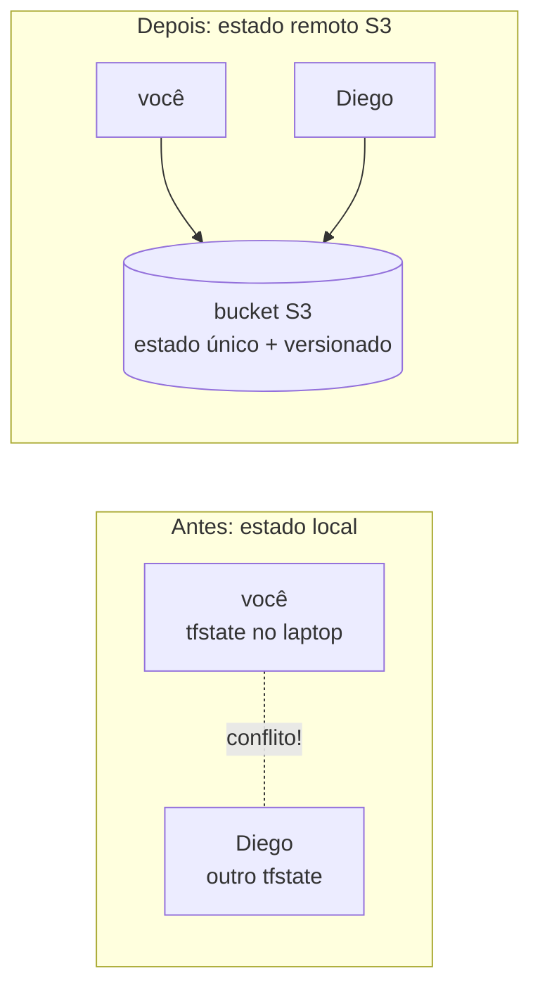
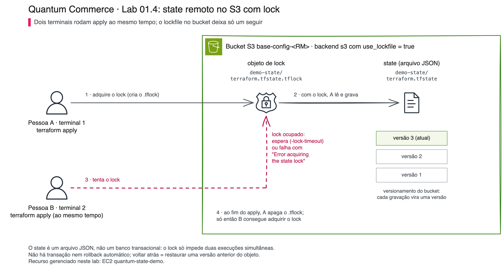
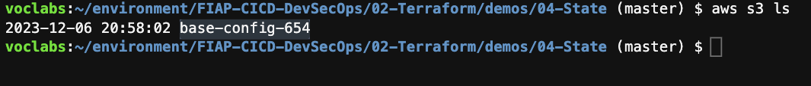
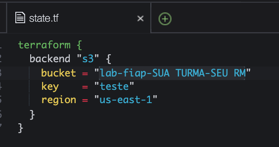
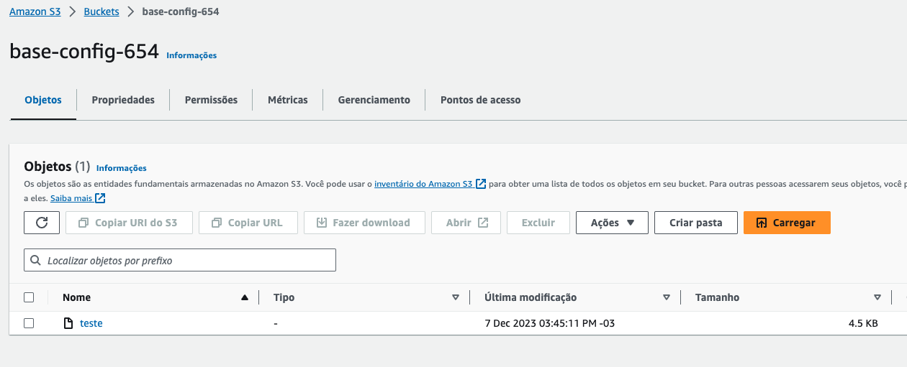
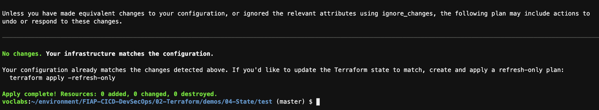

# 01.4 - State remoto: dois engenheiros da Quantum Commerce na mesma infra sem se atropelar

> **Sexta-feira, 9h. Quantum Commerce, infraestrutura do Assistente de Rastreio e Políticas.**
> Agora são duas pessoas mexendo na mesma infra: você e o Diego. Na quinta quase deu problema. Cada um tinha o próprio `terraform.tfstate` no Codespaces, os dois arquivos divergiram e, por pouco, dois `apply` ao mesmo tempo não criaram uma segunda cópia da mesma máquina. **Helena Marques**, Head de Engenharia de IA e Entrega Contínua, chama vocês dois:
>
> > *— "O estado do Terraform não pode viver no laptop de cada um. Se o seu Codespaces some, o estado some junto, e o Diego não enxerga o que você criou. Quero o estado **num lugar único e compartilhado**, com versionamento, e quero a garantia de que dois `apply` nunca rodam ao mesmo tempo."*
>
> **Diego Tavares**, AI SRE sênior, confirma: *— "Estado remoto no S3, com lock. O bucket vira a fonte da verdade, e quem chegar segundo espera a vez."*

Os comandos `bash` rodam **no terminal do Codespaces**. A verificação é feita **no console da AWS** (S3).

Nunca usou Terraform, um terminal ou Git? Tudo bem: cada passo diz o que fazer, onde rodar, o que deve aparecer e o que fazer se aparecer outra coisa. Copie o bloco cinza inteiro, cole no terminal do Codespaces e aperte Enter. Se aparecer uma mensagem começando com `Error:`, pare no passo em que está e abra o bloco **⚠ Se der erro** logo abaixo dele.

> [!WARNING]
> **Pré-requisitos obrigatórios antes de começar:**
>
> - [ ] [Lab 01.3 — Count](../03-Count/README.md) concluído (você domina o ciclo e já destruiu a frota)
> - [ ] A rede da demo 01.2 (VPC `fiap-lab`) aplicada: a instância de teste nasce numa subnet dela. A rede é **persistente** e esta demo só a **lê**; nada aqui a destrói
> - [ ] Credenciais AWS do Academy atualizadas no Codespaces
> - [ ] O bucket S3 criado no [setup da disciplina](../../../00-create-codespaces/README.md) (nome no formato `base-config-<SEU-RM>`)
>
> **Descubra o nome do seu bucket:**
>
> ```bash
> aws s3 ls
> ```
>
> **Confirme que a VPC da demo 01.2 está de pé:**
>
> ```bash
> aws ec2 describe-vpcs --filters "Name=tag:Name,Values=fiap-lab" --query "Vpcs[0].VpcId" --output text
> ```
>
> Se imprimir um `vpc-...`, a rede existe; se vier `None`, suba o [Lab 01.2](../02-Modules/README.md) antes.
>
> **O que você vai fazer:** ligar o versionamento do bucket, configurar o backend S3 com locking nativo, ver o estado nascer no bucket, apagar a cópia local e provar que o `init` recupera o estado do S3, simular você e o Diego rodando `apply` ao mesmo tempo e ver o **lock** bloquear o segundo, fazer **cirurgia de estado** (`state list/show/mv/rm`) e explorar **versionamento** e a questão dos **segredos em texto claro**. **Tempo estimado: ~50 min** (execução pura ~10 min + tempo para ler, copiar e observar).

## Principais pontos de aprendizagem

- o que é o arquivo de estado e por que ele é crítico
- configurar um backend remoto S3 (`terraform { backend "s3" {} }`) com locking nativo (`use_lockfile`)
- entender por que estado remoto habilita trabalho em equipe
- recuperar o estado do S3 após perder a cópia local
- ver o **lock** impedir dois `apply` concorrentes de corromper o estado
- inspecionar e reorganizar o estado com `terraform state list/show/mv/rm`
- restaurar uma versão anterior do estado (DR) e entender que segredos vivem em texto claro no tfstate

## O que você terá ao final

O estado da infra da Quantum Commerce centralizado num bucket S3 versionado, **a fonte única da verdade** que Helena pediu para você e o Diego trabalharem sem se atropelar.

> [!TIP]
> Sempre que encontrar um bloco **💡 Clique para entender**, abra-o.

## Mapa do lab

| Parte | O que você faz | Passos | Tempo |
|-------|----------------|--------|-------|
| [Parte 1](#parte-1---configurando-o-backend-s3) | Configurando o backend S3 | [1](#passo-1) · [2](#passo-2) · [3](#passo-3) · [4](#passo-4) · [5](#passo-5) · [6](#passo-6) · [7](#passo-7) | ~12 min |
| [Parte 2](#parte-2---provando-que-o-estado-vive-no-s3) | Provando que o estado vive no S3 | [8](#passo-8) · [9](#passo-9) · [10](#passo-10) | ~8 min |
| [Parte 3](#parte-3---lock-dois-apply-ao-mesmo-tempo) | Lock: dois `apply` ao mesmo tempo | [11](#passo-11) · [12](#passo-12) · [13](#passo-13) · [14](#passo-14) | ~10 min |
| [Parte 4](#parte-4---cirurgia-de-estado-state-list--show--mv--rm) | Cirurgia de estado (`state list/show/mv/rm`) | [15](#passo-15) · [16](#passo-16) · [17](#passo-17) · [18](#passo-18) · [19](#passo-19) | ~12 min |
| [Parte 5](#parte-5---versionamento-e-o-estado-em-texto-claro) | Versionamento e o estado em texto claro | [20](#passo-20) · [21](#passo-21) · [22](#passo-22) | ~8 min |

> [!TIP]
> Se travou em algum passo, clique no número dele na coluna **Passos**.

## Contexto

Por padrão, o Terraform guarda o estado num arquivo `terraform.tfstate` **local**. Isso funciona para uma pessoa, mas quebra em time: cada um teria sua cópia, as cópias divergem, e dois `apply` simultâneos corrompem tudo. O **backend remoto** move esse arquivo para um lugar central (aqui, o seu bucket `base-config-<SEU-RM>`). Com versionamento ativado no bucket, cada mudança gera uma versão, auditável e reversível.

> [!IMPORTANT]
> O bucket guarda **o state do Terraform**: o mapa de quais recursos AWS existem e quais IDs eles têm. Ele **não** guarda pedidos, clientes nem qualquer dado do e-commerce. Os pedidos continuam no sistema de origem da Quantum Commerce.

Cada demo usa uma `key` (o caminho do arquivo dentro do bucket) só dela. A desta demo é `demo-state/quantum/terraform.tfstate`. Por isso ela não colide com o state de outras demos que usam o mesmo bucket, como `demo-workspaces/terraform.tfstate` (demo 01.5) e `gitlab-runner-fleet` (módulo 02).





*A Pessoa A é você no terminal A; a Pessoa B é o Diego no terminal B. Quem cria o `.tflock` primeiro grava o state; o outro espera ou recebe `Error acquiring the state lock`. O desenho abrevia o caminho: no seu bucket, o state e o lock ficam em `demo-state/quantum/`, e o número de versões é ilustrativo.*

---

## Parte 1 - Configurando o backend S3

### Resultado esperado desta parte

O bucket fica com versionamento ligado, e o Terraform passa a guardar o estado num objeto `demo-state/quantum/terraform.tfstate` dentro dele, com locking nativo ativado.

---

<a id="passo-1"></a>

**1. Entre na pasta da demo**

O código Terraform desta demo fica na subpasta `test`. Todos os blocos seguintes repetem este `cd`, então você pode reabrir o terminal a qualquer momento.

```bash
cd /workspaces/FIAP-AI-Devops-CICD/01-Terraform/demos/04-State/test
ls
```

> Saída esperada:
>
> ```text
> instance.tf  provider.tf  state.tf  vars.tf  versions.tf
> ```

---

<a id="passo-2"></a>

**2. Descubra o nome do seu bucket**

O bucket `base-config-<SEU-RM>` foi criado no setup da disciplina e vai guardar o state.

```bash
aws s3 ls
```

<!-- TROCAR-IMAGEM: images/s3nome.png | motivo: mostra o bucket base-config-654 e o caminho antigo FIAP-CICD-DevSecOps/02-Terraform | capturar: terminal do Codespaces em /workspaces/FIAP-AI-Devops-CICD/01-Terraform/demos/04-State rodando aws s3 ls, com a linha base-config-<RM> -->


*Print de uma versão anterior do curso: o nome do bucket e o caminho no prompt serão diferentes no seu terminal.*

> Saída esperada: uma linha com o seu bucket, por exemplo `2026-10-24 10:00:00 base-config-12345`. Se a lista vier vazia, crie o bucket voltando ao [setup](../../../00-create-codespaces/README.md). Se aparecer `ExpiredToken`, atualize as credenciais do Academy.

---

<a id="passo-3"></a>

**3. Ligue o versionamento do bucket**

O bucket do setup nasce **sem** versionamento. Sem ele, cada gravação do state apaga a anterior e não existe "voltar no tempo" (Parte 5). O bloco descobre o bucket sozinho, liga o versionamento e confere. Pode rodar mais de uma vez sem problema.

O versionamento vale para o **bucket inteiro**, ou seja, para as `key`s de todas as demos e do Trabalho Final, não só para esta. E, depois de ligado, ele **não pode ser desligado**: só suspenso (`--versioning-configuration Status=Suspended`), e as versões já gravadas continuam lá. Isso é seguro e é a recomendação da HashiCorp para buckets de state: o custo é de frações de centavo, e cada `key` ganha a mesma rede de segurança.

```bash
BUCKET=$(aws s3 ls | awk '{print $3}' | grep '^base-config' | head -1)
echo "Bucket: $BUCKET"
aws s3api put-bucket-versioning --bucket "$BUCKET" --versioning-configuration Status=Enabled
aws s3api get-bucket-versioning --bucket "$BUCKET" --query Status --output text
```

> Saída esperada:
>
> ```text
> Bucket: base-config-12345
> Enabled
> ```

Se a linha `Bucket:` vier vazia, o comando não achou nenhum bucket começando com `base-config`: volte ao passo 2.

---

<a id="passo-4"></a>

**4. Aponte o `state.tf` para o seu bucket**

O `state.tf` vem com o placeholder `base-config-SEU-RM`. O bloco troca o placeholder pelo nome real do seu bucket e mostra o resultado.

```bash
cd /workspaces/FIAP-AI-Devops-CICD/01-Terraform/demos/04-State/test
BUCKET=$(aws s3 ls | awk '{print $3}' | grep '^base-config' | head -1)
sed -i "s/base-config-SEU-RM/$BUCKET/" state.tf
grep -E 'bucket|key' state.tf
```

> Saída esperada (com o seu RM):
>
> ```text
>     bucket = "base-config-12345"
>     key    = "demo-state/quantum/terraform.tfstate"
> ```

Prefere ver o arquivo? `code state.tf` abre no editor. O print abaixo é de uma versão anterior da demo: no seu arquivo valem o nome do bucket e a `key` da saída acima.

<!-- TROCAR-IMAGEM: images/state.png | motivo: mostra bucket "lab-fiap-SUA TURMA-SEU RM", key "teste" e nenhum use_lockfile | capturar: VS Code do Codespaces com test/state.tf aberto depois do passo 4, mostrando bucket base-config-<RM>, key demo-state/quantum/terraform.tfstate e use_lockfile = true -->


<details>
<summary><b>💡 Clique para entender: o bloco backend "s3"</b></summary>
<blockquote>

O arquivo `state.tf` configura onde o estado é guardado:

```hcl
terraform {
  backend "s3" {
    bucket       = "base-config-SEU-RM"
    key          = "demo-state/quantum/terraform.tfstate"
    region       = "us-east-1"
    use_lockfile = true
  }
}
```

- `backend "s3"` diz para guardar o estado num bucket S3, em vez de localmente.
- `bucket` é o nome do seu bucket. O passo 4 já trocou o placeholder `base-config-SEU-RM` pelo nome real. Nome de bucket S3 **não pode ter espaços nem maiúsculas**.
- `key` é o caminho/nome do objeto dentro do bucket onde o estado fica (`demo-state/quantum/terraform.tfstate`). Ela é **exclusiva desta demo**: se duas pastas Terraform usarem a mesma `key`, uma passa a enxergar (e destruir) os recursos da outra.
- `region` é a região do bucket.
- `use_lockfile = true` (Terraform 1.10+) liga o **locking de estado nativo no S3**: enquanto um `apply` roda, o Terraform cria um objeto `.tflock` ao lado do estado; um segundo `apply` concorrente é **bloqueado** até o primeiro liberar. Isso impede que dois `apply` simultâneos corrompam o estado, exatamente a dor de você e do Diego na cena de abertura. Antes do TF 1.10, esse lock exigia uma tabela DynamoDB separada; hoje o próprio S3 resolve.

Com versionamento ativado no bucket (passo 3), cada gravação do state gera uma nova versão do objeto, e você pode reverter para um estado anterior se algo der errado (Parte 5).

Documentação oficial: [Backend S3](https://developer.hashicorp.com/terraform/language/backend/s3)

</blockquote>
</details>

<details>
<summary><b>⚠ Se der erro: <code>Error: Failed to get existing workspaces / NoSuchBucket</code></b></summary>
<blockquote>

Causa: o nome do bucket no `state.tf` está errado ou ainda é o placeholder `base-config-SEU-RM`. Rode `grep bucket state.tf`, confira contra `aws s3 ls`, refaça o passo 4 (ou corrija com `code state.tf`) e rode `terraform init -reconfigure`.

</blockquote>
</details>

---

<a id="passo-5"></a>

**5. Inicialize o backend S3**

O `init` baixa o provider AWS e conecta esta pasta ao bucket.

```bash
cd /workspaces/FIAP-AI-Devops-CICD/01-Terraform/demos/04-State/test
terraform init
```

> Saída esperada (as linhas que importam):
>
> ```text
> Successfully configured the backend "s3"! Terraform will automatically
> use this backend unless the backend configuration changes.
> ...
> Terraform has been successfully initialized!
> ```

---

<a id="passo-6"></a>

**6. Crie a instância de teste**

O `apply` cria uma EC2 `t3.micro` chamada `quantum-state-demo` numa subnet pública da VPC `fiap-lab` e grava o state **no S3**, não no disco.

```bash
cd /workspaces/FIAP-AI-Devops-CICD/01-Terraform/demos/04-State/test
terraform apply -auto-approve
```

> Saída esperada (a linha final):
>
> ```text
> Apply complete! Resources: 1 added, 0 changed, 0 destroyed.
> ```

<details>
<summary><b>⚠ Se der erro: <code>no matching EC2 VPC found</code> ou <code>Invalid index</code> em <code>eligible_subnet_ids</code></b></summary>
<blockquote>

A VPC `fiap-lab` da demo 01.2 não existe nesta conta ou não tem subnets públicas. Rode o comando de validação dos pré-requisitos; se vier `None`, suba a rede pelo [Lab 01.2](../02-Modules/README.md) e rode este passo de novo. Não crie rede nesta pasta.

</blockquote>
</details>

---

<a id="passo-7"></a>

**7. Confirme que o state está no S3**

```bash
BUCKET=$(aws s3 ls | awk '{print $3}' | grep '^base-config' | head -1)
aws s3 ls "s3://$BUCKET/demo-state/quantum/"
```

> Saída esperada (data e tamanho variam):
>
> ```text
> 2026-10-24 12:43:18      23825 terraform.tfstate
> ```

Se quiser ver pelo navegador, abra o [console do S3](https://s3.console.aws.amazon.com/s3/buckets?region=us-east-1), entre no seu bucket e nas pastas `demo-state/` e `quantum/`. O print abaixo é de uma versão anterior da demo (outro bucket e outra `key`): no seu console vale o caminho `demo-state/quantum/terraform.tfstate`.

<!-- TROCAR-IMAGEM: images/states3.png | motivo: mostra o bucket base-config-654 com um objeto "teste" na raiz | capturar: console S3 > base-config-<RM> > demo-state/ > quantum/, mostrando o objeto terraform.tfstate depois do passo 6 -->


<details>
<summary><b>💡 Clique para entender: o que é gravado no S3</b></summary>
<blockquote>

O objeto `demo-state/quantum/terraform.tfstate` no bucket contém o **estado do Terraform**: IDs dos recursos provisionados, suas configurações e as dependências entre eles. É como o Terraform sabe, no próximo `apply`, o que já existe e o que precisa mudar.

Boas práticas para o bucket de estado:

1. **Versionamento ativado** — para reverter a um estado anterior em caso de falha.
2. **Criptografia (SSE)** — o estado pode conter dados sensíveis.
3. **Controle de acesso** — só quem deve mexer na infra acessa o bucket.

> O estado **não** deve ser editado à mão. Trate-o como um banco de dados gerenciado pelo Terraform.

Documentação oficial: [State](https://developer.hashicorp.com/terraform/language/state)

</blockquote>
</details>

### Checkpoint

Se chegou até aqui:

- o bucket tem versionamento `Enabled`
- o `state.tf` aponta para o seu bucket
- o `apply` criou a instância de teste
- existe o objeto `demo-state/quantum/terraform.tfstate` no bucket

---

## Parte 2 - Provando que o estado vive no S3

### Resultado esperado desta parte

Você apaga a pasta local `.terraform`, roda `init` de novo e prova que o estado é recuperado do S3: a infra continua intacta. É o que acontece quando o Diego abre a mesma pasta no Codespaces dele.

---

<a id="passo-8"></a>

**8. Apague os arquivos locais do Terraform**

Isso simula o Diego chegando com um Codespaces novo. Repare que não existe `terraform.tfstate` local para apagar: o state nunca esteve no disco.

```bash
cd /workspaces/FIAP-AI-Devops-CICD/01-Terraform/demos/04-State/test
rm -rf .terraform
ls -a
```

> Saída esperada: só os arquivos `.tf` e o `.terraform.lock.hcl`; nenhuma pasta `.terraform` e nenhum `terraform.tfstate`.

---

<a id="passo-9"></a>

**9. Rode `init` de novo**

Além de baixar o provider, ele reconecta ao bucket, onde está o **último estado**.

```bash
cd /workspaces/FIAP-AI-Devops-CICD/01-Terraform/demos/04-State/test
terraform init
```

> Saída esperada (a linha final): `Terraform has been successfully initialized!`

---

<a id="passo-10"></a>

**10. Aplique de novo e veja que nada muda**

A instância já existe, e o Terraform descobriu isso pelo estado remoto.

```bash
cd /workspaces/FIAP-AI-Devops-CICD/01-Terraform/demos/04-State/test
terraform apply -auto-approve
```

> Saída esperada (a linha final):
>
> ```text
> Apply complete! Resources: 0 added, 0 changed, 0 destroyed.
> ```

<!-- TROCAR-IMAGEM: images/apply0.png | motivo: o conteudo esta certo, mas o prompt mostra o caminho antigo FIAP-CICD-DevSecOps/02-Terraform | capturar: terminal do Codespaces em /workspaces/FIAP-AI-Devops-CICD/01-Terraform/demos/04-State/test no fim do passo 10, com "No changes" e "Apply complete! Resources: 0 added, 0 changed, 0 destroyed." -->


*Print de uma versão anterior do curso: o caminho no prompt muda, mas as linhas `No changes` e `0 added, 0 changed, 0 destroyed` são as mesmas que você deve ver.*

Esse "nada a fazer" é a prova do conceito: mesmo sem nenhum arquivo local de estado, o Terraform sabe exatamente o que existe, porque a verdade está no S3, não no seu Codespaces. Se aparecesse `1 to add`, seria sinal de que o `state.tf` aponta para outra `key` ou outro bucket.

### Checkpoint

Se chegou até aqui:

- você apagou o estado local e o recuperou do S3
- provou que o `apply` não recria o que já existe
- a instância de teste continua de pé (vamos usá-la nas Partes 3 a 5)

---

## Parte 3 - Lock: dois `apply` ao mesmo tempo

> **Sexta-feira, 14h.** Helena passa na mesa de vocês: *— "Lembra de quinta, quando você e o Diego rodaram `apply` juntos? Quero ver, com os meus olhos, esse acidente sendo **bloqueado** agora que ligamos o `use_lockfile`."* Vamos reproduzir a cena de propósito: o terminal **A** faz o seu papel e o terminal **B** faz o papel do Diego.

### Resultado esperado desta parte

Você vê o lock nativo do S3 (o objeto `.tflock`) impedir que um segundo `terraform apply` rode enquanto o primeiro segura o estado. É essa proteção que torna o trabalho em equipe seguro. Nada é alterado na AWS: no fim você cancela o primeiro `apply`.

---

<a id="passo-11"></a>

**11. No terminal A, comece um `apply` e deixe-o parado na pergunta**

A variável `responsavel` muda só uma tag da EC2. É uma mudança pequena, que faz o Terraform parar e perguntar `Enter a value:`. Sem nenhuma mudança pendente, o `apply` terminaria na hora com `No changes` e soltaria o lock antes do teste. **Não responda a pergunta ainda.**

```bash
cd /workspaces/FIAP-AI-Devops-CICD/01-Terraform/demos/04-State/test
terraform apply -var responsavel=voce
```

> Saída esperada (o terminal fica parado na última linha):
>
> ```text
>       ~ tags = {
>           ~ "Responsavel" = "time-ia" -> "voce"
> ...
> Plan: 0 to add, 1 to change, 0 to destroy.
> ...
>   Enter a value:
> ```

Enquanto este `apply` aguarda a sua resposta, o lock está **adquirido**: existe um objeto `.tflock` no S3.

---

<a id="passo-12"></a>

**12. Abra o terminal B (o Diego)**

No Codespaces, clique no **+** do painel de terminal para abrir um segundo terminal. Nele, confirme que o lock existe no bucket:

```bash
cd /workspaces/FIAP-AI-Devops-CICD/01-Terraform/demos/04-State/test
BUCKET=$(aws s3 ls | awk '{print $3}' | grep '^base-config' | head -1)
aws s3 ls "s3://$BUCKET/demo-state/quantum/"
```

> Saída esperada (data e tamanho variam):
>
> ```text
> 2026-10-24 12:43:18      23825 terraform.tfstate
> 2026-10-24 12:43:58        256 terraform.tfstate.tflock
> ```

---

<a id="passo-13"></a>

**13. No terminal B, tente aplicar ao mesmo tempo**

O Diego tenta a própria mudança. O Terraform vai **falhar ao adquirir o lock**, porque o terminal A o segura:

```bash
cd /workspaces/FIAP-AI-Devops-CICD/01-Terraform/demos/04-State/test
terraform apply -auto-approve -lock-timeout=0s -var responsavel=diego
```

> Saída esperada (resumida; ID, data e usuário variam):
>
> ```text
> Error: Error acquiring the state lock
>
> Error message: operation error S3: PutObject, https response error
> StatusCode: 412, ...
> api error PreconditionFailed: At least one of the pre-conditions you
> specified did not hold
> Lock Info:
>   ID:        9d278fa0-...
>   Path:      base-config-12345/demo-state/quantum/terraform.tfstate
>   Operation: OperationTypeApply
>   Who:       <usuario>@<host>
>   Created:   2026-10-24 15:43:57 +0000 UTC
>
> Terraform acquires a state lock to protect the state from being written
> by multiple users at the same time. ...
> ```

> [!IMPORTANT]
> Esse erro **não é um defeito: é a proteção funcionando**. Sem o lock, os dois `apply` escreveriam o estado ao mesmo tempo e o corromperiam (a dor da cena de abertura). O `-lock-timeout=0s` faz o terminal B desistir na hora. Sem essa flag, ou com `-lock-timeout=5m`, o Diego ficaria **esperando a vez** em vez de falhar. **Nunca** use `-lock=false` para "passar" desse erro.

<details>
<summary><b>💡 Clique para entender: o lock nativo do S3 e por que o DynamoDB não é mais necessário</b></summary>
<blockquote>

Com `use_lockfile = true` (Terraform 1.10+), antes de escrever o estado o Terraform faz um `PutObject` **condicional** de um objeto `<key>.tflock` (aqui, `demo-state/quantum/terraform.tfstate.tflock`). O S3 garante que esse `PutObject` só tem sucesso se o objeto ainda não existir (o `412 PreconditionFailed` da saída é essa recusa), então **apenas um** processo consegue o lock por vez. Ao terminar, o Terraform apaga o `.tflock`, liberando o próximo.

Antes do TF 1.10, esse controle exigia uma **tabela DynamoDB** separada (`dynamodb_table`) só para guardar o lock. Era mais uma peça de infra para criar, pagar e manter. O `use_lockfile` resolve tudo dentro do próprio bucket — menos recursos, mesma garantia.

Foi o `.tflock` que você listou no passo 12. Assim que o terminal A for liberado (próximo passo), ele some.

Documentação oficial: [S3 backend — state locking](https://developer.hashicorp.com/terraform/language/backend/s3#state-locking)

</blockquote>
</details>

<details>
<summary><b>⚠ Se der erro: o terminal B <b>não</b> reclamou de lock e aplicou normalmente</b></summary>
<blockquote>

O terminal A não estava segurando o lock. Duas causas comuns: (1) o A já tinha terminado, porque você respondeu a pergunta; (2) o A rodou sem o `-var responsavel=voce`, terminou com `No changes` e nunca parou no `Enter a value:`. Se o B aplicou, a tag virou `diego`: rode `terraform apply -auto-approve` no terminal B para voltar a `time-ia`. Depois refaça a partir do passo 11, com o A **parado no `Enter a value:`**.

</blockquote>
</details>

---

<a id="passo-14"></a>

**14. Cancele o terminal A e confirme que o lock foi liberado**

Volte ao terminal **A**: no painel de terminal do Codespaces, a lista de terminais abertos fica à direita; clique no primeiro da lista. (Se preferir ver os dois ao mesmo tempo, use o ícone de dividir terminal no lugar do **+** no passo 12.) Digite `no` e aperte Enter. O objetivo era só segurar o lock; cancelar mantém a EC2 exatamente como estava, e a Parte 4 depende disso.

> Saída esperada no terminal A: `Apply cancelled.`

Depois, em qualquer terminal:

```bash
BUCKET=$(aws s3 ls | awk '{print $3}' | grep '^base-config' | head -1)
echo "Bucket: $BUCKET"
aws s3 ls "s3://$BUCKET/demo-state/quantum/"
```

> Saída esperada: só a linha do `terraform.tfstate`. O `.tflock` sumiu.

Pode fechar o terminal B (ícone de lixeira no painel de terminal).

<details>
<summary><b>⚠ Se der erro: o <code>.tflock</code> continua lá depois do <code>Apply cancelled.</code></b></summary>
<blockquote>

Acontece se o terminal A foi fechado à força (Ctrl+C duas vezes, aba fechada) no meio do `apply`. O Terraform não teve chance de apagar o lock. Antes de qualquer coisa, confirme que **ninguém** está com um `apply` rodando. Depois, pegue o `ID` do lock. Ele aparece em `Lock Info` no erro do terminal B; se você já fechou o B, leia direto do objeto de lock:

```bash
BUCKET=$(aws s3 ls | awk '{print $3}' | grep '^base-config' | head -1)
aws s3 cp "s3://$BUCKET/demo-state/quantum/terraform.tfstate.tflock" -
```

> Saída esperada (uma linha JSON; o valor de `"ID"` é o que você precisa):
>
> ```text
> {"ID":"9d278fa0-...","Operation":"OperationTypeApply", ... "Path":"base-config-12345/demo-state/quantum/terraform.tfstate"}
> ```

Com o `ID` em mãos, libere:

```bash
cd /workspaces/FIAP-AI-Devops-CICD/01-Terraform/demos/04-State/test
terraform force-unlock -force <ID-do-lock>
```

`force-unlock` com alguém aplicando de verdade é exatamente o acidente que o lock evita. Use só com certeza de que o lock é órfão.

</blockquote>
</details>

### Checkpoint

Se chegou até aqui:

- você viu o segundo `apply` falhar com `Error acquiring the state lock`
- entendeu que o `.tflock` no S3 é o que serializa os `apply` do time
- você cancelou o terminal A, o lock foi liberado e o bucket voltou a ter só o `terraform.tfstate`

---

## Parte 4 - Cirurgia de estado (`state list` / `show` / `mv` / `rm`)

> **Sexta-feira, 16h.** Diego: *— "O estado é só um **mapa** entre o teu código e os recursos reais na AWS. Às vezes a gente precisa reorganizar esse mapa — renomear um recurso, esquecer outro — **sem destruir nada**. Os comandos `terraform state` fazem essa cirurgia."*

### Resultado esperado desta parte

Você inspeciona o estado, renomeia um recurso **só no estado** (sem destruir/recriar na AWS) e confirma com `terraform plan` que código e estado voltaram a bater (`No changes`).

---

<a id="passo-15"></a>

**15. Liste tudo que o estado conhece**

`state list` só lê o state; não muda nada.

```bash
cd /workspaces/FIAP-AI-Devops-CICD/01-Terraform/demos/04-State/test
terraform state list
```

> Saída esperada (uma linha `data.aws_subnet.public[...]` por subnet pública, até 6; os IDs variam):
>
> ```text
> data.aws_ami.amazon_linux
> data.aws_ec2_instance_type_offerings.supported
> data.aws_subnet.public["subnet-..."]
> data.aws_subnets.public
> data.aws_vpc.vpc
> aws_instance.example
> ```

Os `data.*` são **leituras** (a VPC `fiap-lab`, as subnets, a oferta de `t3.micro`): o Terraform só consulta, não gerencia. O único recurso **gerenciado** é `aws_instance.example`. É por isso que o `destroy` do passo 22 apaga a EC2 e deixa a rede intacta.

---

<a id="passo-16"></a>

**16. Veja os atributos da instância gravados no estado**

```bash
cd /workspaces/FIAP-AI-Devops-CICD/01-Terraform/demos/04-State/test
terraform state show aws_instance.example
```

> Saída esperada (resumida; IDs e IP variam):
>
> ```text
> # aws_instance.example:
> resource "aws_instance" "example" {
>     ami           = "ami-..."
>     id            = "i-..."
>     instance_type = "t3.micro"
>     private_ip    = "10.0.x.x"
>     subnet_id     = "subnet-..."
>     tags          = {
>         "Name"        = "quantum-state-demo"
>         "Responsavel" = "time-ia"
>     }
>     ...
> }
> ```

Se a tag `Responsavel` vier `diego` ou `voce`, um `apply` da Parte 3 foi confirmado. Rode `terraform apply -auto-approve` para voltar a `time-ia` antes de seguir.

---

<a id="passo-17"></a>

**17. Renomeie o recurso só no estado**

O `state mv` muda o endereço de `aws_instance.example` para `aws_instance.web` no mapa, **sem tocar na instância real**. Em seguida, o `plan` mostra o que aconteceria se alguém rodasse `apply` agora.

```bash
cd /workspaces/FIAP-AI-Devops-CICD/01-Terraform/demos/04-State/test
terraform state mv aws_instance.example aws_instance.web
terraform plan
```

> Saída esperada (as linhas que importam):
>
> ```text
> Move "aws_instance.example" to "aws_instance.web"
> Successfully moved 1 object(s).
> ...
> Plan: 1 to add, 0 to change, 1 to destroy.
> ```

> [!IMPORTANT]
> Nenhuma EC2 foi destruída ou criada: só o **rótulo no estado** mudou, e o `plan` não executa nada. Mas agora o estado conhece `aws_instance.web` enquanto o código ainda diz `aws_instance.example`. Eles estão **desalinhados**, e o `1 to add, 1 to destroy` mostra o estrago que um `apply` faria: destruir `web` (sumiu do código) e criar outra `example`. **Não rode `apply` aqui.** Vamos desfazer no próximo passo.

---

<a id="passo-18"></a>

**18. Volte o nome e confirme com `plan`**

```bash
cd /workspaces/FIAP-AI-Devops-CICD/01-Terraform/demos/04-State/test
terraform state mv aws_instance.web aws_instance.example
terraform plan
```

> Saída esperada (as linhas que importam):
>
> ```text
> Move "aws_instance.web" to "aws_instance.example"
> Successfully moved 1 object(s).
> ...
> No changes. Your infrastructure matches the configuration.
> ```

Esse `No changes` é a prova de que a cirurgia foi **neutra**: o recurso real nunca mudou, só o endereço no estado, e agora ele bate com o código. Se ainda aparecer `1 to add`, rode `terraform state list` e confira se o endereço é `aws_instance.example`.

---

<a id="passo-19"></a>

**19. Conheça o `state rm` (só leitura, não execute)**

Existe também o `terraform state rm`, que **remove um recurso do estado sem destruí-lo na AWS**:

```bash
# terraform state rm aws_instance.example   # NAO EXECUTE neste lab
```

> [!CAUTION]
> `state rm` faz o Terraform **"esquecer"** o recurso: a EC2 continua rodando na AWS, mas o Terraform deixa de gerenciá-la (e um `apply` futuro tentaria **recriar** outra). Use só quando quiser entregar um recurso para outro state/ferramenta, ou antes de re-importá-lo. Errar aqui gera recursos órfãos pagando sem ninguém gerenciar.

<details>
<summary><b>💡 Clique para entender: quando usar <code>state mv</code> vs <code>state rm</code> (e por que hoje preferimos o bloco <code>moved</code>)</b></summary>
<blockquote>

- **`state mv`** — renomear/realocar um recurso no estado durante um refactor (mudou o nome do recurso, moveu para dentro de um módulo). É **imperativo**: você roda na sua máquina, e o Diego precisa rodar o mesmo comando, senão o estado dele diverge.
- **`moved` block** — a forma **declarativa** e moderna de fazer o mesmo refactor. Você escreve o rename no código (`moved { from = ...  to = ... }`) e o Terraform aplica para todo mundo no próximo `apply`, versionado no Git. Hoje **preferimos `moved`** ao `state mv` justamente porque fica no código, e você e o Diego recebem o mesmo rename pelo Git. Você viu isso na [demo 01.2, Parte 4 (Refatorando sem destruir)](../02-Modules/README.md#parte-4---refatorando-sem-destruir-moved).
- **`state rm`** — remover do estado **sem destruir** na AWS. Para "desadotar" um recurso (entregar a outra ferramenta) ou limpar o estado antes de um `import` corrigido.

Documentação oficial: [Manipulating state](https://developer.hashicorp.com/terraform/cli/state)

</blockquote>
</details>

### Checkpoint

Se chegou até aqui:

- você listou recursos e data sources com `state list`
- inspecionou atributos com `state show`
- renomeou no estado com `state mv`, viu o `plan` acusar o desalinhamento e voltou, com `plan` dando `No changes`
- entende `state rm` como conceito (sem executar)

---

## Parte 5 - Versionamento e o estado em texto claro

> **Segunda-feira, 8h.** Helena, café na mão: *— "Duas perguntas finais. Se alguém estragar o estado, eu consigo **voltar no tempo**? E é verdade que **senha** fica em texto puro nesse arquivo?"* As duas respostas estão no S3.

### Resultado esperado desta parte

Você lista as versões do tfstate no bucket (base de um DR de estado) e entende, na prática, que o estado guarda atributos em **texto claro** — e as três mitigações.

---

<a id="passo-20"></a>

**20. Liste as versões do state**

Como você ligou o versionamento no passo 3, cada gravação do state virou uma versão: o `apply` do passo 6, o do passo 10 (mesmo sem mudar nada, ele regrava o state) e os dois `state mv` dos passos 17 e 18. O `apply` cancelado do passo 14 não grava. O bloco descobre o bucket sozinho:

```bash
BUCKET=$(aws s3 ls | awk '{print $3}' | grep '^base-config' | head -1)
aws s3api list-object-versions \
  --bucket "$BUCKET" \
  --prefix demo-state/quantum/terraform.tfstate \
  --query "Versions[?Key=='demo-state/quantum/terraform.tfstate'].{VersionId:VersionId,LastModified:LastModified,Latest:IsLatest}" \
  --output table
```

> Saída esperada (resumida, sem as bordas da tabela; datas e IDs variam): **4 linhas** se você fez cada passo uma vez (mais, se repetiu algum), cada uma com um `VersionId` diferente. A linha com `Latest = True` é a atual.
>
> ```text
> |        LastModified        | Latest  |             VersionId              |
> |  2026-10-24T15:56:56+00:00 |  True   |  Xb3...                            |
> |  2026-10-24T15:56:51+00:00 |  False  |  9kQ...                            |
> |  2026-10-24T15:56:24+00:00 |  False  |  pL0...                            |
> |  2026-10-24T15:55:58+00:00 |  False  |  Tz7...                            |
> ```

Se vier **uma única linha com `VersionId = null`**, o versionamento não estava ligado quando o state foi gravado: refaça o passo 3. As próximas gravações já geram versões.

<details>
<summary><b>💡 Clique para entender: versionamento como DR de estado</b></summary>
<blockquote>

Se um `apply` errado ou um `state rm` acidental corromper o estado, você pode **restaurar uma versão anterior** baixando-a por `VersionId`:

```bash
# conceitual: recupera o conteudo de uma versao especifica para um arquivo local
BUCKET=$(aws s3 ls | awk '{print $3}' | grep '^base-config' | head -1)
aws s3api get-object \
  --bucket "$BUCKET" \
  --key demo-state/quantum/terraform.tfstate \
  --version-id <VERSION_ID_ANTERIOR> \
  estado-recuperado.tfstate
```

A partir daí você inspeciona o arquivo recuperado e, se for o caso, o promove à versão atual. **Sem versionamento ligado no bucket, essa rede de segurança não existe** — por isso ele é boa prática obrigatória para buckets de estado.

</blockquote>
</details>

---

<a id="passo-21"></a>

**21. Leia o state em texto claro**

O bloco descobre o bucket, lê o `terraform.tfstate` direto do S3 (sem salvar nada no disco) e filtra a linha do IP privado da EC2. O `grep` existe só porque o arquivo é longo: os `data.*` vêm antes da instância. Repare que o valor está em **texto claro**, assim como IDs, tags e todo o resto do arquivo.

```bash
BUCKET=$(aws s3 ls | awk '{print $3}' | grep '^base-config' | head -1)
aws s3 cp "s3://$BUCKET/demo-state/quantum/terraform.tfstate" - | grep -m1 '"private_ip"'
```

> Saída esperada (o IP varia; espaços à esquerda não importam):
>
> ```text
>             "private_ip": "10.0.18.228",
> ```

Se não aparecer nada, a EC2 não está no state: rode `terraform state list` e confira se `aws_instance.example` está lá.

> [!CAUTION]
> O tfstate é **JSON em texto puro**. Tudo que um recurso expõe fica aqui legível. Se esta EC2 tivesse uma **senha de banco** (ex.: um `aws_db_instance` ou um `random_password`), a senha apareceria **literalmente** no arquivo — mesmo que no código você tenha marcado o output como `sensitive`.

<details>
<summary><b>💡 Clique para entender: <code>sensitive</code> esconde no CLI, mas NÃO no state</b></summary>
<blockquote>

Marcar uma variável/output como `sensitive` faz o Terraform **mascarar** o valor na saída do `plan`/`apply` e nos logs (mostra `(sensitive value)`). Mas isso é só cosmético para o terminal — **o valor continua em texto claro dentro do tfstate**.

Exemplo clássico: um `random_password` com `output { sensitive = true }`. No CLI você vê `(sensitive value)`; mas se abrir o tfstate, encontra literalmente:

```json
"result": "S3nh4-em-cl4ro-aqui"
```

Por isso o estado precisa de **três mitigações**, em camadas:

1. **Criptografia (SSE) no bucket** — o estado é cifrado em repouso no S3.
2. **Controle de acesso restrito** — só quem deve mexer na infra tem permissão de ler/escrever o bucket.
3. **Marcar variáveis sensíveis como `sensitive`** — protege CLI e logs (mas, repita-se, **não** o state).

E a evolução: **`ephemeral`** (recursos/valores efêmeros, Terraform 1.10) permite que certos valores — como senhas — **nunca sejam persistidos no estado**. É o caminho moderno para segredos que de fato não devem tocar o tfstate.

Documentação oficial: [Sensitive data in state](https://developer.hashicorp.com/terraform/language/state/sensitive-data) · [Ephemeral resources](https://developer.hashicorp.com/terraform/language/resources/ephemeral)

</blockquote>
</details>

---

<a id="passo-22"></a>

**22. Destrua a instância de teste (e só ela)**

O `destroy` apaga o único recurso gerenciado desta pasta, a EC2 `quantum-state-demo`. A VPC `fiap-lab` e as subnets aparecem aqui só como `data` (leitura) e **continuam de pé**, porque os próximos labs e módulos as usam. O state no S3 é atualizado sob lock e fica vazio.

```bash
cd /workspaces/FIAP-AI-Devops-CICD/01-Terraform/demos/04-State/test
terraform destroy -auto-approve
```

> Saída esperada (a linha final):
>
> ```text
> Destroy complete! Resources: 1 destroyed.
> ```

Confirme que a EC2 sumiu e que a rede continua lá:

```bash
aws ec2 describe-instances --filters "Name=tag:Name,Values=quantum-state-demo" "Name=instance-state-name,Values=pending,running,stopping,stopped" --query "length(Reservations)"
aws ec2 describe-vpcs --filters "Name=tag:Name,Values=fiap-lab" --query "Vpcs[0].VpcId" --output text
```

> Saída esperada: `0` na primeira linha (nenhuma EC2 da demo viva) e um `vpc-...` na segunda (a rede intacta).

<details>
<summary><b>💡 Clique para entender: o que fica no bucket depois do destroy (e por que não apagar)</b></summary>
<blockquote>

O objeto `demo-state/quantum/terraform.tfstate` continua no bucket, agora sem recursos, junto com as versões antigas. Custa frações de centavo e serve de histórico. **Não apague o bucket** nem as outras `key`s: o `base-config-<SEU-RM>` guarda o state das demos 01.5, do módulo 02 e do Trabalho Final. Se quiser refazer esta demo do zero, basta voltar ao passo 5: o `apply` recria a EC2 sobre o mesmo state.

</blockquote>
</details>

### Checkpoint

Se chegou até aqui:

- você listou as versões do tfstate no bucket e entende como restaurar uma anterior
- viu que o estado guarda atributos em texto claro e conhece as 3 mitigações (SSE, acesso restrito, `sensitive`) + `ephemeral`
- destruiu a instância de teste e confirmou que a VPC `fiap-lab` continua de pé

---

## Conclusão

Você moveu o estado para um bucket S3 e provou que ele sobrevive à perda da cópia local. Mais do que isso: viu o **lock** bloquear dois `apply` simultâneos, fez **cirurgia de estado** (`state list/show/mv/rm`) sem destruir nada, listou as **versões** do tfstate (a base de um DR de estado) e entendeu que o estado guarda **segredos em texto claro** — e como mitigar isso. Esse é o alicerce do trabalho em equipe com Terraform: uma fonte única, versionada, travada e compartilhada da verdade.

**⏱️ Cronômetro de reprodutibilidade da Quantum Commerce:** *você e o Diego partirem do mesmo ponto da infra, sem se atropelar.* Antes: cada um com seu tfstate no Codespaces, sem garantia de consistência e sem rede de segurança. Agora: **estado único no S3, versionado e recuperável, com lock que serializa os `apply`**. Qualquer pessoa do time faz `init` e enxerga exatamente o mesmo ponto, e dois `apply` concorrentes não corrompem mais nada.

**Mensagem para Helena:** o estado da infra da Quantum Commerce agora vive no S3, não no laptop de ninguém (e o bucket guarda só o state do Terraform, nenhum dado de cliente). Qualquer pessoa do time faz `init` e enxerga a infra real; o lock nativo impede os `apply` simultâneos de se atropelarem; o versionamento dá DR; e sabemos que segredos no state pedem SSE, acesso restrito e (no futuro) `ephemeral`. O próximo passo é separar **dev de prod** sem duplicar o código — usando workspaces sobre esse mesmo estado remoto.

## Próximo passo

Abra o próximo lab: **[Lab 01.5 — Workspaces](../05-Workspaces/README.md)**.

Lá vamos isolar ambientes `dev` e `prod` com o mesmo código, cada um com seu próprio estado dentro do bucket S3.

> [!CAUTION]
> **Custo:** a instância de teste é uma EC2 `t3.micro` (~$0,01/h). Você já rodou `destroy` no passo 22; confirme no painel EC2 que não sobrou nada `running` com o nome `quantum-state-demo`. O state no S3 e suas versões custam frações de centavo. A VPC `fiap-lab` fica de pé de propósito e não tem custo.

---

<details>
<summary><b>💡 Glossário rápido — termos que aparecem neste lab</b></summary>
<blockquote>

| Termo | O que é |
|-------|---------|
| **State / Estado** | Arquivo onde o Terraform registra os recursos que gerencia (IDs, atributos, dependências). |
| **Backend** | Onde o estado é armazenado. `local` por padrão; `s3` neste lab. |
| **Backend S3** | Backend que guarda o estado num bucket S3, habilitando compartilhamento em equipe. |
| **`key` (no backend)** | Caminho/nome do objeto de estado dentro do bucket (`demo-state/quantum/terraform.tfstate`). Cada demo usa uma `key` exclusiva. |
| **`-lock-timeout`** | Quanto tempo o `apply` espera o lock ser liberado antes de desistir. `0s` desiste na hora. |
| **`terraform force-unlock`** | Libera à força um lock órfão. Só com certeza de que ninguém está aplicando. |
| **`use_lockfile` / `.tflock`** | Locking de estado nativo no S3 (TF 1.10+): cria um objeto `.tflock` enquanto um `apply` roda, bloqueando um segundo concorrente. Dispensa DynamoDB. |
| **`terraform state mv`** | Renomeia/realoca um recurso **no estado** sem destruir/recriar na AWS. Hoje preferimos o bloco `moved` (declarativo). |
| **`terraform state rm`** | Remove um recurso **do estado** sem destruí-lo na AWS — o Terraform "esquece" o recurso. |
| **Versionamento (S3) / restore** | O bucket mantém versões anteriores de cada objeto; permite restaurar um tfstate antigo por `VersionId` (DR de estado). |
| **`sensitive`** | Marca uma variável/output para ser mascarada no CLI e nos logs — mas o valor **continua em texto claro no state**. |
| **`ephemeral`** | Recurso/valor efêmero (TF 1.10) que **nunca é persistido no estado** — caminho moderno para segredos. |
| **`terraform init -reconfigure`** | Reinicializa o backend quando a configuração dele mudou (ex.: nome do bucket). |

</blockquote>
</details>

<details>
<summary><b>💡 Como pedir ajuda se travou</b></summary>
<blockquote>

Antes de pedir ajuda, colete estas 4 informações:

1. **Em que passo você está** (ex.: "passo 5, `init` do backend")
2. **Mensagem de erro literal** (texto do terminal)
3. **Saída de** `aws s3 ls` e de `grep -E 'bucket|key' state.tf` (mostra se o bucket existe e para onde o backend aponta)
4. **O que você já tentou**

Canais (em ordem de prioridade):

- **Issues do repositório**: [github.com/vamperst/FIAP-AI-Devops-CICD/issues](https://github.com/vamperst/FIAP-AI-Devops-CICD/issues)
- **E-mail do professor**: `Rafael@rfbarbosa.com`
- **Antes de tudo**: a maioria dos erros aqui é nome de bucket incorreto no `state.tf` ou credencial expirada. Confira com `aws s3 ls`, refaça o passo 4 e rode `terraform init -reconfigure`.

</blockquote>
</details>
