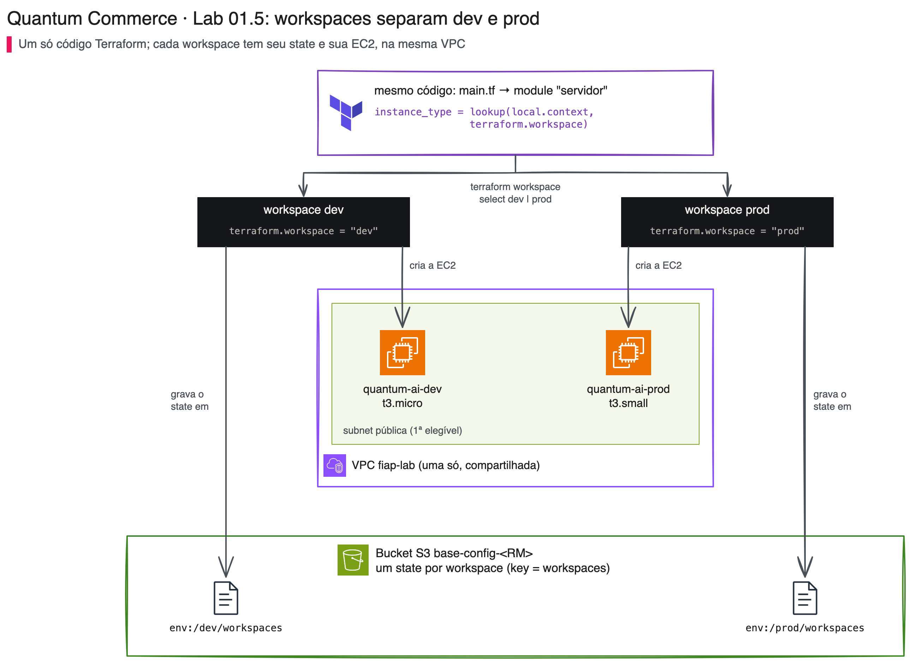
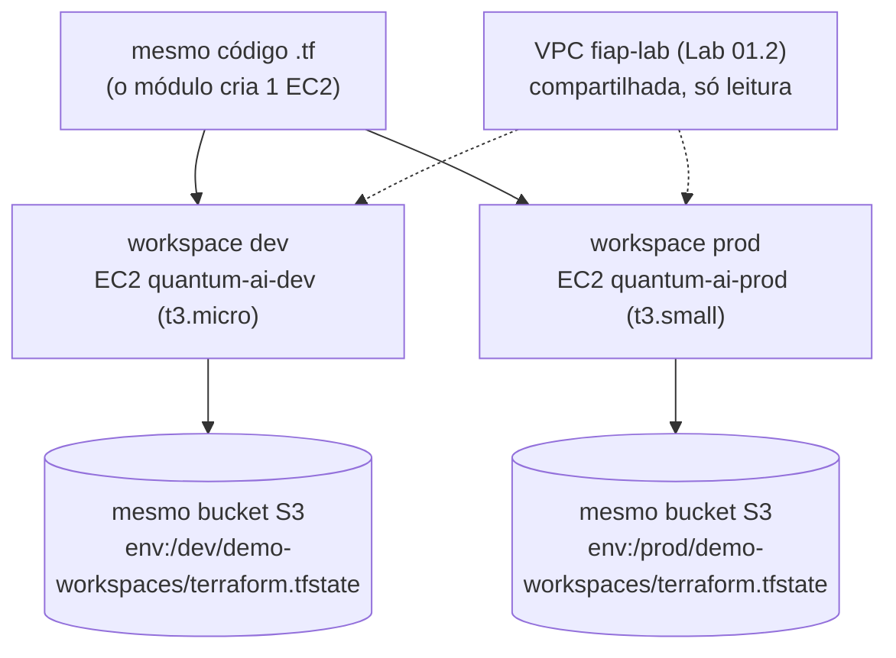
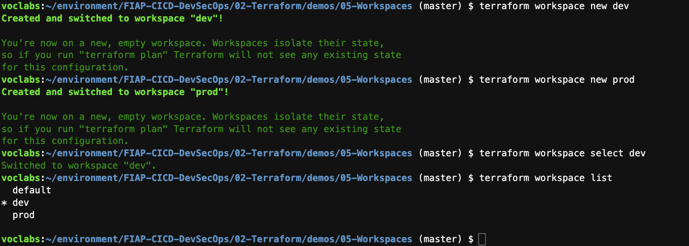

# 01.5 - Workspaces: experimentando sem tocar em produção na Quantum Commerce

> **Sexta-feira, 16h. Aula 2 na Quantum Commerce: a última peça do Terraform.**
> O estado da infra já mora no S3 (Lab 01.4) e a página do **AI Customer Assistant** já sobe por código. Agora o time quer **experimentar** a infraestrutura da futura aplicação: testar outro tamanho de máquina, mudar uma configuração, errar à vontade. **Helena Marques**, Head de Engenharia de IA e Entrega Contínua, põe o limite:
>
> > *— "Experimentem o quanto quiserem, mas nenhum teste pode encostar no ambiente que a diretoria usa. Quero um **dev** para errar e um **prod** intocável, os dois com o **mesmo código**. Não vou manter duas cópias que divergem em um mês."*
>
> **Diego Tavares**, AI SRE sênior, responde: *— "Workspaces. O mesmo código, um estado separado para cada ambiente, e o tamanho da máquina muda conforme o ambiente. Só uma coisa: workspace separa o **estado**, não separa a **conta**. No fim da aula a gente conversa sobre o que isso significa."*

Os comandos `bash` deste lab rodam **no terminal do Codespaces**. As verificações são feitas no terminal e, se quiser conferir visualmente, **no console da AWS** (EC2 e S3).

Nunca usou Terraform ou um terminal? Tudo bem: cada passo diz o que fazer, onde rodar, o que deve aparecer e o que fazer se aparecer outra coisa. Copie o bloco cinza inteiro (ícone de copiar no canto do bloco), cole no terminal do Codespaces e aperte Enter. Se aparecer uma mensagem começando com `Error:`, pare no passo em que está e abra o bloco **⚠ Se der erro** logo abaixo dele.

> [!WARNING]
> **Pré-requisitos obrigatórios antes de começar:**
>
> - [ ] Credenciais AWS do Academy atualizadas no Codespaces, ver [Preparando Credenciais](../../../00-create-codespaces/Inicio-de-aula.md)
> - [ ] [Lab 01.2 — Módulos](../02-Modules/README.md) concluído: a VPC `fiap-lab` com subnets públicas precisa existir, porque as EC2 deste lab nascem nela
> - [ ] [Lab 01.4 — State remoto](../04-State/README.md) concluído: você já sabe o que é um backend S3
> - [ ] O bucket `base-config-...` criado no [setup inicial do ambiente](../../../00-create-codespaces/README.md)
>
> **Valide rapidamente (credencial, VPC e bucket de uma vez):**
>
> ```bash
> aws sts get-caller-identity --query Account --output text
> aws ec2 describe-vpcs --region us-east-1 --filters "Name=tag:Name,Values=fiap-lab" --query "Vpcs[0].VpcId" --output text
> aws s3 ls | awk '/base-config-/{print $3}'
> ```
>
> Saída esperada: três linhas, nesta ordem: o número da sua conta (12 dígitos), um `vpc-...` e o nome do seu bucket `base-config-...`. Se você tiver mais de um bucket `base-config-`, aparece uma linha por bucket, e o passo 2 usa o primeiro em ordem alfabética. Se a segunda linha vier `None`, a rede não existe: volte ao [Lab 01.2](../02-Modules/README.md) e suba a VPC. Se não aparecer nenhum bucket, refaça a criação do bucket no [setup inicial do ambiente](../../../00-create-codespaces/README.md).
>
> **O que você vai fazer:** criar os workspaces `dev` e `prod`, aplicar o mesmo código em cada um, ver que cada ambiente ganha **a sua própria EC2, de tamanho diferente**, e o seu próprio estado no S3, validar com `terraform test` e, no fim, destruir as EC2 e apagar os workspaces. **Tempo estimado: ~35 min** (execução pura ~8 min + tempo para ler, copiar e observar).

Vamos usar o recurso mais simples possível, uma EC2 vazia por ambiente, para que a atenção fique no mecanismo: **o mesmo código gerando ambientes separados**. Nenhuma aplicação nem IA roda nessas máquinas; o que estamos provando aqui é o isolamento de estado entre `dev` e `prod`.

## Principais pontos de aprendizagem

- o que são workspaces e quando usá-los (e quando **não** usá-los)
- criar, listar, selecionar e apagar workspaces (`new`, `list`, `select`, `delete`)
- usar `terraform.workspace` para variar o **tamanho** da máquina por ambiente
- ver que cada workspace tem o seu próprio estado no S3 (`env:/dev/...`, `env:/prod/...`)
- entender o que workspace **não** isola: conta, credenciais e raio de impacto (*blast radius*)
- validar a configuração de forma automatizada com `terraform test`

## O que você terá ao final

Os ambientes `dev` e `prod` da Quantum Commerce criados sobre o **mesmo código**, cada um com uma EC2 dimensionada para o seu propósito (`dev` → `t3.micro`, `prod` → `t3.small`) e estado separado no S3, e depois removidos sem deixar custo. A rede `fiap-lab` continua de pé para os próximos labs.

> [!TIP]
> Sempre que encontrar um bloco **💡 Clique para entender**, abra-o. Ele aprofunda o passo sem atrapalhar quem só quer seguir a sequência.

## Mapa do lab

| Parte | O que você faz | Passos | Tempo |
|-------|----------------|--------|-------|
| [Parte 1](#parte-1---criando-os-workspaces) | Criando os workspaces | [1](#passo-1) · [2](#passo-2) · [3](#passo-3) · [4](#passo-4) · [5](#passo-5) · [6](#passo-6) · [7](#passo-7) | ~10 min |
| [Parte 2](#parte-2---aplicando-por-ambiente) | Aplicando por ambiente e observando o dimensionamento | [8](#passo-8) · [9](#passo-9) · [10](#passo-10) · [11](#passo-11) · [12](#passo-12) · [13](#passo-13) | ~13 min |
| [Parte 3](#parte-3---validando-com-terraform-test-e-limpando) | Validando com `terraform test` e limpando tudo | [14](#passo-14) · [15](#passo-15) · [16](#passo-16) · [17](#passo-17) · [18](#passo-18) | ~12 min |

Se travou em algum passo, clique no número dele na coluna **Passos**.

## Por que essa abordagem existe

| Aspecto | Resposta curta |
|---------|----------------|
| **Problema de negócio** | A Quantum Commerce quer experimentar a infra da futura aplicação sem encostar no ambiente que já está em uso, e sem manter duas cópias do código. |
| **Pergunta que responde bem** | "Mesma infra, estados separados, troca rápida entre ambientes, variando só parâmetros como o tamanho da máquina." |
| **Pergunta que responde mal** | "Produção crítica isolada **de verdade**, em outra conta, com outras credenciais." Workspace não faz isso; ver o trade-off no fim do lab. |
| **Quando acontece na vida real** | Ambientes de teste descartáveis, ambientes temporários de CI e pipelines que aplicam a mesma stack em dev e depois em prod. |

## Contexto

Todo projeto Terraform começa no workspace `default`. Ao criar workspaces adicionais (`dev`, `prod`), você passa a ter **um estado por workspace**, todos sobre o mesmo código. A expressão `terraform.workspace` devolve o nome do ambiente atual, e o código a usa para escolher o **tipo da instância EC2**. No backend S3, cada workspace ganha o seu próprio arquivo de estado, no caminho `env:/<workspace>/<key>`.

Repare no que é **compartilhado**: as duas EC2 nascem na **mesma** VPC `fiap-lab` (criada no Lab 01.2, que esta demo só **lê**), e os dois estados ficam no **mesmo** bucket, acessado pelas **mesmas** credenciais. O que muda entre `dev` e `prod` é o estado e o tamanho da máquina, não a rede nem a conta.



*O mesmo código gera uma EC2 por workspace, as duas na VPC `fiap-lab`, e cada workspace grava o seu estado no mesmo bucket. O desenho abrevia o caminho: o arquivo real é `env:/dev/demo-workspaces/terraform.tfstate` (e `env:/prod/...` para o prod).*



---

## Parte 1 - Criando os workspaces

### Resultado esperado desta parte

O backend S3 inicializado e os workspaces `dev` e `prod` criados, com você posicionado em `dev`.

---

<a id="passo-1"></a>

**1. Entre na pasta da demo**

```bash
cd /workspaces/FIAP-AI-Devops-CICD/01-Terraform/demos/05-Workspaces
ls
```

> Saída esperada:
>
> ```text
> README.md  images  main.tf  modules  outputs.tf  state.tf  tests  versions.tf
> ```

---

<a id="passo-2"></a>

**2. Aponte o backend para o seu bucket**

O `state.tf` vem com o nome de exemplo `base-config-SEU-RM`. O bloco abaixo descobre o nome do seu bucket e grava no arquivo, sem você digitar nada:

```bash
cd /workspaces/FIAP-AI-Devops-CICD/01-Terraform/demos/05-Workspaces
BUCKET=$(aws s3 ls | awk '/base-config-/{print $3; exit}')
echo "Bucket encontrado: $BUCKET"
[ -n "$BUCKET" ] && sed -i 's/bucket *= *"[^"]*"/bucket = "'"$BUCKET"'"/' state.tf || echo "ERRO: nenhum bucket base-config-* encontrado; confira as credenciais (Inicio-de-aula) e rode de novo"
grep -E 'bucket =|key ' state.tf
```

> Saída esperada (o nome do bucket é o seu):
>
> ```text
> Bucket encontrado: base-config-12345
>     bucket = "base-config-12345"
>     key    = "demo-workspaces/terraform.tfstate"
> ```

A `key` `demo-workspaces/terraform.tfstate` é **exclusiva desta demo**: o Lab 01.4 usa `demo-state/quantum/terraform.tfstate`, então os estados das duas demos não se misturam no mesmo bucket. Pode rodar o bloco quantas vezes quiser: ele sempre regrava a linha `bucket` com o nome encontrado. Se nenhum bucket for encontrado, o arquivo não é alterado e aparece a linha `ERRO: ...`.

<details>
<summary><b>⚠ Se der erro: <code>Bucket encontrado:</code> aparece vazio, seguido de <code>ERRO: nenhum bucket base-config-* encontrado</code></b></summary>
<blockquote>

O `aws s3 ls` não achou nenhum bucket começando com `base-config-`. Confira com `aws s3 ls` se o bucket existe. Se ele não existe, refaça a criação do bucket no [setup inicial do ambiente](../../../00-create-codespaces/README.md). Se o comando reclamar de credencial (`ExpiredToken`, `Unable to locate credentials`), atualize as credenciais seguindo o [Início de aula](../../../00-create-codespaces/Inicio-de-aula.md) e rode o bloco de novo. O `state.tf` não foi alterado, então basta repetir o passo.

</blockquote>
</details>

---

<a id="passo-3"></a>

**3. Inicialize o Terraform**

```bash
cd /workspaces/FIAP-AI-Devops-CICD/01-Terraform/demos/05-Workspaces
terraform init
```

> Saída esperada (a linha que importa; o resto da saída varia):
>
> ```text
> Terraform has been successfully initialized!
> ```

<details>
<summary><b>⚠ Se der erro: o <code>init</code> reclama do bucket</b></summary>
<blockquote>

Se aparecer `NoSuchBucket`, `bucket does not exist` ou `The value cannot be empty or all whitespace`, a linha `bucket` do `state.tf` está errada ou vazia. A forma mais simples de corrigir é repetir o [passo 2](#passo-2). Se preferir corrigir à mão, abra o arquivo com `code state.tf`, corrija a linha `bucket = "..."` para o nome que aparece em `aws s3 ls` e reconfigure o backend:

```bash
cd /workspaces/FIAP-AI-Devops-CICD/01-Terraform/demos/05-Workspaces
terraform init -reconfigure
```

</blockquote>
</details>

<details>
<summary><b>💡 Clique para entender: o módulo que dimensiona a EC2 por workspace</b></summary>
<blockquote>

O módulo em `modules/file/` cria **uma instância EC2** cujo **tipo** depende do workspace atual. A raiz (`main.tf`) só invoca o módulo passando `project = "quantum-ai"`.

**`modules/file/main.tf`** (trecho essencial):

```hcl
locals {
  env = terraform.workspace

  # Mapa de "tamanho" do servidor por workspace
  context = {
    default = { instance_type = "t3.micro" }
    dev     = { instance_type = "t3.micro" }
    homol   = { instance_type = "t3.small" }
    prod    = { instance_type = "t3.small" }
  }

  # lookup com fallback para 'default' se o workspace nao estiver no mapa
  context_variables = lookup(local.context, local.env, local.context["default"])
}

# Le (nao cria) a VPC compartilhada fiap-lab e escolhe uma subnet publica
# em uma AZ que oferta o tipo de instancia
data "aws_vpc" "vpc" { tags = { Name = "fiap-lab" } }

resource "aws_instance" "server" {
  ami           = data.aws_ami.amazon_linux.id
  instance_type = local.context_variables.instance_type
  subnet_id     = local.eligible_subnet_ids[0]

  tags = {
    Name = "${var.project}-${local.env}"   # quantum-ai-dev, quantum-ai-prod
    Env  = local.env
  }
}
```

- `terraform.workspace` devolve o nome do ambiente atual (`dev`, `prod`...).
- O mapa `context` traduz o workspace num `instance_type`: pequeno em dev, maior em prod.
- A VPC entra como `data` (leitura), nunca como `resource`. Por isso nenhum `destroy` desta demo consegue apagar a rede.
- A subnet é escolhida entre as AZs que oferecem aquele tipo de instância. Algumas AZs da `us-east-1` (como a `us-east-1e`) não oferecem `t3.micro`; o filtro evita esse erro.
- A tag `Name` carrega o ambiente (`quantum-ai-dev`, `quantum-ai-prod`). Além dela, o `main.tf` da raiz aplica a todos os recursos as tags `Project = quantum-commerce`, `ManagedBy = terraform` e `Lab = 01-terraform`.

Documentação oficial: [Workspaces](https://developer.hashicorp.com/terraform/language/state/workspaces) · [aws_instance](https://registry.terraform.io/providers/hashicorp/aws/latest/docs/resources/instance)

</blockquote>
</details>

---

<a id="passo-4"></a>

**4. Crie o workspace `dev`**

```bash
cd /workspaces/FIAP-AI-Devops-CICD/01-Terraform/demos/05-Workspaces
terraform workspace new dev
```

> Saída esperada:
>
> ```text
> Created and switched to workspace "dev"!
>
> You're now on a new, empty workspace. Workspaces isolate their state,
> so if you run "terraform plan" Terraform will not see any existing state
> for this configuration.
> ```

O próprio Terraform avisa: o workspace novo começa **vazio**, sem enxergar nada que exista em outro workspace.

<details>
<summary><b>⚠ Se der erro: <code>Workspace "dev" already exists</code></b></summary>
<blockquote>

Você já criou esse workspace antes (por exemplo, numa tentativa anterior). Não é problema: siga para o próximo passo.

</blockquote>
</details>

---

<a id="passo-5"></a>

**5. Crie o workspace `prod`**

```bash
cd /workspaces/FIAP-AI-Devops-CICD/01-Terraform/demos/05-Workspaces
terraform workspace new prod
```

> Saída esperada (a primeira linha; o aviso de workspace vazio se repete):
>
> ```text
> Created and switched to workspace "prod"!
> ```

O `new` cria **e já entra** no workspace. Neste momento você está em `prod`.

---

<a id="passo-6"></a>

**6. Volte para o ambiente `dev`**

```bash
cd /workspaces/FIAP-AI-Devops-CICD/01-Terraform/demos/05-Workspaces
terraform workspace select dev
```

> Saída esperada:
>
> ```text
> Switched to workspace "dev".
> ```

<details>
<summary><b>💡 Clique para entender: comandos de workspace</b></summary>
<blockquote>

```bash
terraform workspace new <nome>      # cria e já entra no novo workspace
terraform workspace list            # lista todos (o * marca o atual)
terraform workspace show            # imprime só o nome do atual
terraform workspace select <nome>   # troca para outro workspace
terraform workspace delete <nome>   # remove (não pode ser o atual nem ter recursos)
```

Cada workspace mantém um estado separado no backend. No S3, o Terraform grava o estado de cada um em `env:/<workspace>/<key>`; por isso `dev` e `prod` não se misturam. O workspace `default` é exceção: ele usa a `key` sem prefixo.

</blockquote>
</details>

---

<a id="passo-7"></a>

**7. Liste os workspaces**

```bash
cd /workspaces/FIAP-AI-Devops-CICD/01-Terraform/demos/05-Workspaces
terraform workspace list
```

> Saída esperada (o `*` marca o workspace atual):
>
> ```text
>   default
> * dev
>   prod
> ```

O `default` foi criado automaticamente pelo Terraform e sempre existe.

<!-- TROCAR-IMAGEM: images/workspacescommands.png | capturar de novo o terminal com a saída de `terraform workspace list` mostrando default, * dev e prod (a imagem atual é da versão antiga do lab) -->


*Saída de `terraform workspace list`: o `*` marca o workspace atual.*

### Checkpoint

Se chegou até aqui:

- o backend S3 está inicializado, apontando para o seu bucket
- os workspaces `dev` e `prod` existem
- você está posicionado no workspace `dev` (o `*` está nele)

---

## Parte 2 - Aplicando por ambiente

### Resultado esperado desta parte

Cada workspace cria a sua própria EC2 com tamanho diferente (`dev` → `t3.micro`, `prod` → `t3.small`) e o seu próprio estado no S3. Depois você destrói só o `prod` e prova que o `dev` não foi afetado.

---

<a id="passo-8"></a>

**8. Aplique no workspace `dev`**

Primeiro conferimos em que ambiente estamos; depois aplicamos. Usamos `-auto-approve` em todos os `apply` e `destroy` deste lab para pular a confirmação `yes`.

```bash
cd /workspaces/FIAP-AI-Devops-CICD/01-Terraform/demos/05-Workspaces
terraform workspace show
terraform apply -auto-approve
terraform output instance_type
```

> Saída esperada (a primeira linha é o workspace; o `id` da instância varia):
>
> ```text
> dev
> ...
> Plan: 1 to add, 0 to change, 0 to destroy.
> module.servidor.aws_instance.server: Creation complete after 15s [id=i-0123456789abcdef0]
>
> Apply complete! Resources: 1 added, 0 changed, 0 destroyed.
> ...
> "t3.micro"
> ```

<details>
<summary><b>⚠ Se der erro: <code>no matching EC2 VPC found</code> ou <code>Invalid index</code></b></summary>
<blockquote>

O Terraform não encontrou a VPC `fiap-lab` ou nenhuma subnet pública dentro dela. Rode `aws ec2 describe-vpcs --region us-east-1 --filters "Name=tag:Name,Values=fiap-lab" --query "Vpcs[0].VpcId" --output text`. Se vier `None`, a rede do Lab 01.2 não existe nesta conta: suba a VPC voltando ao [Lab 01.2](../02-Modules/README.md) e rode este passo de novo. Não crie uma VPC nesta pasta.

</blockquote>
</details>

---

<a id="passo-9"></a>

**9. Troque para `prod` e aplique o mesmo código**

```bash
cd /workspaces/FIAP-AI-Devops-CICD/01-Terraform/demos/05-Workspaces
terraform workspace select prod
terraform apply -auto-approve
terraform output instance_type
```

> Saída esperada:
>
> ```text
> Switched to workspace "prod".
> ...
> Plan: 1 to add, 0 to change, 0 to destroy.
> ...
> Apply complete! Resources: 1 added, 0 changed, 0 destroyed.
> ...
> "t3.small"
> ```

Mesmo código, mesmo comando, resultado diferente: `t3.micro` em `dev`, `t3.small` em `prod`. Quem decide é o workspace. Repare também no `Plan: 1 to add`: o `prod` não "vê" a EC2 do `dev`, porque tem o seu próprio estado. Se aqui apareceu `"t3.micro"`, você aplicou no workspace errado: rode `terraform workspace show` para conferir.

---

<a id="passo-10"></a>

**10. Veja as duas EC2 na AWS**

```bash
aws ec2 describe-instances --region us-east-1 \
  --filters "Name=tag:Name,Values=quantum-ai-dev,quantum-ai-prod" "Name=instance-state-name,Values=pending,running" \
  --query "Reservations[].Instances[].{Name:Tags[?Key=='Name']|[0].Value,Type:InstanceType,Env:Tags[?Key=='Env']|[0].Value,Vpc:VpcId}" \
  --output table
```

> Saída esperada (uma linha por ambiente; a ordem das linhas e o `vpc-...` variam):
>
> ```text
> ---------------------------------------------------------------------
> |                         DescribeInstances                         |
> +-------+-------------------+------------+--------------------------+
> |  Env  |       Name        |   Type     |           Vpc            |
> +-------+-------------------+------------+--------------------------+
> |  dev  |  quantum-ai-dev   |  t3.micro  |  vpc-0123456789abcdef0   |
> |  prod |  quantum-ai-prod  |  t3.small  |  vpc-0123456789abcdef0   |
> +-------+-------------------+------------+--------------------------+
> ```

Duas máquinas, tamanhos diferentes, e o **mesmo** `vpc-...` nas duas linhas: `dev` e `prod` dividem a rede `fiap-lab`. Se preferir ver no navegador, abra o [console do EC2](https://us-east-1.console.aws.amazon.com/ec2/home?region=us-east-1#Instances:).

<!-- PRINT SUGERIDO (nota para o professor): images/ec2-por-workspace.png
     Capturar o painel EC2 > Instances mostrando quantum-ai-dev (t3.micro) e
     quantum-ai-prod (t3.small) lado a lado. Depois de salvar, descomente:
      -->

---

<a id="passo-11"></a>

**11. Veja os dois estados separados no S3**

```bash
BUCKET=$(aws s3 ls | awk '/base-config-/{print $3; exit}')
aws s3 ls "s3://$BUCKET" --recursive | grep demo-workspaces
```

> Saída esperada (data, hora e tamanho variam):
>
> ```text
> 2026-10-24 12:44:10      24091 env:/dev/demo-workspaces/terraform.tfstate
> 2026-10-24 12:45:02      24098 env:/prod/demo-workspaces/terraform.tfstate
> ```

Dois arquivos de estado, um por workspace, cada um sabendo só da sua EC2. No [console do S3](https://s3.console.aws.amazon.com/s3/buckets?region=us-east-1) eles aparecem como as pastas `env:` → `dev/` e `env:` → `prod/`.

> [!IMPORTANT]
> **O que workspace NÃO isola.** Os dois estados estão no **mesmo bucket**, na **mesma conta AWS**, e você mexe nos dois com as **mesmas credenciais**. Quem pode alterar `dev` pode alterar `prod`; um erro de permissão ou um bucket apagado atinge os dois ambientes ao mesmo tempo. Ou seja, workspace separa o **estado**, mas não separa a conta, a credencial nem o raio de impacto (*blast radius*) de um erro. Para o "prod intocável" de verdade que Helena pediu, é preciso conta e credenciais separadas. O trade-off está no bloco do fim do lab.

---

<a id="passo-12"></a>

**12. Destrua só o ambiente `prod`**

Conferimos o workspace **antes** de destruir. Este é o hábito que evita apagar o ambiente errado.

```bash
cd /workspaces/FIAP-AI-Devops-CICD/01-Terraform/demos/05-Workspaces
terraform workspace select prod
terraform workspace show
terraform destroy -auto-approve
```

> Saída esperada:
>
> ```text
> prod
> ...
> Plan: 0 to add, 0 to change, 1 to destroy.
> ...
> Destroy complete! Resources: 1 destroyed.
> ```

Como você já estava em `prod` desde o passo 9, o `select` não imprime nada. A linha `Switched to workspace "prod".` só aparece quando o workspace muda de fato. O `Plan` mostra **1** recurso a destruir: só a EC2 deste workspace. A VPC não aparece porque o código só a lê.

---

<a id="passo-13"></a>

**13. Confirme que o `dev` não foi afetado**

```bash
aws ec2 describe-instances --region us-east-1 \
  --filters "Name=tag:Name,Values=quantum-ai-dev,quantum-ai-prod" \
  --query "Reservations[].Instances[].[Tags[?Key=='Name']|[0].Value,State.Name]" \
  --output text
```

> Saída esperada (a ordem das linhas pode variar; `prod` pode aparecer como `shutting-down` por alguns segundos):
>
> ```text
> quantum-ai-prod  terminated
> quantum-ai-dev   running
> ```

Destruir um ambiente não encostou no outro. O arquivo `env:/prod/...` continua no S3, agora sem recursos: o `destroy` limpa a infraestrutura, não o arquivo de estado. Ele só some quando apagamos o workspace, no passo 17.

### Checkpoint

Se chegou até aqui:

- aplicou em `dev` e `prod`, e cada um criou uma EC2 de tamanho diferente (`t3.micro` / `t3.small`)
- viu que as duas EC2 estão na mesma VPC `fiap-lab`
- viu os estados separados no S3 (`env:/dev/...`, `env:/prod/...`) e entendeu que eles estão no mesmo bucket e na mesma conta
- destruiu só o `prod` e confirmou que o `dev` continua `running`

---

## Parte 3 - Validando com terraform test e limpando

### Resultado esperado desta parte

O `terraform test` confirma, **sem criar infraestrutura**, que o workspace `dev` produz uma `t3.micro`. Depois você destrói o `dev`, apaga os dois workspaces e confere que a rede `fiap-lab` continua de pé.

---

<a id="passo-14"></a>

**14. Volte para o `dev` e leia o arquivo de teste**

```bash
cd /workspaces/FIAP-AI-Devops-CICD/01-Terraform/demos/05-Workspaces
terraform workspace select dev
cat tests/workspace.tftest.hcl
```

O trecho que importa:

```hcl
run "dev_usa_t3_micro" {
  command = plan

  assert {
    condition     = output.instance_type == "t3.micro"
    error_message = "No workspace dev, o instance_type deveria ser t3.micro. Confira o workspace atual com: terraform workspace show"
  }
}
```

Em português: "faça um `plan` e confira que o tipo de instância calculado é `t3.micro`; se não for, mostre esta mensagem".

---

<a id="passo-15"></a>

**15. Rode o teste**

```bash
cd /workspaces/FIAP-AI-Devops-CICD/01-Terraform/demos/05-Workspaces
terraform workspace show
terraform test
```

> Saída esperada:
>
> ```text
> dev
> tests/workspace.tftest.hcl... in progress
>   run "dev_usa_t3_micro"... pass
> tests/workspace.tftest.hcl... tearing down
> tests/workspace.tftest.hcl... pass
>
> Success! 1 passed, 0 failed.
> ```

<details>
<summary><b>⚠ Se der erro: <code>Failure! 0 passed, 1 failed.</code> com <code>"t3.small"</code></b></summary>
<blockquote>

Você está no workspace `prod`. O teste avalia `terraform.workspace` com o workspace **selecionado no terminal**, e em `prod` o mapa entrega `t3.small`. A falha aparece assim:

```text
  run "dev_usa_t3_micro"... fail
Error: Test assertion failed
    │ - "t3.small"
    │ + "t3.micro"
No workspace dev, o instance_type deveria ser t3.micro. Confira o workspace
atual com: terraform workspace show
```

Rode `terraform workspace select dev` e o `terraform test` de novo. Esse "erro" é, na verdade, a prova de que o teste enxerga o ambiente atual.

</blockquote>
</details>

<details>
<summary><b>💡 Clique para entender: o que é <code>terraform test</code></b></summary>
<blockquote>

`terraform test` é o framework de testes nativo do Terraform (estável desde a **versão 1.6**). Você escreve arquivos `*.tftest.hcl` com um ou mais blocos `run`, cada um com asserções (`assert`) sobre outputs, valores de recursos ou variáveis.

- `command = plan` valida a configuração **sem criar infraestrutura**: ele só calcula o plano e confere as asserções. (`command = apply`, o padrão, criaria os recursos de verdade e depois os destruiria.)
- O plano roda no workspace atual. Em `dev`, o mapa de contexto entrega `t3.micro` e a asserção passa; em `prod`, entrega `t3.small` e a asserção falha.
- O teste também falha se alguém trocar o tipo de `dev` no mapa de contexto (por exemplo, por um tipo que o Learner Lab não permite). Se a entrada `dev` for removida, o `lookup` cai no `default`, que também é `t3.micro`, e o teste continua passando.
- Mesmo sendo só `plan`, o teste consulta a AWS para ler a VPC, as subnets e a AMI. Por isso ele precisa de credenciais válidas.

**Por que isso importa:** essa é a ponte para o módulo **03-CICD**. Num pipeline, antes de aplicar a infra, você roda `terraform test` para barrar mudanças que quebram a configuração, como um teste unitário barra código quebrado antes do merge.

Documentação oficial: [Tests](https://developer.hashicorp.com/terraform/language/tests)

</blockquote>
</details>

---

<a id="passo-16"></a>

**16. Destrua a EC2 do `dev`**

```bash
cd /workspaces/FIAP-AI-Devops-CICD/01-Terraform/demos/05-Workspaces
terraform workspace select dev
terraform workspace show
terraform destroy -auto-approve
```

> Saída esperada:
>
> ```text
> dev
> ...
> Plan: 0 to add, 0 to change, 1 to destroy.
> ...
> Destroy complete! Resources: 1 destroyed.
> ```

Você já estava em `dev` desde o passo 14, então o `select` não imprime nada; ele está aqui só por segurança. Se você tinha trocado de workspace no meio do caminho, aparece antes a linha `Switched to workspace "dev".`

---

<a id="passo-17"></a>

**17. Apague os workspaces `dev` e `prod`**

Um workspace só pode ser apagado quando **não é o atual** e **não tem recursos**. Por isso voltamos para o `default` antes.

```bash
cd /workspaces/FIAP-AI-Devops-CICD/01-Terraform/demos/05-Workspaces
terraform workspace select default
terraform workspace delete dev
terraform workspace delete prod
terraform workspace list
```

> Saída esperada:
>
> ```text
> Switched to workspace "default".
> Deleted workspace "dev"!
> Deleted workspace "prod"!
> * default
> ```

O `delete` também remove do S3 os arquivos `env:/dev/...` e `env:/prod/...`. Nada fora desta demo é tocado.

<details>
<summary><b>⚠ Se der erro: <code>Workspace is not empty</code></b></summary>
<blockquote>

```text
Error: Workspace is not empty

Workspace "prod" is currently tracking the following resource instances:
  - module.servidor.aws_instance.server
```

Esse workspace ainda tem uma EC2. É uma proteção do Terraform: apagar o workspace agora faria ele "esquecer" uma máquina que continua cobrando na AWS. **Não use `-force`.** Destrua primeiro e apague depois:

```bash
cd /workspaces/FIAP-AI-Devops-CICD/01-Terraform/demos/05-Workspaces
terraform workspace select prod
terraform destroy -auto-approve
terraform workspace select default
terraform workspace delete prod
```

Troque `prod` por `dev` se a mensagem citar o `dev`.

</blockquote>
</details>

<details>
<summary><b>⚠ Se der erro: <code>Workspace "dev" is your active workspace</code></b></summary>
<blockquote>

Não dá para apagar o workspace em que você está. Rode `terraform workspace select default` e repita o `delete`.

</blockquote>
</details>

---

<a id="passo-18"></a>

**18. Confira que nada ficou cobrando e que a rede continua de pé**

```bash
aws ec2 describe-instances --region us-east-1 \
  --filters "Name=tag:Name,Values=quantum-ai-dev,quantum-ai-prod" "Name=instance-state-name,Values=pending,running,stopping,stopped" \
  --query "length(Reservations[].Instances[])" --output text
aws ec2 describe-vpcs --region us-east-1 --filters "Name=tag:Name,Values=fiap-lab" --query "Vpcs[0].[VpcId,State]" --output text
```

> Saída esperada (o `vpc-...` é o seu):
>
> ```text
> 0
> vpc-0123456789abcdef0   available
> ```

O `0` diz que nenhuma EC2 `quantum-ai-*` ficou ligada. A segunda linha prova que a VPC `fiap-lab` continua `available`. Se a primeira linha vier `1` ou `2`, repita o passo 17 (o bloco ⚠ dele mostra como destruir um workspace esquecido).

> [!IMPORTANT]
> **Não destrua a rede.** A VPC `fiap-lab` (criada no Lab 01.2) é a fundação compartilhada do curso: ela é usada pelos módulos **02 (Ansible)** e **03 (CI/CD)** e pelo **Trabalho Final**, que a descobrem pela tag. Esta demo só lê a rede, e nenhum lab do curso a destrói. VPC, subnets e route tables são **gratuitas**; o que custava por hora eram as EC2, que você já destruiu.

### Checkpoint

Se chegou até aqui:

- rodou `terraform test` no `dev` e viu `Success! 1 passed, 0 failed.`
- destruiu as EC2 de `dev` e `prod`; nenhuma instância `quantum-ai-*` ficou ligada
- apagou os workspaces `dev` e `prod`; só sobrou o `default`
- confirmou que a VPC `fiap-lab` continua `available` para os próximos módulos

---

<details>
<summary><b>💡 Clique para entender: workspaces <i>vs.</i> pasta-por-ambiente (o trade-off honesto)</b></summary>
<blockquote>

Workspaces são convenientes, mas **não** são a melhor ferramenta para todo caso. No livro *Terraform: Up & Running*, Yevgeniy Brikman considera workspaces um **anti-padrão** para isolar ambientes sérios, por três motivos:

1. **Mesmo backend, mesma conta, mesmas credenciais.** Todos os workspaces compartilham o bucket S3 e as credenciais AWS. Não há isolamento de blast radius: um erro de permissão ou um bug que apaga o bucket afeta dev **e** prod. Foi o que você viu no passo 11.
2. **O ambiente fica invisível no código.** Em qual ambiente você está não está escrito em nenhum `.tf`: é **estado do terminal** (`terraform.workspace`). Quem lê o repositório não vê "isto é prod"; só descobre rodando `terraform workspace show`.
3. **É fácil rodar `destroy` no workspace errado.** A troca é um comando silencioso, então dá para achar que está em `dev` e destruir `prod`. Por isso os passos 12 e 16 rodam `terraform workspace show` antes do `destroy`.

A alternativa para ambientes sérios é **uma pasta por ambiente** (`dev/`, `prod/`), cada uma com o seu próprio backend (bucket e, idealmente, conta separados) e variáveis. O ambiente fica explícito na estrutura de diretórios e o isolamento é real.

**Quando workspaces funcionam bem:** variações descartáveis ou idênticas, como um ambiente de teste por feature branch, ambientes temporários de CI, ou casos como este lab, em que a única diferença é um parâmetro (o tamanho da instância). **Quando preferir pasta-por-ambiente:** produção crítica que exige conta, credenciais e blast radius isolados.

A lição: aprenda a ferramenta **e** saiba quando não usá-la.

</blockquote>
</details>

---

## Conclusão

Você criou `dev` e `prod` sobre o mesmo código, cada um com uma EC2 dimensionada para o seu propósito e estado separado no S3. Trocar de ambiente é um `terraform workspace select`, e destruir um não afetou o outro. Por cima, validou a configuração com `terraform test` sem criar infraestrutura, e limpou tudo sem tocar na rede compartilhada.

**Mensagem para Helena:** o time já pode experimentar a infraestrutura da futura aplicação em `dev` sem encostar no estado de `prod`, com o mesmo código e máquinas dimensionadas (dev `t3.micro`, prod `t3.small`). O isolamento é de **estado**: os dois ambientes ainda estão na mesma conta, com as mesmas credenciais. Para um prod realmente intocável, o próximo passo é conta e credenciais separadas. A IA ainda não roda nessas máquinas; ela chega nas próximas aulas. **Com isso, fechamos o Terraform**: a infraestrutura da Quantum Commerce é código versionado, escalável, com estado compartilhado e ambientes separados.

> ⏱️ **Cronômetro de reprodutibilidade da Quantum Commerce:** *subir um ambiente novo para experimentar* deixou de ser "pedir uma máquina e esperar alguém configurar" e virou **um `workspace new` e um `apply`**, com o tamanho certo para cada ambiente.

> [!CAUTION]
> **Custo:** esta demo cria até **2 instâncias EC2** (dev `t3.micro` + prod `t3.small`), que custam por hora enquanto estiverem `running`. Se você seguiu os passos 12, 16 e 17, nada ficou cobrando. Confira com o passo [18](#passo-18): a primeira linha deve ser `0`. A VPC `fiap-lab` fica de pé de propósito, sem custo.

## Próximo passo

Você concluiu as demos de Terraform. Para fixar, faça os dois exercícios:

- **[Exercício — Count com SQS](../../exercicios/count/README.md)**
- **[Exercício — State e Workspace com EC2](../../exercicios/State-e-workspace/README.md)**

Depois, siga para o **[Módulo 02 — Ansible](../../../02-Ansible/README.md)**, em que vamos automatizar a configuração de servidores (um GitLab Runner próprio) de forma idempotente.

---

<details>
<summary><b>💡 Glossário rápido — termos que aparecem neste lab</b></summary>
<blockquote>

| Termo | O que é |
|-------|---------|
| **Workspace** | Um estado nomeado dentro do mesmo código; permite vários ambientes sem duplicar arquivos. |
| **`default`** | Workspace criado automaticamente pelo Terraform; sempre existe e não pode ser apagado. |
| **`terraform.workspace`** | Expressão que devolve o nome do workspace atual; aqui escolhe o `instance_type`. |
| **`env:/<ws>/<key>`** | Caminho que o backend S3 usa para guardar o estado de cada workspace (exceto o `default`). |
| **Blast radius** | Raio de impacto de um erro: o que é atingido quando algo dá errado. Workspaces na mesma conta compartilham o mesmo raio. |
| **`terraform test` / `.tftest.hcl`** | Framework de teste nativo (TF 1.6+). Arquivos `*.tftest.hcl` com blocos `run` e asserções; `command = plan` valida sem criar infra. |
| **Data source** | Bloco `data` que **lê** algo existente (aqui, a VPC `fiap-lab`) sem criar nem destruir. |
| **Workspaces vs. pasta-por-ambiente** | Workspaces compartilham backend, conta e credenciais; pasta-por-ambiente dá isolamento real para prod. |
| **`locals`** | Bloco que define valores calculados e reutilizáveis dentro de um módulo. |

</blockquote>
</details>

<details>
<summary><b>💡 Como pedir ajuda se travou</b></summary>
<blockquote>

Antes de pedir ajuda, colete estas 4 informações:

1. **Em que passo você está** (ex.: "passo 9, `apply` no prod")
2. **Mensagem de erro literal** (copie o texto do terminal, não um screenshot)
3. **Saída de** `terraform workspace list` e `aws sts get-caller-identity`
4. **O que você já tentou**

Canais (em ordem de prioridade):

- **Issues do repositório**: [github.com/vamperst/FIAP-AI-Devops-CICD/issues](https://github.com/vamperst/FIAP-AI-Devops-CICD/issues)
- **E-mail do professor**: `Rafael@rfbarbosa.com`
- **Antes de tudo**: confira em qual workspace você está com `terraform workspace show`. Muito "por que a instância não mudou de tamanho?" é só estar no workspace errado.

</blockquote>
</details>
