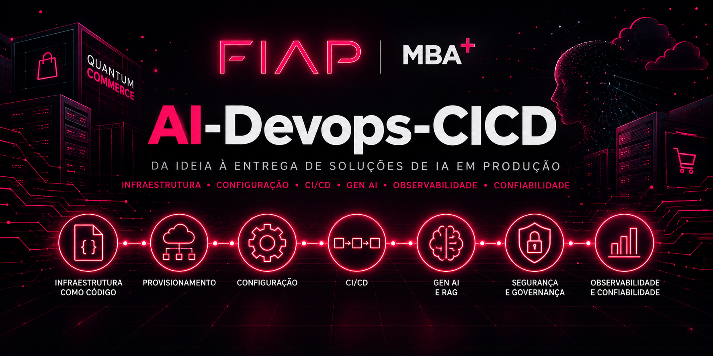
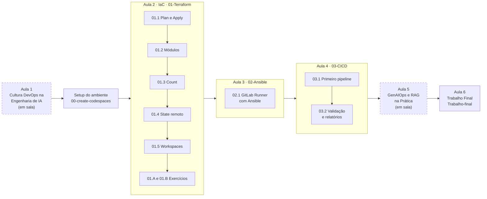

# AI-Devops-CICD



Repositório dos laboratórios práticos da disciplina **AI-Devops-CICD**, do MBA da **FIAP** com foco em IA e GenAI, ministrada pelo **Prof. Rafael Barbosa**. Aqui estão as demos guiadas, os exercícios, o código Terraform e Ansible e os pipelines de CI/CD que usamos em aula.

Quer começar já? Vá direto para [Como começar](#como-começar).

---

## Propósito da disciplina

Vamos aplicar **DevOps, Infrastructure as Code, Configuration Management, CI/CD e confiabilidade** à construção, à implantação e à operação de aplicações de IA. O ponto de partida é um protótipo que funciona na máquina de quem o escreveu; o ponto de chegada é um sistema reproduzível, testável, implantável e confiável.

Esta **não** é uma disciplina de treinamento de modelos. Não treinamos modelos nem fazemos fine-tuning: tratamos o modelo como uma dependência da aplicação e cuidamos de tudo o que o cerca (infraestrutura, configuração, pipeline, testes, observabilidade e operação). Os laboratórios também não presumem nenhum serviço gerenciado de IA na conta AWS Academy; cada lab declara os serviços que usa.

O público são profissionais de nível pleno e sênior. O material está em português do Brasil, com termos técnicos em inglês quando é assim que eles aparecem nas ferramentas e na documentação oficial.

---

## A história: Quantum Commerce

Para dar contexto a cada lab, acompanhamos uma empresa fictícia do começo ao fim do curso: a **Quantum Commerce**, uma plataforma de e-commerce de moda e eletrônicos. O Comitê de Tecnologia aprovou três iniciativas de IA, e cada uma traz um desafio de engenharia diferente:

| Iniciativa | O que faz | O que exige de engenharia |
|---|---|---|
| **Projeto 1: Personal Stylist Virtual** | Conversa com o cliente sobre estilo e produtos, no tom de voz da marca. | Prompt Engineering, versionamento de prompts e avaliação de comportamento. Mais adiante, a análise de quando um fine-tuning valeria o custo (uma decisão de arquitetura, não um treinamento feito em aula). |
| **Projeto 2: Assistente de Rastreio e Políticas** | Responde sobre pedidos, entregas, trocas e devoluções. | É o **fio condutor técnico dos primeiros labs**. Os dados de pedidos vêm da API do sistema de origem; o RAG fica para o conhecimento documental, como as políticas de troca. Grounding, qualidade factual e observabilidade. |
| **Projeto 3: Categorização Automatizada do Catálogo** | Extrai atributos e categoriza os produtos do catálogo em lote. | Processamento em lote, compliance, custo e comparação entre alternativas de modelos. |

### O problema de partida

Os protótipos existem e funcionam, mas nenhum deles está pronto para produção:

- a infraestrutura foi criada à mão, no console da AWS, por pessoas diferentes em momentos diferentes;
- os ambientes não se reproduzem: o que responde certo numa máquina responde errado em outra;
- o deploy só acontece quando uma pessoa específica está disponível.

**Helena Marques** resume o pedido que abre a disciplina:

> *— "Os protótipos provaram que a ideia funciona. Agora preciso que eles virem sistemas: qualquer pessoa do time recria o ambiente, todo deploy passa por teste, e a gente percebe que uma resposta da IA piorou antes do cliente."*

### A pergunta central

Cada aula responde a um pedaço desta pergunta:

> **Como transformar aplicações experimentais de IA em sistemas reproduzíveis, testáveis e continuamente entregáveis, sem perder qualidade, segurança e controle operacional?**

### Quem é quem

| Personagem | Papel na Quantum Commerce | Como aparece nos labs |
|---|---|---|
| **Helena Marques** | Head de Engenharia de IA e Entrega Contínua | Traz a demanda de negócio e os requisitos de cada etapa. |
| **Diego Tavares** | AI SRE sênior | Traz os problemas de confiabilidade, automação, observabilidade e operação que já viu acontecer. |
| **Você** | AI DevOps Engineer recém-contratado(a) | Implementa cada peça, lab a lab. |

---

## As 6 aulas e onde está o material

| Aula | Tema | Material neste repositório |
|---|---|---|
| Antes do primeiro lab | Setup do ambiente: Codespaces, AWS Academy, credenciais e chave SSH | [00-create-codespaces](00-create-codespaces/README.md) |
| **1** | **Cultura DevOps na Engenharia de IA:** Three Ways, fluxo, feedback, aprendizagem contínua e postmortems | Conduzida em sala. Material escrito em construção, ainda sem pasta neste repositório. |
| **2** | **Infrastructure as Code para IA:** Terraform, recursos, módulos, escalabilidade, state e workspaces | [01-Terraform](01-Terraform/README.md) |
| **3** | **Configuration Management e Automação:** Ansible, idempotência e preparação do GitLab Runner | [02-Ansible](02-Ansible/README.md) |
| **4** | **CI/CD e Deployment de Aplicações de IA:** GitLab, pipelines, testes, segurança e introdução a testes de prompts | [03-CICD](03-CICD/README.md) |
| **5** | **GenAIOps e RAG na Prática:** RAG, APIs empresariais, avaliações, observabilidade e quality gates de GenAI | Conduzida em sala. Material escrito em construção, ainda sem pasta neste repositório. |
| **6** | **Architecture Challenge / Trabalho Final:** aplicação integradora | [Trabalho-final](Trabalho-final/README.md) |

A coluna **Tema** descreve o escopo completo de cada encontro. O que ainda não tem lab escrito é conduzido em sala.

**A numeração das pastas não é o número da aula.** As pastas seguem a ordem dos módulos práticos (`01-Terraform` é o material da Aula 2), e uma aula pode ter várias demos; por isso as pastas não são renomeadas pela sequência dos encontros. Nos labs, siga a ordem das pastas numeradas: `01-Terraform`, `02-Ansible`, `03-CICD` e, por fim, `Trabalho-final`.

---

## Pré-requisitos

- uma conta no [GitHub](https://github.com), para o fork do repositório e o Codespaces;
- uma conta ativa no [AWS Academy](https://www.awsacademy.com/vforcesite/LMS_Login), na turma `AWS Academy Learner Lab`;
- acesso ao email institucional da FIAP (`rm<SEU RM>@fiap.com.br`);
- uma conta gratuita no [GitLab](https://gitlab.com), usada a partir de `02-Ansible`.

Não é preciso instalar Terraform, Ansible nem AWS CLI na sua máquina: tudo roda no GitHub Codespaces, com o ambiente descrito como código em `.devcontainer/`.

> [!CAUTION]
> **SEMPRE DESLIGUE** o Codespaces ao final da aula, para não consumir suas horas gratuitas. Em [github.com/codespaces](https://github.com/codespaces), clique nos três pontinhos ao lado do ambiente e selecione `Stop Codespace`.

---

## Como começar

**1. Faça o setup do ambiente, uma única vez.**

Siga o [lab 00 - Setup e configuração do ambiente](00-create-codespaces/README.md): fork do repositório, Codespaces, conta AWS Academy, bucket base no S3, credenciais e chave SSH.

**2. Comece toda aula pelo ritual de início.**

O [Início de aula](00-create-codespaces/Inicio-de-aula.md) sincroniza o seu fork com o repositório oficial e recoloca credenciais AWS válidas no Codespaces (a sessão do Learner Lab dura 4 horas). Guarde esse link: você vai usá-lo em todo encontro.

**3. Abra o lab do dia.**

Use a tabela de [laboratórios disponíveis](#laboratórios-disponíveis) e siga a ordem das pastas numeradas.

---

## Laboratórios disponíveis

Os primeiros labs constroem, peça por peça, a base de engenharia que vai sustentar o Assistente de Rastreio e Políticas (Projeto 2). Cada lab tem o próprio `README.md`, com pré-requisitos, passos numerados, explicações nos blocos `💡 Clique para entender` e prints de referência.

> [!NOTE]
> A disciplina está migrando o storytelling. Alguns labs ainda contam a história da **Vortex Mobility** e chamam o aluno de *Platform Engineer*. O conteúdo técnico é o mesmo: leia "Vortex" como **Quantum Commerce** e "Platform Engineer" como **AI DevOps Engineer**.

| # | Laboratório | O que você faz | Link |
|---|---|---|---|
| 00 | **Setup e configuração do ambiente** | Fork do repositório, Codespaces, conta AWS Academy, bucket base no S3, credenciais e chave SSH. | [00-create-codespaces](00-create-codespaces/README.md) |
| 01.1 | **Terraform: Plan e Apply** | Primeira EC2 provisionada por código: ciclo `init`, `plan`, `apply` e `destroy`, leitura do plano, drift e inspeção do estado. | [01-Plan-Apply](01-Terraform/demos/01-Plan-Apply/README.md) |
| 01.2 | **Terraform: Módulos** | Rede (VPC, subnets e route tables) em módulos reutilizáveis; adoção de recurso existente com `import` e refatoração sem destruir com `moved`. | [02-Modules](01-Terraform/demos/02-Modules/README.md) |
| 01.3 | **Terraform: Count** | Escalar servidores web atrás de um Application Load Balancer mudando um número, com um `check` block validando a saúde. | [03-Count](01-Terraform/demos/03-Count/README.md) |
| 01.4 | **Terraform: State remoto** | Estado no S3 com locking nativo, cirurgia de estado (`state mv`/`rm`) e versionamento. | [04-State](01-Terraform/demos/04-State/README.md) |
| 01.5 | **Terraform: Workspaces** | `dev` e `prod` a partir do mesmo código, com `terraform test` validando a configuração. | [05-Workspaces](01-Terraform/demos/05-Workspaces/README.md) |
| 01.A | **Exercício: Count com SQS** | N filas SQS parametrizadas com `variable` e `count`. | [count](01-Terraform/exercicios/count/README.md) |
| 01.B | **Exercício: State e Workspace com EC2** | AMI descoberta por data source, EC2 por workspace e estado remoto no S3. | [State-e-workspace](01-Terraform/exercicios/State-e-workspace/README.md) |
| 02.1 | **Ansible: GitLab Runner** | EC2 criada com Terraform e configurada por um playbook Ansible até virar um GitLab Runner próprio, com acesso via SSM e token guardado no Parameter Store. | [01-provisionando-gitlab-runner](02-Ansible/01-provisionando-gitlab-runner/README.md) |
| 03.1 | **CI/CD: Primeiro pipeline** | `.gitlab-ci.yml` com `plan` (CI) e `apply` (CD) a cada push na `master`, subindo uma API serverless (API Gateway, Lambda e DynamoDB). | [01-Primeiro-pipeline](03-CICD/01-Primeiro-pipeline/README.md) |
| 03.2 | **CI/CD: Validação e relatórios** | Stage `validate` com `terraform fmt`/`validate`, TFLint, Checkov, `terraform test` e validação do código da Lambda, com relatório JUnit na aba **Tests** do GitLab. | [02-Validando-e-gerando-relatorios](03-CICD/02-Validando-e-gerando-relatorios/README.md) |
| 04 (Aula 6) | **Trabalho Final** | Demo Count transformada em módulo, estado remoto, workspaces `dev`/`prod` e pipeline de 3 etapas (validar, gate de segurança, aplicar) no runner próprio. Entrega em `.zip`. | [Trabalho-final](Trabalho-final/README.md) |

---

## Ordem recomendada

As setas mostram a ordem das aulas. Os nós tracejados são as aulas conduzidas em sala, ainda sem pasta neste repositório.



Cada lab assume que os anteriores foram concluídos. Em especial:

- os labs de **Terraform (01.x)** vão em ordem de dificuldade, e as demos 01.3, 01.4 e 01.5 usam a rede criada na 01.2: mantenha essa VPC de pé até o fim do curso;
- o lab de **Ansible (02.1)** provisiona o GitLab Runner que executa os pipelines de `03-CICD`; sem ele, o CI/CD não tem onde rodar;
- os labs de **CI/CD (03.x)** automatizam exatamente o `plan`/`apply` que você aprendeu a rodar na mão em `01-Terraform`;
- o **Trabalho Final** junta Terraform, Ansible e CI/CD num único projeto entregável.

---

## Estrutura do repositório

```
.
├── .devcontainer/                              # Ambiente do Codespaces descrito como código
├── 00-create-codespaces/                       # Setup do ambiente e ritual de início de aula
├── 01-Terraform/                               # Aula 2: Infrastructure as Code
│   ├── demos/
│   │   ├── 01-Plan-Apply/                      # 01.1 ciclo plan/apply/destroy
│   │   ├── 02-Modules/                         # 01.2 módulos de rede, import e moved
│   │   ├── 03-Count/                           # 01.3 escalar com count atrás de um ALB
│   │   ├── 04-State/                           # 01.4 state remoto no S3
│   │   └── 05-Workspaces/                      # 01.5 dev e prod com workspaces
│   └── exercicios/
│       ├── count/                              # 01.A count com SQS
│       └── State-e-workspace/                  # 01.B state remoto e workspaces
├── 02-Ansible/                                 # Aula 3: Configuration Management
│   └── 01-provisionando-gitlab-runner/         # 02.1 GitLab Runner com Ansible
├── 03-CICD/                                    # Aula 4: CI/CD com GitLab
│   ├── 01-Primeiro-pipeline/                   # 03.1 primeiro pipeline
│   └── 02-Validando-e-gerando-relatorios/      # 03.2 gate de validação e relatórios
├── Trabalho-final/                             # Aula 6: Trabalho Final
└── README.md
```

---

## Dicas gerais

- **Blocos `💡 Clique para entender`:** abra sempre que encontrar um. Eles trazem o porquê de cada comando e links para a documentação oficial.
- **`cd` absoluto nos comandos:** os blocos de terminal usam caminhos como `/workspaces/FIAP-AI-Devops-CICD/...`, para que cada passo funcione sozinho mesmo se você reabrir o terminal.
- **Erro `ExpiredToken`?** A sessão do AWS Academy dura 4 horas. Inicie uma nova sessão e recopie as credenciais, como no [Início de aula](00-create-codespaces/Inicio-de-aula.md).
- **Recursos pagos:** cada lab que cria infraestrutura paga termina com um passo de limpeza (`terraform destroy`). A VPC `fiap-lab` criada na 01.2 fica de pé até o fim do curso (usada pelos labs 01.3 a 01.5, 02.1, 03.x e pelo Trabalho Final); nenhum lab a destrói. Ela é gratuita. O runner da 02.1 fica de pé até o fim de `03-CICD`; o README de cada lab diz quando destruir.

---

## Suporte e contato

Se travou:

- releia o passo em que você está: os READMEs sinalizam os erros mais comuns em blocos `⚠ Se der erro`;
- confira os pré-requisitos no topo do lab;
- chame o professor ou os monitores durante a aula.

Ao pedir ajuda, informe em que passo você está, a mensagem de erro literal (copiada do terminal, não print), a saída de `aws sts get-caller-identity` e o que você já tentou.

- **Issues:** [github.com/vamperst/FIAP-AI-Devops-CICD/issues](https://github.com/vamperst/FIAP-AI-Devops-CICD/issues)
- **E-mail:** [Rafael@rfbarbosa.com](mailto:Rafael@rfbarbosa.com)
- **LinkedIn:** [Rafael Barbosa](https://www.linkedin.com/in/rafael-barbosa-serverless/)

---

## Créditos e referências

Disciplina **AI-Devops-CICD**, MBA FIAP. Laboratórios e material didático: **Prof. Rafael Barbosa**.

Para aprofundar:

- Gene Kim, Jez Humble, Patrick Debois, John Willis e Nicole Forsgren. *The DevOps Handbook*, 2ª edição. IT Revolution, 2021. Referência para as Three Ways da Aula 1.
- [Postmortem Culture: Learning from Failure](https://sre.google/sre-book/postmortem-culture/), capítulo do livro *Site Reliability Engineering* (Google).
- [Documentação do Terraform](https://developer.hashicorp.com/terraform/docs)
- [Documentação do Ansible](https://docs.ansible.com/)
- [GitLab CI/CD](https://docs.gitlab.com/ci/)
- [GitHub Codespaces](https://docs.github.com/pt/codespaces/overview)
- Patrick Lewis et al. [Retrieval-Augmented Generation for Knowledge-Intensive NLP Tasks](https://arxiv.org/abs/2005.11401), 2020. O artigo que introduziu o RAG, base da Aula 5.

**Bons estudos!**
